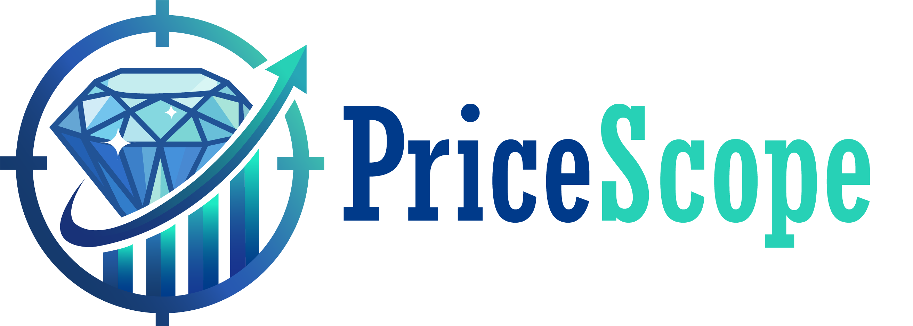
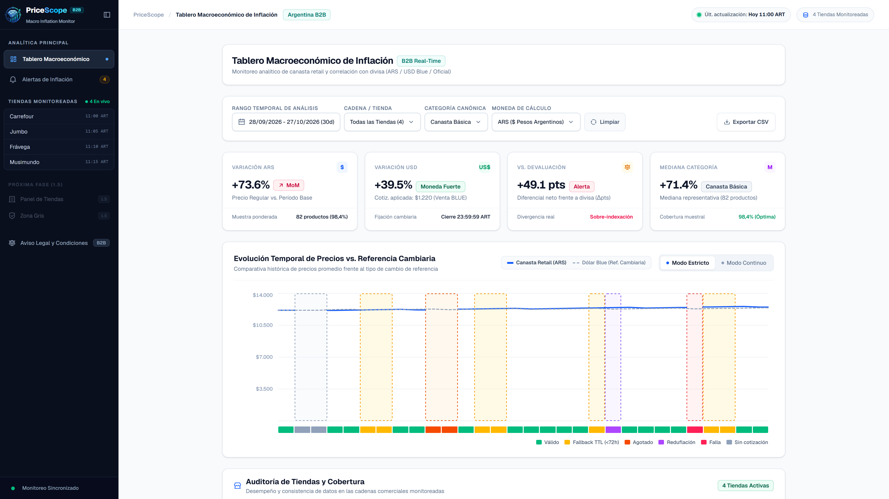
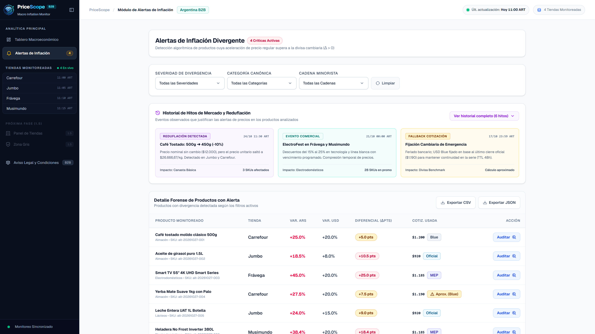
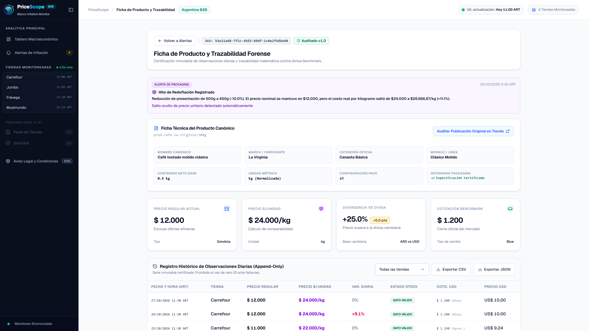
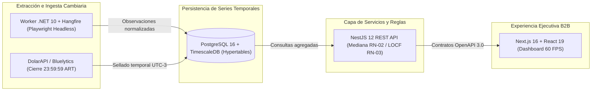

<a id="top"></a>

<p align="center">
  
</p>

<h1 align="center"><strong>PriceScope - Monitor de Inflación Real Multimoneda</strong></h1>

<p align="center">
  <strong>Plataforma B2B de Analítica Económica e Inteligencia de Mercado</strong><br>
  <em>Simulación Laboral Abierta - NoCountry (Cohorte 2026 / Equipo S10-26-EQUIPO-2)</em>
</p>

<p align="center">
  
  
  
  
  
  
  
  
</p>

<p align="center">
  <a href="https://youtu.be/h6M2ssmtuYY" target="_blank">
    
  </a>
  <a href="https://youtu.be/Y_DFOFpSsPw" target="_blank">
    
  </a>
</p>

---

## Tabla de Contenidos
* [Presentación en Video y Vista Previa](#presentación-en-video-y-vista-previa)
* [Acerca del Proyecto](#acerca-del-proyecto)
  * [El Problema (Relevamiento Manual Ineficiente)](#el-problema-relevamiento-manual-ineficiente)
  * [La Solución Desarrollada (PriceScope)](#la-solución-desarrollada-pricescope)
* [Tech Stack](#tech-stack)
* [Arquitectura del Monorepo](#arquitectura-del-monorepo)
* [Funcionalidades del MVP (Fase 1) y Plus (Fase 1.5)](#funcionalidades-del-mvp-fase-1-y-plus-fase-15)
* [Reglas Matemáticas y de Negocio](#reglas-matemáticas-y-de-negocio)
* [Instalación y Puesta en Marcha Local](#instalación-y-puesta-en-marcha-local)
* [Documentación Técnica Oficial](#documentación-técnica-oficial)
* [Equipo de Desarrollo (NoCountry)](#equipo-de-desarrollo-nocountry)

---

## Presentación en Video y Vista Previa

Explora la plataforma según el tiempo que tengas disponible: un **pitch visual de alto impacto (0:39)** o el **recorrido explicativo completo paso a paso (3:00)**.

| ⚡ Video Promocional • Pitch (0:39) | 🎓 Video Explicativo • Demo Completa (3:00) |
| :---: | :---: |
| [](https://youtu.be/h6M2ssmtuYY) | [](https://youtu.be/Y_DFOFpSsPw) |
| **Propuesta de valor e impacto B2B**<br/>Resumen dinámico a 60 FPS sobre monitoreo de inflación real vs. divisa y detección forense de reduflación. | **Recorrido funcional y explicación detallada**<br/>Explicación completa del flujo de la aplicación, arquitectura, métricas del tablero y casos de uso en vivo. |
| [](https://youtu.be/h6M2ssmtuYY) | [](https://youtu.be/Y_DFOFpSsPw) |

### Vista Rápida de la Interfaz (UI Showcase)

| 1. Tablero Macroeconómico B2B | 2. Alertas de Inflación Divergente | 3. Trazabilidad Forense y Reduflación |
| :---: | :---: | :---: |
| [](docs/assets/screenshots/01_dashboard_kpis_grafica.png) | [](docs/assets/screenshots/02_alertas_inflacion_divergente.png) | [](docs/assets/screenshots/03_trazabilidad_forense_reduflacion.png) |
| KPIs multimoneda ARS/USD, cierre `23:59:59 ART` y banda semafórica de calidad. | Detección automática de sobre-indexación frente a la devaluación y alertas críticas. | Auditoría *append-only* y detección de recorte de gramaje (`500g → 450g`). |

---

## Acerca del Proyecto

### Contexto y Sector de Negocio
**Sector:** FinTech / Inteligencia de Mercado (`B2B Analytics`) - *Tablero con Inflación Real vs. Divisa*.

PriceScope simula la operación de una **firma de analítica económica** que provee informes de variación de precios e inflación en tiempo real a cadenas minoristas, fondos de inversión y medios de comunicación en mercados de alta volatilidad cambiaria. La organización monitorea el comportamiento de la canasta básica y bienes durables para ayudar a las empresas a ajustar sus listas de precios y cubrirse estratégicamente frente a la devaluación.

### El Problema (Relevamiento Manual Ineficiente)
El equipo de analistas de la firma tradicionalmente realizaba un relevamiento manual visitando portales de e-commerce dos veces por semana, volcando datos artesanalmente en hojas de cálculo y calculando la inflación a mano.

Con un catálogo objetivo de **más de 10.000 productos bajo observación**, el proceso manual genera:
1. **Retrasos Críticos:** Imposibilidad de reaccionar oportunamente ante saltos cambiarios intradiarios.
2. **Errores Humanos:** Distorsión de indicadores por fallas de digitación manual.
3. **Pérdida de Trazabilidad ante Ofertas y Reduflación:** Dificultad para discernir si una baja de precio es una promoción transitoria o reducción de gramaje (*reduflación / shrinkflation*).
4. **Dispersión y Nombres Heterogéneos:** Un mismo producto figura con descripciones, SKUs y formatos incompatibles en cada portal minorista.

### La Solución Desarrollada (PriceScope)
PriceScope implementa un **sistema de monitoreo continuo y desatendido** compuesto por:
* **Pipeline de Extracción Automatizado:** Workers programados en **ASP.NET Core (.NET 10) con Hangfire y Playwright .NET** que recolectan periódicamente precios en cadenas piloto, normalizando identidades y detectando anomalías.
* **Motor de Ingesta Cambiaria con Sellado Temporal:** Ingesta automatizada de cotizaciones oficiales y paralelas (DolarAPI / Bluelytics) sincronizadas al cierre formal del día (23:59:59 ART) con protocolo de tolerancia y fallback de 72 horas.
* **Almacén de Series Temporales Optimizado:** Base de datos en **PostgreSQL 16 + TimescaleDB** con hypertables particionadas y agregaciones continuas, compatible con Docker local y Neon Cloud Serverless.
* **Dashboard Ejecutivo B2B:** Aplicación web moderna en **Next.js 16 (React 19, TypeScript), Tailwind CSS v4, Radix UI y Recharts 3.10** con soporte Local-First (modo mock transparente) y navegación fluida a 60 FPS.
* **Módulo de Alertas e Historial de Trazabilidad:** Detección automática de productos cuyo aumento supera la devaluación cambiaria, auditoría inmutable (*append-only*) y exportación de datos.

---

## Tech Stack

| Capa / Dominio | Tecnologías y Librerías Principales |
| :--- | :--- |
| **Frontend Web** | **Next.js 16.4** (App Router, Turbopack), **React 19**, **Tailwind CSS v4**, **Recharts 3.10 + Tremor Raw**, **Radix UI**, **@remixicon/react**, **date-fns**, **Vitest**, **Playwright Test** |
| **Backend REST & Servicios** | **NestJS 12**, **Node.js (TypeScript)**, **oxlint**, **Class-Validator**, **RxJS** |
| **Extracción & Scraping** | **.NET 10 (C#)**, **Hangfire 1.8 (PostgreSQL Storage)**, **Playwright .NET**, **Npgsql 10** |
| **Persistencia & Series Temporales** | **PostgreSQL 16 + TimescaleDB 2.x** (Hypertables particionadas, compatible con Neon Cloud Serverless y Docker) |
| **DevOps & CI/CD** | **Docker Compose**, **GitHub Actions** (Pipelines independientes para Client, API y Scraper) |

---

## Arquitectura del Monorepo

El repositorio organiza sus servicios de forma desacoplada bajo el estándar de **Monorepo en `apps/`**:



```text
S10-26-EQUIPO-2-PriceScope/
├── .github/                      # CI/CD y Plantilla obligatoria de PRs
│   ├── PULL_REQUEST_TEMPLATE.md
│   └── workflows/                # Workflows de GitHub Actions (Client, API, Scraper)
├── apps/
│   ├── client/                   # Frontend Web en Next.js 16 + React 19 + Tailwind v4
│   │   ├── docs/constitution.md  # Estándares de diseño y arquitectura frontend
│   │   ├── specs/                # Especificaciones de features (002, 003, 004)
│   │   └── src/                  # App Router, componentes, mocks, hooks y servicios
│   ├── api/                      # Backend REST en NestJS 12
│   │   └── src/                  # Módulos, controladores, servicios y configuración
│   ├── scraper/                  # Sistema de extracción en .NET 10
│   │   └── src/
│   │       ├── ScrapersLibrary/  # Biblioteca de abstracciones y scrapers por tienda
│   │       └── Worker/           # Worker ejecutable con Hangfire y PostgreSQL
│   └── database/                 # Persistencia e infraestructura compartida
│       ├── init.sql              # Script DDL oficial e idempotente (Tablas, Hypertables, Seed)
│       └── README.md             # Guía de configuración local y Neon Cloud
├── docs/                         # Documentación integral de análisis, planeación y QA
│   ├── 01-analisis/              # 8 documentos canónicos (SRS, OpenAPI, DER, Reglas, etc.)
│   ├── 02-planeacion/            # Plan Operativo, Roadmap y Matriz de Riesgos
│   ├── 03-qa/                    # Espacio de certificación, actas y pruebas de calidad
│   └── assets/                   # Logos, imagotipos, capturas UI y fotos del equipo
├── docker-compose.yml            # Orquestación de TimescaleDB (PostgreSQL 16)
└── README.md                     # Documentación general del repositorio
```

---

## Funcionalidades del MVP (Fase 1) y Plus (Fase 1.5)

### Fase 1: MVP Esencial (Local-First)
* **Tablero Ejecutivo B2B (`/`):** Gráfica de evolución temporal interactiva con alternancia instantánea entre Pesos ($), Dólar Blue y Dólar Oficial.
* **Filtros Temporales Dinámicos:** Rango libre (`fecha_desde` y `fecha_hasta` hasta 365 días) con atajos rápidos (`30D`, `90D`, `1A`) y calendario popover.
* **Downsampling Algorítmico:** Agrupación semanal transparente por mediana para rangos mayores a 90 días, optimizando rendimiento a 60 FPS.
* **Banda Semafórica de Calidad:** Franja forense inferior que distingue estados de dato: Verde (`DATO_VALIDO`), Amarillo (`AGOTADO`) y Rojo (`ERROR_CAPTURA` / `SIN_DATO`).
* **Módulo de Alertas (`/alerts`):** Detección automática de productos cuyo aumento supera la devaluación, con filtros por categoría, severidad, tienda, paginación y exportación CSV.
* **Ficha de Trazabilidad (`/products/[id]/traceability`):** Auditoría histórica inmutable (*append-only*), cotización exacta de cierre aplicada y detección de reduflación.
* **Modo Mock Transparente:** El frontend conmuta a mocks locales si el backend no está conectado, permitiendo desarrollo y revisión sin fricción.

### Fase 1.5: Buffer Condicional (Post-MVP)
* **Panel de Administración de Tiendas (`HU-01`):** Control y telemetría de scrapers en tiempo real.
* **Bandeja de Aprobación de Zona Gris (`HU-10`):** Validación manual para productos con similitud intermedia (0.41 <= S <= 0.84).
* **Ingesta HTTP Segura (`HU-06`):** Endpoint desacoplado `POST /api/v1/ingest/observations` con token API.

---

## Reglas Matemáticas y de Negocio

* **RN-01 (Cierre del Día):** Las cotizaciones cambiarias se emparejan con el último valor registrado antes de las **23:59:59 ART** (UTC-3).
* **RN-02 (Prohibición del Promedio Simple):** Las variaciones agregadas por categoría se calculan exclusivamente mediante la **Mediana Estadística** para aislar distorsiones de outliers.
* **RN-03 (Tolerancia Cambiaria 72h):** Ante feriados bancarios o caídas de APIs financieras, se aplica cotización aproximada (LOCF) hasta 72 horas con advertencia. A las 72h+1s se aplica corte estricto (`SIN_DATO`).
* **RN-04 (Anti-Cero):** Prohibición terminante de registrar o renderizar el valor numérico `0` ante falta de precio o stock.
* **RN-09 (Límite Temporal 365 Días):** Consultas mayores a 365 días se rechazan con código HTTP `422 Unprocessable Entity` para proteger la memoria del sistema.

---

## Instalación y Puesta en Marcha Local

El proyecto sigue una estrategia **Local-First** mediante Docker Compose:

### 1. Clonar el Repositorio
```bash
git clone https://github.com/No-Country-simulation/S10-26-EQUIPO-2-PriceScope.git
cd S10-26-EQUIPO-2-PriceScope
```

### 2. Iniciar la Base de Datos Local (TimescaleDB / PostgreSQL 16)
```bash
docker compose up -d timescaledb
```
*Base de datos disponible en `localhost:5432` con tablas, hypertables y datos iniciales de `apps/database/init.sql`.*

### 3. Iniciar el Backend (NestJS 12)
```bash
cd apps/api
npm install
npm run start:dev
```
*API REST disponible en `http://localhost:3001`.*

### 4. Iniciar el Frontend (Next.js 16)
```bash
cd apps/client
npm install
npm run dev
```
*Aplicación web disponible en `http://localhost:3000` (conmuta a mocks locales si el backend no está levantado).*

### 5. Iniciar el Scraper Worker (.NET 10 / Hangfire)
```bash
cd apps/scraper/src/Worker
dotnet restore
dotnet run
```
*Dashboard de Hangfire disponible en `http://localhost:5000/hangfire`.*

---

## Documentación Técnica Oficial

Toda la documentación de ingeniería, arquitectura y calidad se encuentra versionada en [`docs/`](docs/):

| Código | Documento Técnico | Enlace |
| :--- | :--- | :--- |
| **`SRS`** | Especificación de Requerimientos de Software y Backlog HUs | [01-SRS-PriceScope.md](docs/01-analisis/01-SRS-PriceScope.md) |
| **`API`** | Contratos OpenAPI 3.0, Endpoints y DTOs | [02-API-Contracts-OpenAPI.md](docs/01-analisis/02-API-Contracts-OpenAPI.md) |
| **`DB`** | Modelo de Datos TimescaleDB, DDL y Hypertables | [03-Data-Model-TimescaleDB.md](docs/01-analisis/03-Data-Model-TimescaleDB.md) |
| **`MATH`** | Reglas de Negocio, Mediana, Cierre UTC y Lógica Financiera | [04-Business-Rules-Math-Logic.md](docs/01-analisis/04-Business-Rules-Math-Logic.md) |
| **`ARCH`** | Arquitectura de Software, Monorepo y Pipelines | [05-Software-Architecture-Pipeline.md](docs/01-analisis/05-Software-Architecture-Pipeline.md) |
| **`QA`** | Matriz de Casos de Prueba y Criterios de Aceptación | [06-QA-Test-Matrix.md](docs/01-analisis/06-QA-Test-Matrix.md) |
| **`UIX`** | Especificaciones de Diseño UX/UI y Frontend | [07-Frontend-UX-UI-Specs.md](docs/01-analisis/07-Frontend-UX-UI-Specs.md) |
| **`USE`** | Especificación de Casos de Uso (Flujos Formales) | [08-Casos-de-Uso-Use-Cases.md](docs/01-analisis/08-Casos-de-Uso-Use-Cases.md) |
| **`ROADMAP`** | Plan Operativo de Desarrollo y Roadmap | [01-Plan-Operativo-Roadmap.md](docs/02-planeacion/01-Plan-Operativo-Roadmap.md) |
| **`RISK`** | Matriz de Riesgos y Protocolos de Contingencia | [02-matriz-riesgos.md](docs/02-planeacion/02-matriz-riesgos.md) |
| **`RACI`** | Matriz RACI y Modelo de Gobernanza de Células | [03-Matriz-RACI-Gobernanza.md](docs/02-planeacion/03-Matriz-RACI-Gobernanza.md) |
| **`ENV`** | Estrategia de Ambientes y Despliegue Cloud | [04-Estrategia-Despliegue-Ambientes.md](docs/02-planeacion/04-Estrategia-Despliegue-Ambientes.md) |
| **`DEMO`** | Guion de Demostración y Pitch Comercial B2B | [05-Guion-Demo-Presentacion-B2B.md](docs/02-planeacion/05-Guion-Demo-Presentacion-B2B.md) |
| **`E-QA`** | Espacio de Homologación y Evidencias QA | [README.md (docs/03-qa)](docs/03-qa/README.md) |
| **`DESIGN`** | Estándares y Lineamientos Frontend | [constitution.md](apps/client/docs/constitution.md) |

---

## Equipo de Desarrollo (NoCountry)

### Equipo de Frontend & Experiencia de Usuario (`E-F/UX/UI`)

<table>
  <thead>
    <tr>
      <th align="center">
        <br>
        <strong>Juan Camilo Garcia</strong><br>
        <sub>Frontend Lead & UX/UI Designer</sub>
      </th>
    </tr>
  </thead>
  <tbody>
    <tr>
      <td align="center">
        <a href="https://www.linkedin.com/in/juan-camilo-garcia-" target="_blank">
          
        </a><br>
        <a href="https://github.com/SnackMasterDev" target="_blank">
          
        </a>
      </td>
    </tr>
  </tbody>
</table>

### Equipo de Backend, Base de Datos y Divisas (`E-API`)

<table>
  <thead>
    <tr>
      <th align="center">
        <br>
        <strong>Luis Feliz</strong><br>
        <sub>Backend & DB Lead</sub>
      </th>
      <th align="center">
        <br>
        <strong>Yenny Castro</strong><br>
        <sub>Backend Developer</sub>
      </th>
    </tr>
  </thead>
  <tbody>
    <tr>
      <td align="center">
        <a href="https://www.linkedin.com/in/luis-antonio-feliz" target="_blank">
          
        </a><br>
        <a href="https://github.com/LuisAntonioFeliz" target="_blank">
          
        </a>
      </td>
      <td align="center">
        <a href="https://www.linkedin.com/in/alexandra-castro-web-developer" target="_blank">
          
        </a><br>
        <a href="https://github.com/YenCastro" target="_blank">
          
        </a>
      </td>
    </tr>
  </tbody>
</table>

### Equipo de Extracción y Web Scraping (`E-Scrapper`)

<table>
  <thead>
    <tr>
      <th align="center">
        <br>
        <strong>Alejandro Hernandez OReilly</strong><br>
        <sub>Scraper Lead (.NET / Playwright)</sub>
      </th>
      <th align="center">
        <br>
        <strong>Anthony Ciprian</strong><br>
        <sub>Scraper Developer</sub>
      </th>
    </tr>
  </thead>
  <tbody>
    <tr>
      <td align="center">
        <a href="https://www.linkedin.com/in/alejandro-hern%C3%A1ndez-o-reilly-0a0929312" target="_blank">
          
        </a><br>
        <a href="https://github.com/Alejoho" target="_blank">
          
        </a>
      </td>
      <td align="center">
        <a href="https://www.linkedin.com/in/anthonyciprian" target="_blank">
          
        </a><br>
        <a href="https://github.com/stuart-ware" target="_blank">
          
        </a>
      </td>
    </tr>
  </tbody>
</table>

### Equipo de Aseguramiento de Calidad y Homologación (`E-QA`)

<table>
  <thead>
    <tr>
      <th align="center">
        <br>
        <strong>Gonzalo Cecchin</strong><br>
        <sub>Tech Lead / Product Owner Review</sub>
      </th>
      <th align="center">
        <br>
        <strong>Karina Luvianos</strong><br>
        <sub>QA Analyst Lead</sub>
      </th>
    </tr>
  </thead>
  <tbody>
    <tr>
      <td align="center">
        <a href="https://www.linkedin.com/in/gonzalo-cecch%C3%ADn" target="_blank">
          
        </a><br>
        <a href="https://github.com/QAGonzaloCecchin" target="_blank">
          
        </a>
      </td>
      <td align="center">
        <a href="https://www.linkedin.com/in/kluvianosta" target="_blank">
          
        </a><br>
        <a href="https://github.com/Luvitaka" target="_blank">
          
        </a>
      </td>
    </tr>
  </tbody>
</table>

---

<p align="center">
  <em>"Porque en economía, la certeza no es un lujo. Es la regla."</em><br>
  <strong>PriceScope</strong> • Simulación Laboral NoCountry (Cohorte 2026 — Equipo S10-26-EQUIPO-2)<br><br>
  <a href="#top">⬆ Volver arriba</a>
</p>
