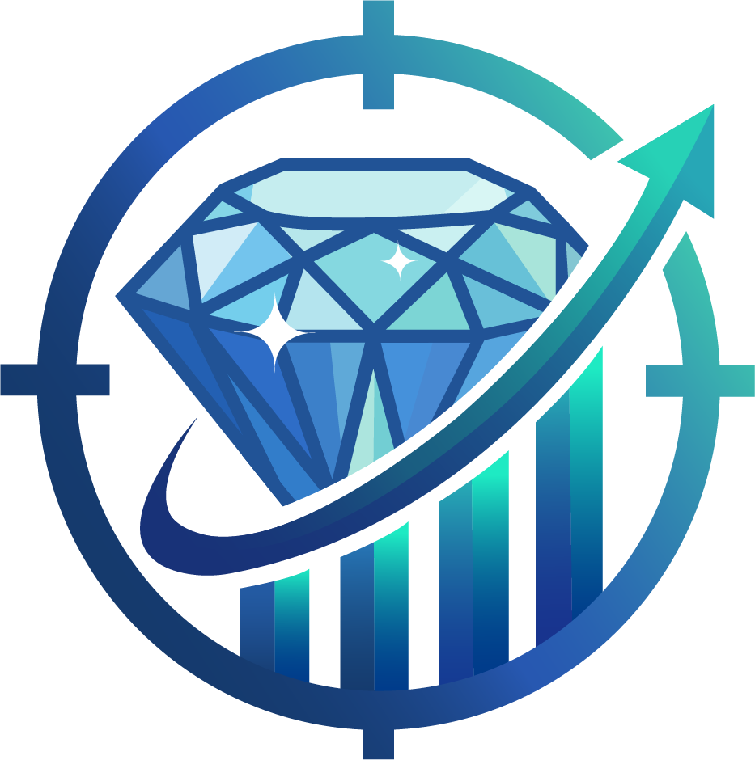

<p align="center">
  
</p>

<h1 align="center"><strong>PriceScope — Monitor de Inflación Real Multimoneda</strong></h1>

<p align="center">
  <strong>Plataforma B2B de Analítica Económica e Inteligencia de Mercado</strong><br>
  <em>Simulación Laboral Abierta — NoCountry (Cohorte 2026 / Equipo S10-26-EQUIPO-2)</em>
</p>

<p align="center">
  
  
  
  
  
  
  
  
  
</p>

---

## 📌 Tabla de Contenidos
* [📖 Acerca del Proyecto](#-acerca-del-proyecto)
  * [El Problema](#el-problema)
  * [La Solución (PriceScope)](#la-solución-pricescope)
* [💻 Tech Stack](#-tech-stack)
* [🏛️ Arquitectura del Monorepo](#️-arquitectura-del-monorepo)
* [✨ Funcionalidades del MVP (Fase 1) y Plus (Fase 1.5)](#-funcionalidades-del-mvp-fase-1-y-plus-fase-15)
* [📐 Reglas Matemáticas y de Negocio](#-reglas-matemáticas-y-de-negocio)
* [🚀 Instalación y Puesta en Marcha Local](#-instalación-y-puesta-en-marcha-local)
* [📚 Documentación Técnica Oficial](#-documentación-técnica-oficial)
* [👥 Equipo de Desarrollo (NoCountry)](#-equipo-de-desarrollo-nocountry)

---

## 📖 Acerca del Proyecto

### Contexto y Sector de Negocio
**Sector:** FinTech / Inteligencia de Mercado (`B2B Analytics`) — *Tablero con Inflación Real vs. Divisa*.

PriceScope simula la operación de una **firma de analítica económica** que provee informes de variación de precios e inflación en tiempo real a cadenas minoristas, fondos de inversión y medios de comunicación en mercados de alta volatilidad cambiaria. Actualmente, la organización monitorea el comportamiento de la canasta básica y bienes durables para ayudar a las empresas a ajustar sus listas de precios y cubrirse estratégicamente frente a la devaluación.

### El Problema (Relevamiento Manual Ineficiente)
Actualmente, el equipo de analistas de la firma realiza un **relevamiento manual de precios visitando hasta 15 portales de e-commerce** (supermercados, tiendas de electrodomésticos y tiendas de moda) dos veces por semana. Estos datos se vuelcan artesanalmente en hojas de cálculo y se convierten a mano al tipo de cambio del día (oficial y paralelo/blue) para estimar la inflación acumulada en moneda local y divisa extranjera.

Con un catálogo objetivo de **más de 10.000 productos bajo observación**, este proceso manual genera:
1. **Retrasos Críticos de Varios Días:** Imposibilidad de reaccionar oportunamente ante saltos cambiarios intradiarios.
2. **Errores Humanos en el Tipeo de Montos:** Distorsión de los indicadores por fallas de digitación manual.
3. **Pérdida de Trazabilidad ante Ofertas y Reduflación:** Dificultad para discernir si una baja de precio es una promoción transitoria (ej. *"CyberWeek"* o *"2x1"*) o si el fabricante redujo silenciosamente el gramaje del producto (*reduflación / shrinkflation*).
4. **Dispersión y Nombres Heterogéneos:** Un mismo modelo de Smart TV o paquete de café figura con descripciones, códigos SKU y formatos completamente distintos en cada portal minorista.

### La Necesidad de la Empresa
Automatizar la recolección periódica de precios en plataformas de e-commerce y registrar su evolución histórica en relación directa con las variaciones del tipo de cambio, permitiendo **medir la inflación real tanto en moneda local como en moneda dura**.

### La Solución Desarrollada (PriceScope)
PriceScope implementa un **sistema de monitoreo continuo y desatendido** compuesto por:
* **Pipeline de Extracción Automatizado:** Scrapers programados en **ASP.NET Core (.NET 10) con Hangfire y Playwright .NET** que recolectan diariamente precios de productos representativos en cadenas piloto (Carrefour, Jumbo, Frávega, Musimundo), normalizando identidades mediante un modelo canónico y detectando automáticamente eventos de promoción y reduflación.
* **Motor de Ingesta Cambiaria con Sellado Temporal:** Ingesta horaria automatizada de cotizaciones oficiales y paralelas (DolarAPI / Bluelytics) sincronizadas al cierre formal del día (23:59:59 ART) con protocolo de tolerancia y fallback de 72 horas.
* **Almacén de Series Temporales Optimizado:** Base de datos en **PostgreSQL 15 + TimescaleDB** con hypertables particionadas y agregaciones continuas, diseñada para procesar inflación acumulada, variación porcentual vs. cotización de la divisa y detección de picos por categoría mediante la **Mediana Estadística**.
* **Dashboard Ejecutivo B2B:** Aplicación web moderna en **Next.js 14+ (TypeScript), Tremor y shadcn/ui** donde los clientes corporativos filtran de forma dinámica por rango temporal (hasta 365 días), tienda, categoría y moneda, visualizando gráficos de evolución interactivos con downsampling algorítmico fluido a **60 FPS**.
* **Módulo de Alertas e Hitos:** Sistema visual que identifica aquellos productos cuyo aumento supera la tasa de devaluación cambiaria en una ventana de tiempo determinada y grafica hitos comerciales del mercado.

---

## 💻 Tech Stack

| Capa / Dominio | Tecnologías y Librerías Principales |
| :--- | :--- |
| **Frontend Web** | **Next.js 14+** (React, TypeScript), **Tremor** (LineChart, AreaChart, Analytics UI), **shadcn/ui** (Radix UI), **Tailwind CSS**, Lucide Icons |
| **Backend REST & Cálculos** | **NestJS** (Node.js, TypeScript), **TimescaleDB / PostgreSQL 15**, Class-Validator, Decimal.js |
| **Extracción & Scraping** | **ASP.NET Core (.NET 10)**, **Hangfire** (Orquestación con reintentos exponenciales), **Playwright .NET** (Chromium Headless) |
| **Persistencia & Series Temporales** | **PostgreSQL 15 + TimescaleDB 2.x** (Hypertables particionadas, Continuous Aggregates) |
| **DevOps & CI/CD** | **Docker Compose**, **GitHub Actions** (Pipelines independientes con Path Filtering) |

---

## 🏛️ Arquitectura del Monorepo

El repositorio organiza sus servicios de forma desacoplada bajo el estándar de **Monorepo en `apps/`**:

```text
pricescope-monorepo/
├── .github/                      # CI/CD y Plantilla obligatoria de PRs
│   ├── PULL_REQUEST_TEMPLATE.md
│   └── workflows/                # Pipelines de validación continua (Client, API, Scraper)
├── apps/
│   ├── client/                   # Frontend Web en Next.js (Juan Camilo García)
│   ├── api/                      # Backend REST y Agregaciones en NestJS (Luis Feliz, Yenny Castro)
│   └── scraper/                  # Worker extractor en .NET 10 + Hangfire + Playwright (Alejandro, Anthony, Sebastian)
├── docs/                         # Especificaciones de ingeniería, planeación y QA
│   ├── 01-analisis/              # SRS, OpenAPI, DER TimescaleDB, Reglas Matemáticas, UX/UI
│   ├── 02-planeacion/            # Plan Operativo Roadmap y Matriz de Riesgos
│   ├── 03-qa/                    # Espacio de certificación y pruebas de estrés
│   └── assets/                   # Logos, imagotipos y wireframes
├── docker-compose.yml            # Base de datos compartida TimescaleDB para desarrollo local
└── seed.json                     # Archivo semilla MVP con URLs piloto normalizadas (HU-00)
```

---

## ✨ Funcionalidades del MVP (Fase 1) y Plus (Fase 1.5)

### 🟢 Fase 1: MVP Esencial (Local-First)
* **Tablero Ejecutivo B2B (`/dashboard`):** Gráfica de evolución temporal interactiva con alternancia instantánea entre pesos ($) y dólares (USD Blue), soportando **60 FPS** continuos.
* **Filtros Temporales Personalizables:** Rango de fechas libre (`fecha_desde` y `fecha_hasta` hasta 365 días) con atajos rápidos de interfaz (`30D`, `90D`, `1A`).
* **Downsampling Algorítmico Automático:** Agrupación semanal transparente (mediana) para rangos $> 90$ días, optimizando el consumo de memoria del navegador.
* **Banda Semafórica de Calidad:** Franja diaria inferior que distingue estados forenses: Verde (`DATO_VALIDO`), Amarillo (`AGOTADO`) y Rojo (`ERROR_CAPTURA` / `SIN_DATO`).
* **Módulo Paginado de Alertas (`/alerts`):** Detección automática de productos cuyo incremento supera la tasa de devaluación, paginado estrictamente a 50 registros (HU-46 / RFC 7807).
* **Ficha de Trazabilidad Forense (`/products/{id}/traceability`):** Auditoría histórica inmutable (*append-only*), cotización exacta de cierre aplicada y detección de reduflación.

### 🟡 Fase 1.5: Buffer Condicional (Plus Post-MVP)
* **Panel de Administración de Tiendas (`HU-01`):** Control de encendido/pausa de tiendas y monitoreo de salud de scrapers.
* **Bandeja de Aprobación de Zona Gris (`HU-10`):** Interfaz para validar publicaciones con score de similitud dudoso ($0.41 \le S \le 0.84$).
* **Ingesta HTTP Segura (`HU-06`):** Endpoint desacoplado `POST /api/v1/ingest/observations` con token API.

---

## 📐 Reglas Matemáticas y de Negocio

* **RN-01 (Cierre del Día):** Las cotizaciones cambiarias se emparejan determinísticamente con el último valor antes de las **23:59:59 ART** (UTC-3).
* **RN-02 (Prohibición del Promedio Simple):** Las variaciones agregadas por categoría se calculan exclusivamente mediante la **Mediana Estadística** para aislar distorsiones causadas por *outliers*.
* **RN-03 (Tolerancia Cambiaria 72h):** Ante feriados bancarios o caídas de APIs financieras, se aplica cotización aproximada (LOCF) hasta 72 horas con icono de advertencia (⚠️). A las 72h+1s se aplica corte físico estricto (`SIN_DATO`).
* **RN-04 (Anti-Cero):** Prohibición terminante de registrar o renderizar el valor numérico `0` ante falta de precio o stock.
* **RN-09 (Límite Temporal 365 Días):** Consultas mayores a 365 días se rechazan con código HTTP `422 Unprocessable Entity` para proteger la memoria del sistema.

---

## 🚀 Instalación y Puesta en Marcha Local

El proyecto sigue una estrategia **Local-First** para que todo el equipo trabaje de manera uniforme mediante Docker Compose:

### 1. Clonar el Repositorio
```bash
git clone https://github.com/No-Country-simulation/S10-26-EQUIPO-2-PriceScope.git
cd S10-26-EQUIPO-2-PriceScope
```

### 2. Levantar la Base de Datos Local (TimescaleDB)
```bash
docker-compose up -d timescaledb
```
*Base de datos disponible en `localhost:5432` con las tablas relacionales e hypertables inicializadas.*

### 3. Ejecutar el Backend (NestJS)
```bash
cd apps/api
npm install
npm run start:dev
```
*API REST disponible en `http://localhost:3001`.*

### 4. Ejecutar el Frontend (Next.js)
```bash
cd apps/client
npm install
npm run dev
```
*Aplicación web disponible en `http://localhost:3000`.*

### 5. Ejecutar los Scrapers (.NET 10 / Hangfire)
```bash
cd apps/scraper
dotnet restore
dotnet run
```
*Dashboard de Hangfire disponible en `http://localhost:5000/hangfire`.*

---

## 📚 Documentación Técnica Oficial

Toda la ingeniería del sistema se encuentra formalizada y versionada en la carpeta [`docs/`](docs/):

| Código | Documento Técnico | Enlace |
| :--- | :--- | :--- |
| **`SRS`** | Especificación de Requerimientos del Sistema (Backlog HUs y RNs) | [01-SRS-PriceScope.md](docs/01-analisis/01-SRS-PriceScope.md) |
| **`API`** | Contratos OpenAPI 3.0, Endpoints y DTOs | [02-API-Contracts-OpenAPI.md](docs/01-analisis/02-API-Contracts-OpenAPI.md) |
| **`DB`** | Modelo de Datos TimescaleDB, DDL y Hypertables | [03-Data-Model-TimescaleDB.md](docs/01-analisis/03-Data-Model-TimescaleDB.md) |
| **`MATH`** | Reglas de Negocio, Mediana, Cierre UTC y Lógica Financiera | [04-Business-Rules-Math-Logic.md](docs/01-analisis/04-Business-Rules-Math-Logic.md) |
| **`ARCH`** | Arquitectura de Software, Topología y Pipelines CI/CD | [05-Software-Architecture-Pipeline.md](docs/01-analisis/05-Software-Architecture-Pipeline.md) |
| **`QA`** | Matriz de Casos de Prueba (18 TCs) y Sign-Off Gate | [06-QA-Test-Matrix.md](docs/01-analisis/06-QA-Test-Matrix.md) |
| **`UIX`** | Especificación de Diseño UX/UI, Wireframes y Tokens Figma | [07-Frontend-UX-UI-Specs.md](docs/01-analisis/07-Frontend-UX-UI-Specs.md) |
| **`ROADMAP`**| Plan Operativo de Desarrollo (Sprints 1 a 4) | [01-Plan-Operativo-Roadmap.md](docs/02-planeacion/01-Plan-Operativo-Roadmap.md) |
| **`RISK`** | Matriz de Riesgos y Protocolos de Contingencia | [02-matriz-riesgos.md](docs/02-planeacion/02-matriz-riesgos.md) |

---

## 👥 Equipo de Desarrollo (NoCountry)

### 🎨 Equipo de Frontend & Experiencia de Usuario (`E-F/UX/UI`)

<table>
  <thead>
    <tr>
      <th align="center">
        <br>
        <strong>Juan Camilo García</strong><br>
        <sub>Frontend Lead & UX/UI Designer</sub>
      </th>
    </tr>
  </thead>
  <tbody>
    <tr>
      <td align="center">
        <a href="https://www.linkedin.com/in/juan-camilo-garcia-" target="_blank">
          
        </a><br>
        <a href="https://github.com/SnackMasterDev" target="_blank">
          
        </a>
      </td>
    </tr>
  </tbody>
</table>

### ⚙️ Equipo de Backend, Base de Datos y Divisas (`E-API`)

<table>
  <thead>
    <tr>
      <th align="center">
        <br>
        <strong>Luis Feliz</strong><br>
        <sub>Backend & DB Lead</sub>
      </th>
      <th align="center">
        <br>
        <strong>Yenny Castro</strong><br>
        <sub>Backend Developer</sub>
      </th>
    </tr>
  </thead>
  <tbody>
    <tr>
      <td align="center">
        <a href="https://www.linkedin.com/in/luis-antonio-feliz" target="_blank">
          
        </a><br>
        <a href="https://github.com/LuisAntonioFeliz" target="_blank">
          
        </a>
      </td>
      <td align="center">
        <a href="https://www.linkedin.com/in/alexandra-castro-web-developer" target="_blank">
          
        </a><br>
        <a href="https://github.com/YenCastro" target="_blank">
          
        </a>
      </td>
    </tr>
  </tbody>
</table>

### 🕷️ Equipo de Extracción y Web Scraping (`E-Scrapper`)

<table>
  <thead>
    <tr>
      <th align="center">
        <br>
        <strong>Alejandro Hernández OReilly</strong><br>
        <sub>Scraper Lead (.NET / Playwright)</sub>
      </th>
      <th align="center">
        <br>
        <strong>Anthony Ciprian</strong><br>
        <sub>Scraper Developer</sub>
      </th>
      <th align="center">
        <br>
        <strong>Sebastian Torres</strong><br>
        <sub>Scraper Developer</sub>
      </th>
    </tr>
  </thead>
  <tbody>
    <tr>
      <td align="center">
        <a href="https://www.linkedin.com/in/alejandro-hern%C3%A1ndez-o-reilly-0a0929312" target="_blank">
          
        </a><br>
        <a href="https://github.com/Alejoho" target="_blank">
          
        </a>
      </td>
      <td align="center">
        <a href="https://www.linkedin.com/in/anthonyciprian" target="_blank">
          
        </a><br>
        <a href="https://github.com/stuart-ware" target="_blank">
          
        </a>
      </td>
      <td align="center">
        <a href="#" target="_blank">
          
        </a><br>
        <a href="#" target="_blank">
          
        </a>
      </td>
    </tr>
  </tbody>
</table>

### 🧪 Equipo de Aseguramiento de Calidad y Homologación (`E-QA`)

<table>
  <thead>
    <tr>
      <th align="center">
        <br>
        <strong>Gonzalo Cecchín</strong><br>
        <sub>Tech Lead / Product Owner Review</sub>
      </th>
      <th align="center">
        <br>
        <strong>Karina Luvianos</strong><br>
        <sub>QA Analyst Lead</sub>
      </th>
    </tr>
  </thead>
  <tbody>
    <tr>
      <td align="center">
        <a href="https://www.linkedin.com/in/gonzalo-cecch%C3%ADn" target="_blank">
          
        </a><br>
        <a href="https://github.com/QAGonzaloCecchin" target="_blank">
          
        </a>
      </td>
      <td align="center">
        <a href="https://www.linkedin.com/in/kluvianosta" target="_blank">
          
        </a><br>
        <a href="https://github.com/Luvitaka" target="_blank">
          
        </a>
      </td>
    </tr>
  </tbody>
</table>
