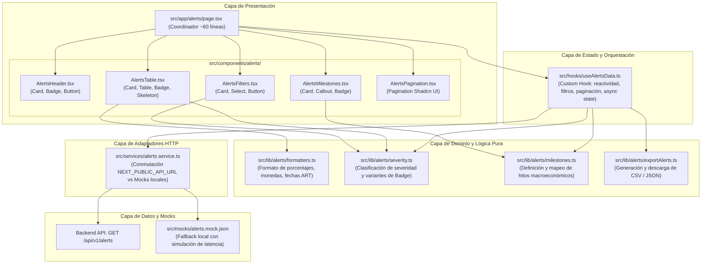
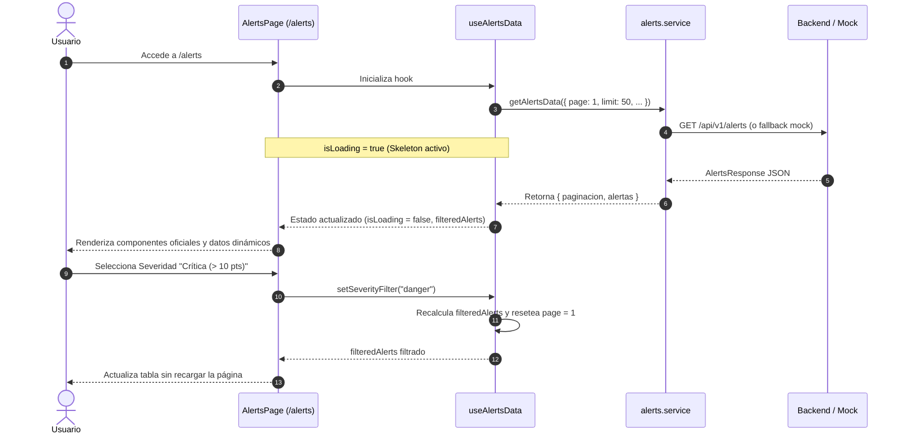

# Plan Arquitectónico: 003-alerts-components-integration

**Módulo:** Alertas Inflacionarias e Hitos Macroeconómicos (`/alerts`)  
**Ámbito:** `apps/client`  
**Estado:** Propuesta de Arquitectura y Diseño Técnico  
**Fecha:** 19 de Octubre de 2026

---

## 1. Visión Arquitectónica y Desacoplamiento por Capas

El objetivo central de este plan es transformar la vista `/alerts` —actualmente un archivo monolítico de 613 líneas con HTML crudo y datos estáticos— en una arquitectura limpia, modular y mantenible alineada con los estándares de PriceScope y Clean Code.

La solución desacopla estrictamente las siguientes capas:



---

## 2. Detalle de Capas y Responsabilidades

### 2.1 Capa de Contratos y Tipos (`src/types/api.ts` y `src/lib/alerts/types.ts`)

Se garantizan los contratos de datos del OpenAPI oficial sin alterar contratos ya aprobados:

1. **`src/types/api.ts`:**
   - Incorporación de las interfaces oficiales estipuladas en `02-API-Contracts-OpenAPI.md`:
     ```typescript
     export interface AlertaItem {
       alerta_id: string;
       producto_canonico_id: string;
       producto_nombre: string;
       tienda_nombre: string;
       periodo: {
         inicio_utc: string;
         fin_utc: string;
       };
       variacion_precio_pct: number;
       variacion_cotizacion_pct: number;
       diferencial_puntos: number;
       cotizacion_usada_cierre: number;
       cobertura_pct: number;
       regla_faltantes: string;
       tipo_alerta: string;
     }

     export interface AlertsResponse {
       paginacion: PaginacionMeta;
       alertas: AlertaItem[];
     }
     ```
2. **`src/lib/alerts/types.ts`:**
   - Tipos complementarios para parámetros de búsqueda y gestión en UI:
     ```typescript
     export type SeverityLevel = "all" | "danger" | "warning" | "info";

     export interface AlertsQueryParams {
       page?: number;
       limit?: number;
       fecha_desde?: string;
       fecha_hasta?: string;
       tienda_id?: string | null;
       categoria_id?: string | null;
       severidad?: SeverityLevel;
     }

     export interface AlertMilestoneItem {
       id: string;
       title: string;
       description: string;
       timestampArt: string;
       impactCategory: string;
       impactDetail: string;
       tag: string;
       variant: "purple" | "teal" | "warning" | "default" | "error";
     }
     ```

---

### 2.2 Capa de Adaptadores HTTP (`src/services/alerts.service.ts`)

Implementa el patrón de adaptador con conmutación transparente idéntico al de `dashboard.service.ts`:

- **Conmutación Inteligente:**
  - Si `process.env.NEXT_PUBLIC_API_URL` existe, construye `URLSearchParams` y realiza `fetch` real hacia `${apiUrl}/api/v1/alerts`. Maneja códigos de error y respuestas bajo RFC 7807.
  - Si no existe (entorno local sin backend conectado o CI), simula una latencia de red (`simulateNetworkDelay(1200)`) y filtra el contenido de `src/mocks/alerts.mock.json`.
- **Filtrado y Paginación en Modo Mock:**
  - Emula la respuesta del backend filtrando por `tienda_id`, `categoria_id`, y paginando por `page` (1..N) y `limit` (fijo en 50 o el solicitado), retornando un objeto con estructura exacta `AlertsResponse`.
- **Servicio de Hitos Macroeconómicos:**
  - `getAlertsMilestones(): Promise<AlertMilestoneItem[]>`: Desacopla los hitos explicativos de reduflación y política cambiaria, permitiendo extenderlos o consumirlos dinámicamente.

---

### 2.3 Capa de Dominio y Lógica Pura (`src/lib/alerts/`)

Módulos libres de efectos secundarios de React, fácilmente testeables de forma unitaria:

1. **`formatters.ts`:**
   - `formatPercentage(value: number): string`: Formatea a `+25.0%` o `-5.0%` con soporte de signo explícito.
   - `formatDeltaPoints(points: number): string`: Formatea a `+5.0 pts`.
   - `formatRateCurrency(value: number): string`: Formatea la cotización cambiaria con separador de miles argentino (`$1.200`).
   - `formatDateArt(isoString: string): string`: Conversión segura a formato local ART (`DD/MM HH:mm ART`).
2. **`severity.ts`:**
   - `classifySeverity(deltaPoints: number): "danger" | "warning" | "info"`:
     - `> 10.0` => `"danger"` (Crítica, variación superior a 10 puntos respecto a la divisa).
     - `5.0 .. 10.0` => `"warning"` (Moderada).
     - `< 5.0` => `"info"` (Leve).
   - `getSeverityBadgeConfig(level: "danger" | "warning" | "info")`: Entrega la variante de `@/components/ui/badge` (`error`, `warning`, `default`) y etiqueta legible.
3. **`exportAlerts.ts`:**
   - `exportAlertsToCsv(alerts: AlertaItem[], filename?: string): void`: Construye cadena CSV con escape adecuado de caracteres y dispara la descarga en el cliente.
   - `exportAlertsToJson(alerts: AlertaItem[], filename?: string): void`: Serializa las alertas en formato legible JSON con sangría de 2 espacios y dispara la descarga.
4. **`milestones.ts`:**
   - Cataloga los hitos macroeconómicos canónicos (Reduflación en Café, ElectroFest en cadenas, Fijación Cambiaria BCRA, Regulación de Precios, Salto Cambiario Blue, Scraping de Musimundo).

---

### 2.4 Capa de Estado (`src/hooks/useAlertsData.ts`)

Centraliza el estado reactivo, evitando prop drilling y efectos secundarios síncronos redundantes:

- **Estados Internos:**
  - `alertsData: AlertsResponse | null`
  - `milestones: AlertMilestoneItem[]`
  - `isLoading: boolean`
  - `severityFilter: SeverityLevel` ("all" por defecto)
  - `categoryFilter: string` ("all" por defecto)
  - `storeFilter: string` ("all" por defecto)
  - `currentPage: number` (1 por defecto)
  - `showAllMilestones: boolean` (false por defecto)
  - `error: string | null`
- **Valores Derivados (`useMemo`):**
  - `filteredAlerts`: Lista de alertas resultante tras evaluar los filtros activos.
  - `criticalAlertsCount`: Cantidad de alertas en estado crítico (`diferencial_puntos > 10.0`).
  - `pagination`: Objeto `PaginacionMeta` actualizado según la página activa y el total de registros.
- **Acciones Expuestas:**
  - `setSeverityFilter(val: SeverityLevel)`
  - `setCategoryFilter(val: string)`
  - `setStoreFilter(val: string)`
  - `setCurrentPage(page: number)`
  - `toggleShowAllMilestones()`
  - `resetFilters()`
  - `handleExportCsv()`
  - `handleExportJson()`

---

### 2.5 Capa Visual (`src/components/alerts/`)

Todos los subcomponentes se estructuran bajo una estricta limitación de líneas (~40-100 líneas) reutilizando el sistema de diseño oficial de `@/components/ui/`:

| Componente                 | Líneas Est. | Primitivos Reutilizados                                                | Responsabilidad                                                                                        |
| :------------------------- | :---------- | :--------------------------------------------------------------------- | :----------------------------------------------------------------------------------------------------- |
| **`AlertsHeader.tsx`**     | ~45-65      | `Card`, `Badge`, `Button`                                              | Cabecera ejecutiva, indicador de alertas críticas activas y botones de exportación CSV/JSON.           |
| **`AlertsFilters.tsx`**    | ~65-90      | `Card`, `Select`, `Button`                                             | Barra de filtros desplegables para severidad, categoría y tienda con botón de limpieza.                |
| **`AlertsMilestones.tsx`** | ~75-95      | `Card`, `Callout`, `Badge`, `Button`                                   | Panel de contexto macroeconómico con tarjetas `Callout` de hitos y control de expansión (3 vs N).      |
| **`AlertsTable.tsx`**      | ~85-110     | `Card`, `Table`, `Badge`, `Skeleton`                                   | Tabla forense con columnas tipadas, badges de severidad, estados de carga y navegación a trazabilidad. |
| **`AlertsPagination.tsx`** | ~40-60      | `Pagination` (`PaginationContent`, `PaginationItem`, `PaginationLink`) | Barra inferior de paginación con desglose de registros y límites de navegación.                        |
| **`index.ts`**             | ~15         | Barrel export                                                          | Exportación unificada de todos los componentes del módulo.                                             |

---

### 2.6 Coordinador de Página (`src/app/alerts/page.tsx`)

El coordinador de la ruta `/alerts` se reduce a una función concisa de ~60 líneas que une el custom hook con los subcomponentes:

```tsx
"use client";

import {
  AlertsHeader,
  AlertsFilters,
  AlertsMilestones,
  AlertsTable,
  AlertsPagination,
} from "@/components/alerts";
import { useAlertsData } from "@/hooks/useAlertsData";

export default function AlertsPage() {
  const {
    filteredAlerts,
    milestones,
    isLoading,
    severityFilter,
    setSeverityFilter,
    categoryFilter,
    setCategoryFilter,
    storeFilter,
    setStoreFilter,
    currentPage,
    setCurrentPage,
    pagination,
    criticalAlertsCount,
    showAllMilestones,
    toggleShowAllMilestones,
    resetFilters,
    handleExportCsv,
    handleExportJson,
  } = useAlertsData();

  return (
    <main className="mx-auto max-w-7xl space-y-6 p-8">
      <AlertsHeader
        criticalCount={criticalAlertsCount}
        isLoading={isLoading}
        onExportCsv={handleExportCsv}
        onExportJson={handleExportJson}
      />

      <AlertsFilters
        severity={severityFilter}
        onSeverityChange={setSeverityFilter}
        category={categoryFilter}
        onCategoryChange={setCategoryFilter}
        store={storeFilter}
        onStoreChange={setStoreFilter}
        onReset={resetFilters}
      />

      <AlertsMilestones
        milestones={milestones}
        showAll={showAllMilestones}
        onToggleShowAll={toggleShowAllMilestones}
      />

      <AlertsTable alerts={filteredAlerts} isLoading={isLoading} />

      <AlertsPagination
        pagination={pagination}
        currentPage={currentPage}
        onPageChange={setCurrentPage}
        isLoading={isLoading}
      />
    </main>
  );
}
```

---

## 3. Diagrama de Secuencia: Ciclo de Carga y Filtrado



---

## 4. Estrategia de Pruebas y Validación de Calidad

1. **Pruebas Unitarias (Vitest):**
   - `src/lib/alerts/formatters.test.ts`: Pruebas de redondeo, porcentajes positivos/negativos, monedas con `tabular-nums` y fechas en huso ART.
   - `src/lib/alerts/severity.test.ts`: Validación de umbrales exactos (>10, 5..10, <5) y asignación de variantes de badge.
   - `src/services/alerts.service.test.ts`: Verificación de conmutación mediante mock de `process.env.NEXT_PUBLIC_API_URL` y fallback a `alerts.mock.json`.
2. **Pruebas de Componentes (React Testing Library / Vitest):**
   - Verificación de renderizado de `AlertsTable` con estados `Skeleton` cuando `isLoading === true`.
   - Verificación del comportamiento del botón "Limpiar Filtros" en `AlertsFilters`.
3. **Verificación Estática y Estándares:**
   - Ejecución de `npm run check-all` (ESLint, Prettier, CSpell, Vitest).
   - Verificación de 0 apariciones de `any` en TypeScript.
   - Verificación de que no se modifique ningún archivo fuera de `apps/client`.
