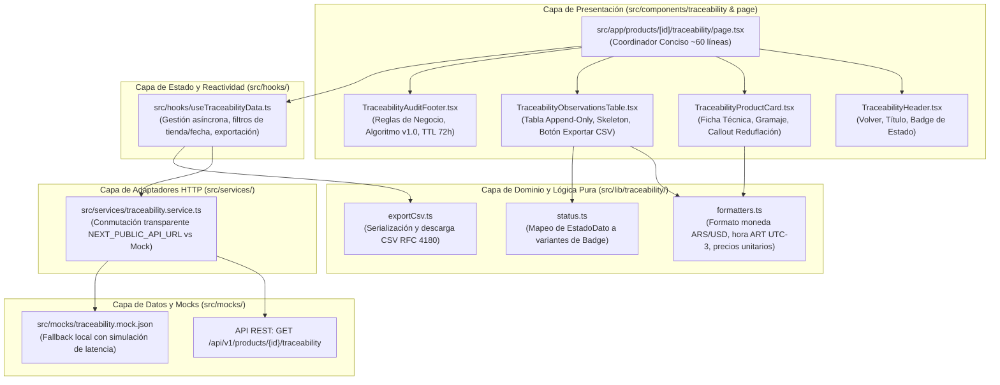

# Plan Arquitectónico: 004-traceability-architecture

**Módulo:** Ficha de Producto y Trazabilidad Forense (`/products/{id}/traceability`)  
**Ámbito:** `apps/client`  
**Estado:** Propuesta de Arquitectura y Diseño Técnico  
**Fecha:** 19 de Octubre de 2026  

---

## 1. Visión y Separación de Preocupaciones (SoC)

La pantalla de trazabilidad forense (`/products/{id}/traceability`) es el componente de auditoría clave de PriceScope, diseñado para que directores legales y analistas financieros certifiquen la procedencia de cada registro de precio en las cadenas minoristas.

Para migrar del monolito de 694 líneas a una arquitectura limpia, aplicamos los principios de Clean Architecture y MVVM en frontend, desacoplando estrictamente la interfaz visual de la orquestación de estado, el acceso a datos y la lógica de dominio puro:



---

## 2. Decisiones de Diseño y Clean Code

### 2.1 Ubicación Estratégica del Botón de Exportación CSV
El requerimiento explícito del usuario instruye:
> *"si los botones de export exportan es solo los datos de la tabla, colocalos en la cabecera de la tabla, si exportan todo lo de la pagina dejalos donde estan"*

**Decisión:** El botón de exportación CSV genera un archivo estructurado con las filas del histórico de observaciones (`historico_observaciones`). Por ende, se ubica directamente en la barra de herramientas superior de `TraceabilityObservationsTable.tsx`, junto al contador de observaciones registradas. Esto refuerza el principio de proximidad visual de UX y cohesión funcional.

### 2.2 Desacoplamiento de la API y Facilidad de Conmutación
Para satisfacer el requerimiento:
> *"asegurate que todo quede listo para maquetarse con la respuesta de la api, deja configurado para que despues sea solo cambiar la url de la api, y se maquete todo bajo esos mismos datos"*

Se diseña el servicio `src/services/traceability.service.ts`:
- Si `process.env.NEXT_PUBLIC_API_URL` está definido, realiza una petición `fetch` directa a `${NEXT_PUBLIC_API_URL}/api/v1/products/${id}/traceability`.
- Si la variable no está configurada o se produce una excepción de red, recurre automáticamente al dataset canónico `src/mocks/traceability.mock.json`.
- Tanto la respuesta real de la API como el mock local comparten de forma estricta el contrato `TraceabilityResponse` definido en `src/types/api.ts`. Bastará con configurar la variable de entorno en el archivo `.env.local` para que la vista consuma los datos del backend sin tocar una sola línea de código fuente.

### 2.3 Modularización de Componentes (~40 - 100 Líneas)
Cada componente asume una única responsabilidad (Single Responsibility Principle):
- **`TraceabilityHeader.tsx` (~45 líneas):** Navegación breadcrumb hacia `/` o `/alerts`, título del producto, SKU y badge de validación algorítmica.
- **`TraceabilityProductCard.tsx` (~80 líneas):** Muestra el desglose de especificaciones canónicas (marca, modelo, categoría, contenido base normalizado, pack) y alerta de reduflación cuando corresponda mediante el primitivo `Callout`.
- **`TraceabilityObservationsTable.tsx` (~95 líneas):** Renderiza la tabla de auditoría cronológica append-only con los primitivos `Table`, `TableHeader`, `TableRow`, `TableHead`, `TableBody`, `TableCell`, `Badge`, estados de carga `Skeleton` y el botón `Button` de descarga CSV.
- **`TraceabilityAuditFooter.tsx` (~50 líneas):** Expone las reglas del pipeline de datos (versión v1.0, sincronización 23:59:59 ART y fallback cambiario con TTL de 72h).
- **`index.ts` (~10 líneas):** Barrel export limpio de los componentes de trazabilidad.

### 2.4 Lógica de Negocio Pura y Testeabilidad
Se aíslan todas las transformaciones en funciones puras sin dependencias de React:
- **`formatters.ts`:**
  - `formatArtDateTime(isoUtcString: string): string` -> `DD/MM/YYYY HH:mm ART` con zona horaria fija `America/Argentina/Buenos_Aires`.
  - `formatCurrency(amount: number | null, currency: "ARS" | "USD"): string`.
  - `formatUnitPrice(price: number | null, unit: string): string`.
- **`status.ts`:**
  - `mapDataStatusToBadge(status: EstadoDato): { label: string; variant: "default" | "warning" | "destructive" | "secondary" }`.
- **`exportCsv.ts`:**
  - `exportObservationsToCsv(productName: string, observations: ObservacionTrazabilidadItem[]): void`.

---

## 3. Estructura de Archivos a Implementar

```text
apps/client/
├── src/
│   ├── types/
│   │   └── api.ts                             # Tipos canónicos OpenAPI
│   ├── services/
│   │   └── traceability.service.ts            # Adaptador HTTP con conmutación
│   ├── lib/
│   │   └── traceability/
│   │       ├── formatters.ts                  # Formato de fechas ART y monedas
│   │       ├── status.ts                      # Variantes visuales de estado de dato
│   │       ├── exportCsv.ts                   # Exportador RFC 4180
│   │       └── index.ts                       # Barrel export de utilidades
│   ├── hooks/
│   │   ├── useTraceabilityData.ts             # Custom hook de estado y reactividad
│   │   └── index.ts                           # Reexportación del hook
│   ├── components/
│   │   └── traceability/
│   │       ├── TraceabilityHeader.tsx         # Cabecera y navegación
│   │       ├── TraceabilityProductCard.tsx    # Ficha técnica canónica y reduflación
│   │       ├── TraceabilityObservationsTable.tsx # Tabla con botón exportar en header
│   │       ├── TraceabilityAuditFooter.tsx    # Tarjeta de auditoría algorítmica
│   │       └── index.ts                       # Barrel export
│   └── app/
│       └── products/
│           └── [id]/
│               └── traceability/
│                   └── page.tsx               # Orquestador conciso (~60 líneas)
└── tests/
    └── unit/
        └── traceability.test.ts               # Suite de tests unitarios
```
