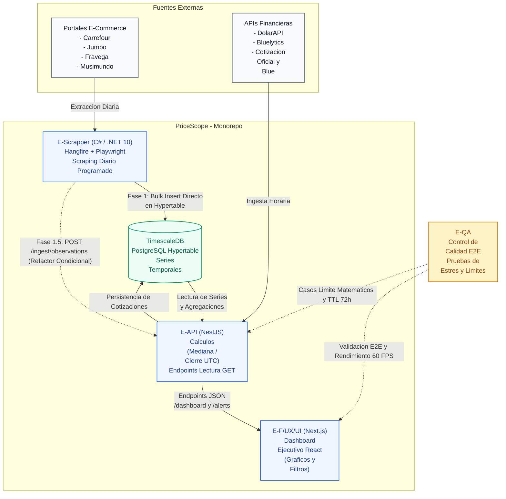

<p align="center">
  
</p>

# Especificación de Requerimientos de Software (SRS) y Backlog de Requerimientos
**PriceScope — Monitor de Inflación Real Multimoneda**  
*Plataforma B2B de Analítica Económica e Inteligencia de Mercado*

---

## Metadatos del Documento

| Atributo | Detalle Oficial |
| :--- | :--- |
| **Código del Documento** | `SRS-PRICESCOPE-V1.0` |
| **Proyecto** | PriceScope — Monitor de Inflación Real Multimoneda |
| **Organización / Programa** | Simulación Laboral Abierta — NoCountry |
| **Sector de Negocio** | FinTech / Analítica Económica (B2B Analytics) |
| **Versión** | 1.0 (Oficial Aprobada para Desarrollo) |
| **Fecha de Emisión** | 16 de Octubre de 2026 |
| **Ubicación en Repositorio** | `docs/01-analisis/01-SRS-PriceScope.md` |
| **Documentos Vinculantes** | `02-API-Contracts-OpenAPI.md`, `03-Data-Model-TimescaleDB.md`, `04-Business-Rules-Math-Logic.md` |
| **Estado** | En Revisión y Aprobación Técnica |

---

## Control de Cambios y Aprobación Formal (Sign-Off)

### CONTROL DE VERSIONES Y APROBACIÓN TÉCNICA

**Documento:** Especificación de Requerimientos del Sistema (SRS) v1.0
**Proyecto:** PriceScope — Monitor de Inflación Real Multimoneda

HISTORIAL DE VERSIONES
--------------------------------------------------------------------------------
Versión | Fecha       | Autor               | Descripción del Cambio
--------|-------------|---------------------|-----------------------------------
0.1     | 2026-10-12  | Equipo PriceScope   | Borrador inicial de HU (45 ítems)
1.0     | 2026-10-16  | Juan Camilo García  | Reestructuración oficial: inclusión de HU-00 (Seed JSON), HU-46 y HU-47, formalización matemática (Mediana, Cierre UTC,  TTL 72h) y matriz E-Team.

### ACTA DE APROBACIÓN DE ALCANCE (SIGN-OFF)
La firma de este apartado formaliza los requerimientos funcionales y no 
funcionales del sistema para el ciclo de desarrollo de 4 semanas. 
Cualquier funcionalidad fuera de este marco se considerará mejora para versiones 
posteriores.

Rol                     | Nombre               | Estado     | Firma / Fecha
------------------------|----------------------|------------|-------------------
Frontend Lead & UX/UI   | Juan Camilo García   | Aprobado   | 16/10/2026
Tech Lead / PO Review   | Gonzalo Cecchín      | Pendiente  | [  /  / 2026 ]

## 1. Estructura de Equipos de Trabajo (Células Operativas)
Para asegurar el avance simultáneo en el monorepo y evitar bloqueos, las tareas se distribuyen en cuatro células especializadas con responsables directos:

-----------------------------------------------------------------------------------------------
Identificador |	Célula de Trabajo |	Cupos |	Integrantes Asignados |	Responsabilidad Principal
--------------|-------------------|-------|-----------------------|--------------------------
E-Scrapper | Extracción y Scraping | 3 | 1. Alejandro Hernández OReilly <br> 2. Anthony Ciprian <br> 3. Sebastian Torres | Desarrollo de scrapers diarios en C# (ASP.NET Core / .NET 10 con Hangfire y Playwright .NET) para 4 tiendas piloto (Carrefour, Jumbo, Frávega, Musimundo), lectura de URLs desde seed.json y persistencia directa en lote (bulk insert) en PostgreSQL + TimescaleDB. La migración de ingesta hacia un endpoint HTTP se reserva como refactor condicional para Fase 1.5. |
E-API | Backend, DB y Divisas | 2 | 1. Luis Feliz <br> 2. Yenny Castro | Modelado en PostgreSQL + TimescaleDB, desarrollo de API REST en NestJS (TypeScript), endpoint receptor POST /ingest, ingesta horaria de cotizaciones (DolarAPI), cálculo de Cierre del Día (23:59:59), Mediana por categoría, paginación y downsampling. |
E-F/UX/UI | Frontend y Experiencia | 1 | 1. Juan Camilo García | Arquitectura de interfaz en Next.js (React / TypeScript), maquetación del Dashboard analítico, visualización interactiva (líneas y dispersión), filtros combinados, controles de paginación y conexión con API mocks y real. |
E-QA | Aseguramiento de Calidad | 2 | 1. Gonzalo Cecchín <br> 2. Karina Luvianos | Diseño de planes de prueba y casos límite matemáticos (Mediana en pares/impares, descarte de valor 0), pruebas de estrés de catálogo (10.000+ productos) y validación de cortes de red. |

## 2. Arquitectura de Ingesta y Comunicación del Sistema

El flujo de información se desacopla a través de la API para garantizar la validación de tipos antes de persistir en base de datos:



### Estructura del Objeto de Extracción (DTO de Ingesta)
El equipo `E-Scrapper` estructura y procesa las observaciones mediante este payload JSON por cada lote recolectado:

> "Nota de Arquitectura y Mapeo: Este esquema JSON define la estructura de datos que genera el extractor. Durante la **Fase 1 (MVP Esencial)**, los scrapers mapean este objeto directamente a las sentencias de inserción masiva (`bulk insert`) en la tabla `observaciones_precios` de PostgreSQL/TimescaleDB (donde el campo `estado_captura` se almacena físicamente en la columna `estado_dato`). Si el avance de la Semana 3 o 4 lo permite (**Fase 1.5 Buffer Condicional**), el backend habilitará la ruta `POST /api/v1/ingest/observations` para desacoplar el acceso a la base de datos vía HTTP sin modificar la estructura del payload."

```json
{
  "tienda_id": "carrefour",
  "lote_timestamp_utc": "2026-10-16T14:00:00Z",
  "total_registros": 2,
  "observaciones": [
    {
      "url_origen": "https://www.carrefour.com.ar/cafe-molido-marca-a-500g",
      "sku_tienda": "CAR-12345",
      "nombre_publicacion": "Café molido Marca A 500g",
      "precio_regular": 12000.0,
      "precio_promocional": null,
      "disponible": true,
      "estado_captura": "DATO_VALIDO"
    },
    {
      "url_origen": "https://www.carrefour.com.ar/aceite-girasol-15l",
      "sku_tienda": "CAR-67890",
      "nombre_publicacion": "Aceite de girasol 1.5L",
      "precio_regular": null,
      "precio_promocional": null,
      "disponible": false,
      "estado_captura": "AGOTADO"
    }
  ]
}
```

## 3. Introducción y Resumen Ejecutivo
###  3.1 Contexto y Necesidad del Negocio
  PriceScope es una solución de analítica económica que provee informes de variación de precios e inflación en tiempo real a cadenas minoristas, fondos de inversión y medios de comunicación en entornos de alta volatilidad cambiaria.
  
  Actualmente, el relevamiento de precios se realiza manualmente inspeccionando 15 portales de e-commerce dos veces por semana y volcando montos en hojas de cálculo. Con un catálogo de más de 10.000 productos bajo observación, este procedimiento manual genera retrasos de varios días, errores de tipeo y pérdida de trazabilidad ante ofertas transitorias.
  
  La firma necesita automatizar el proceso para ofrecer a sus clientes corporativos un tablero interactivo con actualización diaria sobre el comportamiento real de los precios frente al tipo de cambio.

### 3.2 Alcance del MVP y Estrategia de Phasing (MoSCoW)
<br>

- **Fase 1 (MVP Esencial - Semanas 1 a 4):** 
Cobertura de 4 tiendas piloto (Carrefour y Jumbo para supermercados; Frávega y Musimundo para electrodomésticos) en Canasta Básica y Bienes Durables. Ingesta de fuentes mediante archivo semilla (seed.json) con URLs directas normalizadas (HU-00). Captura diaria de precios e ingesta periódica de divisas oficiales y paralelas.
<br>

- **Fase 1.5 (Buffer Condicional - Semanas 3 a 4):** 
El Panel de Administración de Tiendas (HU-01) y la interfaz de revisión de Zona Gris (HU-10) se integran de forma modular únicamente tras consolidar el pipeline base de scraping, persistencia y visualización.

## 4. Actores del Sistema

| Actor | Tipo de Actor | Descripción y Alcance Operativo | Permisos y Acciones Principales | Frecuencia de Uso |
| :--- | :--- | :--- | :--- | :--- |
| **Analista Interno** | Humano / Operador | Persona del equipo técnico que supervisa fuentes, valida emparejamientos de productos y monitorea la ingesta. | Configurar tiendas y categorías, auditar asociaciones en Zona Gris, excluir observaciones atípicas y definir reglas de negocio. | Diaria |
| **Cliente Lector** | Humano / Consultor B2B | Analista de cadenas minoristas, fondos de inversión o medios de comunicación que toma decisiones estratégicas. | Consultar tablero analítico, aplicar filtros por tienda/período/categoría/moneda, visualizar alertas de inflación y auditar trazabilidad. | Diaria / Semanal |
| **Sistema Programado** | Agente Autónomo | Procesos y tareas programadas en segundo plano que operan de forma automatizada. | Ejecutar scrapers diarios, consumir APIs de divisas horariamente, procesar cruces de monedas y calcular series temporales sin intervención humana. | Diaria / Horaria |
| **Analista QA** | Técnico Evaluador *(Rol operativo)* | Rol de control de calidad encargado de certificar la fiabilidad matemática y técnica del sistema. | Probar casos de prueba habituales y límite, validar reglas matemáticas (mediana, cierre UTC, fallback 72h) y reportar defectos. | Por iteración / Sprint |

> **Nota de Alcance del MVP:** Para la fase de demostración de la simulación laboral no se implementará autenticación (login) ni arquitectura multi-tenant; el tablero web será de acceso directo para validar el flujo funcional de punta a punta. Los roles y controles de acceso granulares quedan formalizados como deuda técnica para fases posteriores a producción.

## 5. Reglas de Negocio y Convenciones Técnicas Obligatorias

### RN-01: Almacenamiento en UTC y Sincronización Cambiaria ("Cierre del Día")
* **Persistencia Temporal:** Toda estampa de tiempo de observación se almacena en base de datos estrictamente en formato UTC bajo el estándar ISO 8601 con precisión de minutos o milisegundos.
* **Definición de Cierre:** Para el emparejamiento cambiario diario, el Backend es el único responsable de cruzar la captura del precio con la última cotización válida registrada antes de las 23:59:59 de la hora local del mercado objetivo.
* **Desacoplamiento Frontend:** El cliente web recibe los precios previamente calculados y convertidos por la API, limitándose a presentar y formatear la marca temporal en la zona horaria del navegador del usuario.

### RN-02: Agregación de Categorías Mediante la Mediana (Prohibición de Promedio Simple)
* **Prohibición:** Se prohíbe el uso del promedio simple para calcular la variación porcentual de una categoría o canasta.
* **Fundamento Matemático:** Al operar mediante web scraping externo, el sistema no cuenta con volúmenes de transacción reales para ponderar. Un promedio simple provocaría que un artículo de bajo costo con fluctuación atípica (por ejemplo, un cable HDMI subiendo un +100%) distorsione severamente el índice de toda una categoría de bienes durables (como Smart TVs que subieron un +5%).
* **Algoritmo de Cálculo:**
  1. El Backend ordena de menor a mayor las variaciones porcentuales individuales ($v_1, v_2, \dots, v_n$) de los productos canónicos de la categoría.
  2. **Muestra impar ($N$ impar):** Se toma el valor que ocupa la posición central exacta:
     $$\text{Mediana} = v_{\left(\frac{N+1}{2}\right)}$$
  3. **Muestra par ($N$ par):** Se calcula la media aritmética de los dos valores centrales:
     $$\text{Mediana} = \frac{v_{\left(\frac{N}{2}\right)} + v_{\left(\frac{N}{2} + 1\right)}}{2}$$
* **Entrega:** La API expone el resultado calculado en el campo `variacion_mediana_pct`, acompañado de la cantidad de productos evaluados (`cantidad_productos`) y la cobertura muestral (`cobertura_pct`).

### RN-03: Fallback Cambiario y Ventana de Tolerancia Máxima (TTL 72 Horas)
* **Tratamiento de Vacíos:** Si falta la cotización cambiaria de la fecha objetivo (debido a feriados bancarios, fines de semana o caídas de la API financiera), el motor busca hacia atrás hasta un límite máximo de 72 horas (Time-To-Live).
* **Cotización Aproximada:** Si se localiza una cotización válida dentro de la ventana de 72 horas, la conversión a divisa extranjera se efectúa y el backend retorna obligatoriamente el flag `"cotizacion_aproximada": true`. El Frontend debe renderizar un icono de advertencia visual (⚠️) en la interfaz para informar al cliente corporativo.
* **Corte por Expiración:** Si transcurren más de 72 horas continuas sin cotizaciones válidas, el Backend aborta la conversión cambiaria y asigna el estado `SIN_DATO`, provocando un corte visible en la línea temporal de la gráfica en USD.

### RN-04: Prohibición del Valor Cero (0) y Taxonomía de Faltantes (Anexo A)
* **Prohibición de Cero:** Un dato faltante nunca debe guardarse ni exponerse como cero (`0`), para evitar falsear las series temporales simulando caídas de precio del 100%.
* **Taxonomía Estricta:** Se implementan tres estados obligatorios para datos no disponibles:
  * `AGOTADO`: Publicación sin stock disponible o con el botón de compra deshabilitado en tienda.
  * `ERROR_CAPTURA`: Falla técnica atribuible a códigos HTTP 5xx, bloqueos de red o timeouts durante el scraping.
  * `SIN_DATO`: Omisión de captura programada o fallo cambiario que superó la ventana de tolerancia de 72 horas.
* **Visualización en Interfaz:** Los valores faltantes se representan por defecto como cortes o huecos (*gaps*) en las líneas del gráfico. La franja inferior de calidad (`banda_calidad_diaria`) expone un semáforo diario: Verde (`DATO_VALIDO`), Amarillo (`AGOTADO`) y Rojo (`ERROR_CAPTURA` / `SIN_DATO`).
* **Regla de Cálculo (LOCF):** Los cálculos de variación acumulada utilizan la última observación válida (*Last Observation Carried Forward*) respecto a los extremos de la fecha y deben reportar siempre el porcentaje de cobertura.

### RN-05: Reduflación y Comparabilidad por Contenido Neto (Anexo B)
* **Normalización de Contenido:** Todo producto canónico registra su contenido neto en valor numérico y unidad de medida estandarizada (`kg`, `L`, `unidad`), desacoplado de la configuración de empaque (`pack x1`, `pack x3`, etc.).
* **Precio por Unidad:** Se calcula obligatoriamente el precio por unidad métrica normalizada para garantizar comparaciones equitativas entre competidores:
  $$\text{Precio por Unidad} = \frac{\text{Precio Regular}}{\text{Contenido Neto Normalizado}}$$
* **Detección de Reduflación:** Si el contenido neto de una presentación disminuye y el precio nominal se mantiene o incrementa, el sistema dispara automáticamente un hito tipificado como `REDUFLACION`, preservando la trazabilidad del cambio de gramaje.

### RN-06: Paginación Obligatoria de Listados Masivos (HU-46)
* **Protección del Navegador:** Para evitar el *over-fetching* y el bloqueo del hilo principal (*Main Thread*) del navegador con catálogos superiores a 10.000 productos, todo endpoint que devuelva tablas o colecciones (catálogo, alertas) exige parámetros de paginación:
  * Parámetros estándar: `?page=1&limit=50`.
  * Límite de servidor: El backend restringe o trunca peticiones a un máximo estricto de 50 elementos por página.
  * Metadatos obligatorios: Toda respuesta paginada incluye un objeto con: `pagina_actual`, `limite_por_pagina`, `total_registros` y `total_paginas`.

### RN-07: Downsampling Algorítmico en Series Temporales (HU-47)
* **Control de Densidad Gráfica:** Si la consulta temporal del cliente abarca un rango mayor a 3 meses (90 días), el Backend aplica downsampling para reducir la densidad de datos enviando 1 único punto consolidado por semana.
* **Método de Agrupación:** El punto semanal consolidado se obtiene calculando la mediana de las observaciones registradas dentro de dicha semana.
* **Rendimiento UI:** En rangos anuales completos (365 días), la API devuelve un máximo de 52 puntos por producto en lugar de 365 registros diarios, garantizando que el gráfico en React renderice de manera fluida a 60 FPS.
* **Flags de Respuesta:** El payload JSON incluye la confirmación `"downsampling_aplicado": true` y el parámetro `"intervalo_agrupacion": "1w"`.

### RN-08: Rigor Terminológico de Indicadores Macroeconómicos
* **Prohibición de Ambigüedad:** Queda estrictamente prohibido utilizar la expresión "inflación real" en el sistema sin calificar explícitamente la métrica mostrada.
* **Tres Métricas Independientes:** El sistema debe discriminar claramente en pantallas y contratos JSON tres cálculos distintos:
  1. *Variación Acumulada en Pesos ($):* Cambio porcentual de los precios regulares en moneda local.
  2. *Variación Acumulada en USD:* Cambio porcentual de los precios convertidos a divisa extranjera con especificación de la cotización utilizada.
  3. *Comparación vs. Devaluación:* Diferencial en puntos porcentuales entre la variación del precio y la variación de la cotización cambiaria en el mismo período.

### RN-09: Límite Máximo de Consulta Temporal (Ventana de 365 Días)
* **Protección de Base de Datos y Memoria:** Para prevenir ataques de denegación de servicio (DoS) involuntarios o escaneos excesivos sobre las hypertables de TimescaleDB, ninguna consulta temporal puede abarcar un rango mayor a **366 días** (1 año calendario con soporte de año bisiesto):
  $$\Delta_{\text{días}} = \text{fecha\_hasta} - \text{fecha\_desde} \le 366 \text{ días}$$
* **Prohibición de Fechas Futuras:** La `fecha_hasta` no puede ser posterior a la fecha actual del sistema.
* **Respuesta de Servidor (RFC 7807):** Cualquier petición que exceda el límite de 365 días o presente fechas invertidas se rechaza inmediatamente con código HTTP **`422 Unprocessable Entity`**, sin ejecutar consultas a base de datos.
* **Control en Interfaz de Usuario:** El componente de calendario en Next.js restringe el selector impidiendo marcar rangos superiores a 365 días y desactiva las fechas futuras.

## 6. Backlog Detallado de Historias de Usuario

---

### Épica E1 — Captura e Ingesta Automatizada de Precios

#### HU-00: Ingesta Determinística por Archivo Semilla
* **Épica:** E1 — Captura e Ingesta Automatizada de Precios.
* **Prioridad:** Must Have (Fase 1 — Semana 1).
* **Célula Responsable:** `E-Scrapper` / `E-API`.
* **Como:** Desarrollador y Sistema Programado.
* **Quiero:** Cargar la configuración inicial de tiendas, URLs directas de productos y alias comerciales desde un archivo estructurado `seed.json`.
* **Para:** Poner en funcionamiento el scraping de las 4 tiendas piloto sin depender de interfaces administrativas web intermedias en la primera semana.
* **Criterios de Aceptación:**
  * [ ] El sistema lee `seed.json` e inicializa los registros maestros de productos canónicos y tiendas en la base de datos.
  * [ ] Soporta la definición de productos con contenido neto normalizado (`valor`, `unidad`), tipo de empaque `pack` y array de `tiendas` con `url_origen` y `alias_producto`.
  * [ ] La ejecución es idempotente; reejecutar la carga no duplica catálogos ni corrompe claves foráneas.
* **Datos de Prueba Sugeridos:**
  * Archivo `seed.json` con café molido 500g (Carrefour y Jumbo) y Smart TV 55" (Frávega y Musimundo).
* **Pantallas / Endpoints Involucrados:** CLI / Script de migración inicial.

---

#### HU-01: Configurar Tiendas y Categorías del MVP vía Web
* **Épica:** E1 — Captura e Ingesta Automatizada de Precios.
* **Prioridad:** Could Have (Fase 1.5 — Buffer Condicional Semana 3-4).
* **Célula Responsable:** `E-API` / `E-F/UX/UI`.
* **Como:** Analista Interno.
* **Quiero:** Dar de alta, editar y desactivar tiendas (URL base, tipo) y categorías desde una interfaz web.
* **Para:** Administrar las fuentes de extracción del pipeline en caliente sin manipular archivos de configuración ni tocar código.
* **Criterios de Aceptación:**
  * [ ] Permite crear, modificar y desactivar tiendas con: nombre, URL base, categoría asignada y tipo (supermercado/electro).
  * [ ] El sistema impide registrar dos tiendas con el mismo nombre.
  * [ ] Al desactivar una tienda, sus observaciones históricas se conservan intactas en la base de datos.
  * [ ] Toda modificación genera un registro de auditoría con fecha/hora UTC y usuario responsable.
* **Datos de Prueba Sugeridos:**
  * Alta de tienda "Carrefour" (supermercado, canasta básica).
  * Intento duplicado de "Carrefour" → Rechazo con error de validación.
* **Pantallas / Endpoints Involucrados:** `POST /api/v1/admin/stores`, `PUT /api/v1/admin/stores/{id}`, Panel Web de Configuración.

---

#### HU-02: Ejecutar Captura Diaria Programada por Tienda
* **Épica:** E1 — Captura e Ingesta Automatizada de Precios.
* **Prioridad:** Must Have (Fase 1 — Semana 1).
* **Célula Responsable:** `E-Scrapper`.
* **Como:** Sistema Programado.
* **Quiero:** Ejecutar la recolección automática sobre cada tienda activa una vez por día.
* **Para:** Mantener el historial de precios actualizado sin demandar intervención manual.
* **Criterios de Aceptación:**
  * [ ] Cada tienda activa genera una ejecución diaria identificable (id de corrida, marcas de tiempo inicio/fin, estado).
  * [ ] Si una captura falla, el resto de las tiendas continúa de forma aislada.
  * [ ] La reejecución en la misma fecha no genera registros redundantes en la base de datos (idempotencia).
  * [ ] Cada corrida emite un reporte con total de publicaciones procesadas, guardadas y fallidas.
* **Datos de Prueba Sugeridos:**
  * Corrida normal → 4 tiendas procesadas exitosamente.
  * Falla simulada en 1 tienda → 3 tiendas OK y 1 tienda marcada como fallida en logs.
* **Pantallas / Endpoints Involucrados:** Hangfire Dashboard / Worker de Playwright .NET en ASP.NET Core (`apps/scraper`).

---

#### HU-03: Capturar los Campos de Cada Publicación
* **Épica:** E1 — Captura e Ingesta Automatizada de Precios.
* **Prioridad:** Must Have (Fase 1 — Semana 1).
* **Célula Responsable:** `E-Scrapper`.
* **Como:** Sistema Programado.
* **Quiero:** Extraer nombre, precio regular, precio tachado, disponibilidad de stock, categoría y URL de cada publicación.
* **Para:** Disponer de la materia prima estructurada que alimenta los indicadores económicos.
* **Criterios de Aceptación:**
  * [ ] Por cada publicación se registran: nombre, precio regular, precio tachado (si existe), estado de stock, categoría y URL.
  * [ ] Si la publicación no presenta precio tachado, el campo se envía y almacena como `null` (nunca en cero).
  * [ ] La URL se preserva íntegra para posibilitar la navegación y trazabilidad hacia la publicación original.
* **Datos de Prueba Sugeridos:**
  * Publicación con promo: precio regular $8.000, tachado $10.000.
  * Publicación sin promo: tachado `null`.
* **Pantallas / Endpoints Involucrados:** DTO de extracción del Scraper.

---

#### HU-04: Registrar el Timestamp UTC de Captura
* **Épica:** E1 — Captura e Ingesta Automatizada de Precios.
* **Prioridad:** Must Have (Fase 1 — Semana 1).
* **Célula Responsable:** `E-Scrapper` / `E-API`.
* **Como:** Sistema Programado.
* **Quiero:** Guardar la fecha y hora exacta en formato UTC bajo norma ISO 8601 en cada observación.
* **Para:** Garantizar un huso horario común que permita el emparejamiento cambiario determinístico.
* **Criterios de Aceptación:**
  * [ ] Toda observación incluye obligatoriamente `timestamp_utc` con precisión de minutos o milisegundos.
  * [ ] La base de datos rechaza inserciones con fechas nulas o en formatos locales ambiguos.
  * [ ] El Frontend recibe la fecha en UTC y es el único encargado de formatearla a la hora local del usuario.
* **Datos de Prueba Sugeridos:**
  * Captura local ART 14:00 (UTC-3) → Persistida como `YYYY-MM-DDTHH:MM:SSZ`.
* **Pantallas / Endpoints Involucrados:** Campo `timestamp_utc` en tabla `observaciones_precios`.

---

#### HU-05: Reintentos y Clasificación de Fallos de Red
* **Épica:** E1 — Captura e Ingesta Automatizada de Precios.
* **Prioridad:** Must Have (Fase 1 — Semana 1).
* **Célula Responsable:** `E-Scrapper`.
* **Como:** Sistema Programado.
* **Quiero:** Reintentar solicitudes ante caídas técnicas y clasificar fallas persistentes.
* **Para:** Distinguir un error de conectividad o bloqueo de IP de una baja real de precio o despublicación.
* **Criterios de Aceptación:**
  * [ ] Aplica hasta 3 reintentos con retroceso exponencial (*exponential backoff*) ante códigos HTTP 5xx o timeout.
  * [ ] Si la falla persiste, se genera un registro con estado `ERROR_CAPTURA` preservando el motivo y la URL.
  * [ ] Un registro de tipo `ERROR_CAPTURA` nunca guarda precio cero (`0`).
* **Datos de Prueba Sugeridos:**
  * Simulación de HTTP 503 en 1 publicación → 3 reintentos fallidos → Registro `ERROR_CAPTURA` con precio `null`.
* **Pantallas / Endpoints Involucrados:** Logs de ejecución y motor de reintentos.

---

#### HU-06: Detectar Publicaciones Duplicadas
* **Épica:** E1 — Captura e Ingesta Automatizada de Precios.
* **Prioridad:** Must Have (Fase 1 — Semana 1).
* **Célula Responsable:** `E-API`.
* **Como:** Sistema Programado.
* **Quiero:** Impedir la inserción redundante de una misma publicación dentro del mismo ciclo diario.
* **Para:** No distorsionar ponderaciones estadísticas ni inflar el tamaño de la base de datos.
* **Criterios de Aceptación:**
  * [ ] Se impone una restricción de unicidad compuesta por `(tienda_id, url_origen, fecha_captura)`.
  * [ ] Las peticiones duplicadas son descartadas o actualizan el registro existente sin crear nuevas filas.
* **Datos de Prueba Sugeridos:**
  * Enviar dos payloads con la misma URL y fecha → Se procesa únicamente una observación.
* **Pantallas / Endpoints Involucrados:** Constraint `UNIQUE` en PostgreSQL.

---

### Épica E2 — Normalización e Identidad de Productos

#### HU-07: Definir Producto Canónico con Atributos Mínimos
* **Épica:** E2 — Normalización e Identidad de Productos.
* **Prioridad:** Must Have (Fase 1 — Semana 1).
* **Célula Responsable:** `E-API`.
* **Como:** Analista Interno.
* **Quiero:** Modelar entidades canónicas con atributos mínimos estandarizados.
* **Para:** Disponer de una unidad económica base y comparable entre portales competidores.
* **Criterios de Aceptación:**
  * [ ] Atributos obligatorios: identificador canónico, categoría, marca, nombre normalizado, contenido neto (`valor`, `unidad` en kg/L/unidad) y tipo de empaque `pack`.
  * [ ] El contenido neto se normaliza a unidades base (ej. 500g se guarda como `valor: 0.5`, `unidad: kg`).
  * [ ] El pack se especifica de forma independiente (`x1`, `x3`, etc.) y queda prohibido fusionarlo con unidades sueltas sin normalizar.
* **Datos de Prueba Sugeridos:**
  * Canónico: "Café molido Marca A — 500g — paquete simple".
* **Pantallas / Endpoints Involucrados:** Tabla `productos_canonicos`.

---

#### HU-08: Asociar Automáticamente Publicaciones a un Canónico
* **Épica:** E2 — Normalización e Identidad de Productos.
* **Prioridad:** Must Have (Fase 1 — Semana 1-2).
* **Célula Responsable:** `E-API`.
* **Como:** Sistema Programado.
* **Quiero:** Asignar publicaciones a productos canónicos mediante reglas determinísticas y similitud textual.
* **Para:** Agrupar catálogos de distintas tiendas mitigando la carga manual masiva.
* **Criterios de Aceptación:**
  * [ ] El sistema calcula un score de confianza normalizado entre 0.0 y 1.0.
  * [ ] Score $\ge 0.85$: Confirmación y asociación directa automática.
  * [ ] Score $\le 0.40$: Rechazo automático (queda descartado).
  * [ ] Score entre $0.41$ y $0.84$: Derivación a la cola de revisión de Zona Gris (HU-10).
  * [ ] Toda asociación persiste método utilizado, score y fecha de cálculo.
* **Datos de Prueba Sugeridos:**
  * "Café A 500g" vs "Café Marca A paquete 500 gramos" → Score $\ge 0.85$ (Asociación automática).
  * "Café A 500g" vs "Café A 250g" → Rechazo automático por diferencia de contenido.
* **Pantallas / Endpoints Involucrados:** Motor interno de matching.

---

#### HU-09: Gestionar Alias por Tienda
* **Épica:** E2 — Normalización e Identidad de Productos.
* **Prioridad:** Must Have (Fase 1 — Semana 1).
* **Célula Responsable:** `E-API`.
* **Como:** Analista Interno.
* **Quiero:** Consultar y mantener los nombres comerciales con los que cada tienda publica un producto.
* **Para:** Mantener la trazabilidad y comparabilidad ante modificaciones cosméticas en títulos de portales.
* **Criterios de Aceptación:**
  * [ ] Cada canónico puede asociar múltiples alias con identificador de tienda.
  * [ ] Permite añadir o corregir alias registrando usuario y fecha.
  * [ ] Modificar un alias no elimina las observaciones históricas vinculadas previamente.
* **Datos de Prueba Sugeridos:**
  * Alias "Carrefour — Café Molienda 500g" vinculado a `prod-cafe-500g`.
* **Pantallas / Endpoints Involucrados:** Ficha del producto canónico / Tabla de alias.

---

#### HU-10: Revisar Asociaciones Dudosas (Cola de Revisión de Zona Gris)
* **Épica:** E2 — Normalización e Identidad de Productos.
* **Prioridad:** Should Have (Fase 1.5 — Buffer Condicional Semana 3-4).
* **Célula Responsable:** `E-API` / `E-F/UX/UI`.
* **Como:** Analista Interno.
* **Quiero:** Disponer de una interfaz visual con publicaciones con score intermedio para aprobar o descartar.
* **Para:** Garantizar la pureza del catálogo evitando falsos positivos automáticos del matching.
* **Criterios de Aceptación:**
  * [ ] Lista pares propuestos con score (0.41 - 0.84), diferencias de atributos y enlaces directos.
  * [ ] Permite aprobar, rechazar o reasignar a otro canónico existente con botones directos.
  * [ ] Cada decisión guarda usuario, fecha y motivo.
  * [ ] Al aprobar o descartar, el par abandona la lista de pendientes.
* **Datos de Prueba Sugeridos:**
  * Par con score 0.72 → Aparece en la cola; al hacer clic en aprobar se confirma en base de datos.
* **Pantallas / Endpoints Involucrados:** `GET /api/v1/matching/pending`, `POST /api/v1/matching/approve`, Pantalla de Curaduría.

---

#### HU-11: Reasignar una Asociación con Auditoría Inmutable
* **Épica:** E2 — Normalización e Identidad de Productos.
* **Prioridad:** Must Have (Fase 1 — Semana 2).
* **Célula Responsable:** `E-API`.
* **Como:** Analista Interno.
* **Quiero:** Corregir manualmente la asignación de una publicación hacia otro canónico.
* **Para:** Subsanar errores de matching sin perder el rastro forense de las correcciones.
* **Criterios de Aceptación:**
  * [ ] El sistema permite reasignar el ID canónico de una publicación.
  * [ ] La mutación registra valor anterior, valor asignado, usuario, timestamp UTC y motivo.
  * [ ] Se prohíbe eliminar de forma destructiva registros de auditoría anteriores.
* **Datos de Prueba Sugeridos:**
  * Publicación reasignada de "Café 250g" a "Café 500g" → Registro generado en log inmutable.
* **Pantallas / Endpoints Involucrados:** `POST /api/v1/canonical/reassign`, Tabla `auditoria_cambios`.

---

### Épica E3 — Clasificación (Precio, Promo, Stock y Reduflación)

#### HU-12: Clasificar Precio Regular vs. Promocional
* **Épica:** E3 — Clasificación (Precio, Promo, Stock y Reduflación).
* **Prioridad:** Must Have (Fase 1 — Semana 1).
* **Célula Responsable:** `E-API`.
* **Como:** Sistema Programado.
* **Quiero:** Discriminar si el precio observado es regular de lista o corresponde a un descuento puntual.
* **Para:** Proteger las métricas oficiales de inflación evitando distorsiones por promociones efímeras.
* **Criterios de Aceptación:**
  * [ ] Si existe precio tachado mayor al precio actual, se guarda el tachado en `precio_regular` y el precio con descuento en `precio_promocional`.
  * [ ] Las variaciones e indicadores económicos oficiales consumen exclusivamente la serie de `precio_regular`.
  * [ ] El `precio_promocional` se preserva para su consulta y visualización aislada.
* **Datos de Prueba Sugeridos:**
  * Lunes: $10.000 regular; Martes: oferta $8.000 con tachado $10.000 → Regular se mantiene en $10.000.
* **Pantallas / Endpoints Involucrados:** Pipeline de normalización de Backend.

---

#### HU-13: Detección Heurística de Promociones
* **Épica:** E3 — Clasificación (Precio, Promo, Stock y Reduflación).
* **Prioridad:** Should Have (Fase 2 — Mejoras Post-MVP).
* **Célula Responsable:** `E-Scrapper` / `E-API`.
* **Como:** Sistema Programado.
* **Quiero:** Etiquetar promociones mediante análisis de texto en publicaciones ("2x1", "descuento").
* **Para:** Identificar ofertas donde el e-commerce omite publicar el precio tachado en su HTML.
* **Criterios de Aceptación:**
  * [ ] Detección de palabras clave configurables en títulos y banners.
  * [ ] La coincidencia sugiere una promoción y adjunta la evidencia textual detectada.
* **Datos de Prueba Sugeridos:**
  * Título: "Café molido 500g - Promo 2da unidad al 50%" → Etiqueta preventiva de oferta.
* **Pantallas / Endpoints Involucrados:** Filtros de expresiones regulares en el extractor.

---

#### HU-14: Registrar Disponibilidad y Control de Stock
* **Épica:** E3 — Clasificación (Precio, Promo, Stock y Reduflación).
* **Prioridad:** Must Have (Fase 1 — Semana 1).
* **Célula Responsable:** `E-Scrapper` / `E-API`.
* **Como:** Sistema Programado.
* **Quiero:** Registrar el estado de stock (disponible / agotado) de cada producto.
* **Para:** No interpretar la falta momentánea de un bien como un descenso de precio a cero.
* **Criterios de Aceptación:**
  * [ ] Artículos sin stock o con botón de compra deshabilitado se guardan con `disponible = false` y `estado_dato = AGOTADO`.
  * [ ] Un registro en estado `AGOTADO` jamás guarda valor numérico cero (`0`).
  * [ ] La interfaz visual refleja el estado de stock en la trazabilidad del punto.
* **Datos de Prueba Sugeridos:**
  * Publicación con cartel "Sin Stock" → `estado_dato: AGOTADO`, `precio_regular: null`.
* **Pantallas / Endpoints Involucrados:** Campo `estado_dato` en base de datos.

---

#### HU-15: Monitorear Contenido Neto y Detectar Reduflación
* **Épica:** E3 — Clasificación (Precio, Promo, Stock y Reduflación).
* **Prioridad:** Must Have (Fase 1 — Semana 2).
* **Célula Responsable:** `E-API`.
* **Como:** Analista Interno.
* **Quiero:** Detectar disminuciones en el contenido neto de un producto canónico a lo largo del tiempo.
* **Para:** Catalogar eventos de reduflación cuando el empaque se achica pero el precio nominal se mantiene.
* **Criterios de Aceptación:**
  * [ ] Registra historial de contenido neto (valor, unidad, fecha de inicio).
  * [ ] Si el contenido disminuye y el precio nominal se sostiene o sube, se crea un hito de tipo `REDUFLACION`.
  * [ ] El evento altera el precio por unidad sin catalogarse erróneamente como un nuevo producto.
* **Datos de Prueba Sugeridos:**
  * Café de 500g a $10.000 pasa a 450g a $10.000 → Hito `REDUFLACION` registrado (+11.1% por gramo).
* **Pantallas / Endpoints Involucrados:** Historial de canónicos / Array de `hitos`.

---

#### HU-16: Calcular Precio por Unidad de Medida Normalizada
* **Épica:** E3 — Clasificación (Precio, Promo, Stock y Reduflación).
* **Prioridad:** Must Have (Fase 1 — Semana 1).
* **Célula Responsable:** `E-API`.
* **Como:** Sistema Programado.
* **Quiero:** Calcular el valor por unidad métrica ($/kg, $/L, $/unidad) para cada observación válida.
* **Para:** Comparar presentaciones de distinto tamaño de forma homogénea.
* **Criterios de Aceptación:**
  * [ ] Aplica la relación: `precio_por_unidad = precio_regular / valor_contenido_normalizado`.
  * [ ] Soporta conversiones automáticas entre submúltiplos métricos (gramos a kilogramos, mililitros a litros).
* **Datos de Prueba Sugeridos:**
  * $10.000 / 0.5 kg = $20.000/kg; $10.000 / 0.45 kg = $22.222,22/kg.
* **Pantallas / Endpoints Involucrados:** Campo `precio_por_unidad` en API.

---

### Épica E4 — Series Históricas y Trazabilidad

#### HU-17: Almacenar Historial Append-Only en TimescaleDB
* **Épica:** E4 — Series Históricas y Trazabilidad.
* **Prioridad:** Must Have (Fase 1 — Semana 1).
* **Célula Responsable:** `E-API`.
* **Como:** Sistema Programado.
* **Quiero:** Insertar observaciones cronológicas de forma estrictamente incremental en una hypertable.
* **Para:** Preservar la inmutabilidad histórica evitando sobrescrituras destructivas.
* **Criterios de Aceptación:**
  * [ ] La tabla de observaciones opera bajo inserciones continuas sin sentencias de actualización destructiva (`UPDATE` de montos históricos).
  * [ ] Cada fila vincula: canónico, tienda, timestamp UTC, precio regular, promocional, stock y moneda.
  * [ ] Permite reconstruir la serie temporal íntegra de un producto de forma cronológica.
* **Datos de Prueba Sugeridos:**
  * Inserción secuencial de 3 días de precios → 3 tuplas independientes ordenadas por fecha.
* **Pantallas / Endpoints Involucrados:** Hypertable `observaciones_precios` en TimescaleDB.

---

#### HU-18: Registrar Estado del Dato y Causa de Faltante
* **Épica:** E4 — Series Históricas y Trazabilidad.
* **Prioridad:** Must Have (Fase 1 — Semana 1).
* **Célula Responsable:** `E-API`.
* **Como:** Sistema Programado.
* **Quiero:** Tipificar obligatoriamente cada registro bajo un estado estricto.
* **Para:** Distinguir con precisión un hueco técnico o de stock frente a un valor cero.
* **Criterios de Aceptación:**
  * [ ] Toda fila registra un valor del ENUM: `DATO_VALIDO`, `AGOTADO`, `ERROR_CAPTURA` o `SIN_DATO`.
  * [ ] Ningún faltante se persiste o devuelve como cero (`0`).
  * [ ] El motivo del faltante queda registrado para auditoría y visualización.
* **Datos de Prueba Sugeridos:**
  * Día sin captura → `SIN_DATO`; sin stock → `AGOTADO`; HTTP 500 → `ERROR_CAPTURA`.
* **Pantallas / Endpoints Involucrados:** Columna `estado_dato` en base de datos.

---

#### HU-19: Reconstruir el Origen de un Indicador (Trazabilidad)
* **Épica:** E4 — Series Históricas y Trazabilidad.
* **Prioridad:** Must Have (Fase 1 — Semana 2).
* **Célula Responsable:** `E-API` / `E-F/UX/UI`.
* **Como:** Cliente Lector y Analista Interno.
* **Quiero:** Consultar las observaciones de origen, fecha de captura y tasa cambiaria detrás de cada número.
* **Para:** Respaldar y auditar los resultados frente a comités de inversión.
* **Criterios de Aceptación:**
  * [ ] Desde cualquier indicador o punto del gráfico se accede a: fechas base, cotización aplicada, fuente y cobertura porcentual.
  * [ ] Expone la regla de faltantes utilizada (LOCF).
* **Datos de Prueba Sugeridos:**
  * Consultar variación de café → Ver las dos capturas asociadas y la cotización de cierre aplicada.
* **Pantallas / Endpoints Involucrados:** `GET /api/v1/products/{id}/traceability`, Modal de trazabilidad.

---

### Épica E5 — Ingesta de Cotizaciones de Divisas

#### HU-20: Ingestar Cotizaciones Oficial y Paralela con Timestamp
* **Épica:** E5 — Ingesta de Cotizaciones de Divisas.
* **Prioridad:** Must Have (Fase 1 — Semana 2).
* **Célula Responsable:** `E-API`.
* **Como:** Sistema Programado.
* **Quiero:** Consumir cotizaciones horarias de divisas (oficial y paralela/blue) vía API externa.
* **Para:** Disponer de referencias cambiarias continuas para las conversiones multimoneda.
* **Criterios de Aceptación:**
  * [ ] Ingesta automatizada de cotizaciones compra y venta mediante integraciones como DolarAPI.
  * [ ] Cada cotización guarda valor numérico y timestamp UTC de captura y publicación.
  * [ ] Si la API de divisas no responde, registra el incidente sin inventar valores numéricos.
* **Datos de Prueba Sugeridos:**
  * Cotización oficial 1.000/USD y paralela 1.200/USD en el mismo período.
* **Pantallas / Endpoints Involucrados:** Cron job de ingesta cambiaria.

---

#### HU-21: Almacenar Metadatos Cambiarios
* **Épica:** E5 — Ingesta de Cotizaciones de Divisas.
* **Prioridad:** Must Have (Fase 1 — Semana 2).
* **Célula Responsable:** `E-API`.
* **Como:** Sistema Programado.
* **Quiero:** Registrar moneda, tipo, entidad proveedora, convención y condición de compra/venta.
* **Para:** Garantizar la reproducibilidad estricta de las conversiones en cualquier recálculo histórico.
* **Criterios de Aceptación:**
  * [ ] Campos requeridos: moneda base, moneda cotizada, tipo (oficial/blue), fuente (DolarAPI/BCRA) y condición (venta).
  * [ ] Se prohíbe utilizar cotizaciones que carezcan de metadatos de procedencia validados.
* **Datos de Prueba Sugeridos:**
  * Registro: Tipo "Oficial", Condición "Venta", Fuente "DolarAPI_BCRA", Timestamp UTC.
* **Pantallas / Endpoints Involucrados:** Tabla `cotizaciones_divisas`.

---

#### HU-22: Fallback Cambiario con Ventana de Tolerancia (TTL 72 Horas)
* **Épica:** E5 — Ingesta de Cotizaciones de Divisas.
* **Prioridad:** Must Have (Fase 1 — Semana 2).
* **Célula Responsable:** `E-API`.
* **Como:** Sistema Programado.
* **Quiero:** Implementar una ventana de tolerancia máxima de 72 horas ante ausencias de cotización.
* **Para:** Cubrir fines de semana o feriados bancarios sin extrapolar cotizaciones desactualizadas.
* **Criterios de Aceptación:**
  * [ ] Si falta la cotización para el día analizado, busca hacia atrás la más cercana hasta un tope de 72 horas.
  * [ ] Si la localiza dentro de las 72h, efectúa el cálculo marcando `"cotizacion_aproximada": true`.
  * [ ] Si transcurren más de 72 horas continuas sin cotización, aborta la conversión y asigna `SIN_DATO`.
* **Datos de Prueba Sugeridos:**
  * Feriado bancario de 48h → Conversión OK con flag aproximado (`true`).
  * Caída de API de 96h → Conversión abortada; estado `SIN_DATO`.
* **Pantallas / Endpoints Involucrados:** Lógica de fallback en Backend.

---

### Épica E6 — Conversión y Sincronización Temporal

#### HU-23: Sincronización Cambiaria al Cierre del Mercado ("Cierre del Día")
* **Épica:** E6 — Conversión y Sincronización Temporal.
* **Prioridad:** Must Have (Fase 1 — Semana 2).
* **Célula Responsable:** `E-API`.
* **Como:** Sistema Programado.
* **Quiero:** Emparejar las observaciones de precios con la cotización de cierre del día local.
* **Para:** Normalizar la comparación diaria independientemente de volatilidades intradiarias.
* **Criterios de Aceptación:**
  * [ ] El cruce toma la última cotización válida registrada antes de las 23:59:59 de la hora local del mercado.
  * [ ] La operación de cruce se realiza de forma determinística en el Backend antes de serializar el JSON.
  * [ ] El Frontend recibe el precio convertido listo para pintar sin requerir lógica de sincronización.
* **Datos de Prueba Sugeridos:**
  * Precio capturado a las 10:00 local → Emparejado con cotización de cierre de las 23:59:59 del mismo día.
* **Pantallas / Endpoints Involucrados:** Servicio de sincronización temporal en Backend.

---

#### HU-24: Persistencia de la Tasa Efectivamente Utilizada
* **Épica:** E6 — Conversión y Sincronización Temporal.
* **Prioridad:** Must Have (Fase 1 — Semana 2).
* **Célula Responsable:** `E-API`.
* **Como:** Sistema Programado.
* **Quiero:** Registrar el valor numérico del tipo de cambio aplicado en cada observación procesada.
* **Para:** Garantizar la auditabilidad y posibilitar recálculos sin consultar tablas externas.
* **Criterios de Aceptación:**
  * [ ] Toda fila convertida conserva referencia a: tasa aplicada, fuente cambiaria y hora de corte.
  * [ ] Recalcular con una tasa nueva crea un resultado nuevo con su propia marca sin sobrescribir el original.
* **Datos de Prueba Sugeridos:**
  * Precio $12.000 / Cotización 1.200 = USD 10 → Tasa 1.200 persistida junto a la observación.
* **Pantallas / Endpoints Involucrados:** Columna `tipo_cambio_usado` en base de datos.

---

#### HU-25: Conversión de Precios a Moneda Dura (USD)
* **Épica:** E6 — Conversión y Sincronización Temporal.
* **Prioridad:** Must Have (Fase 1 — Semana 2).
* **Célula Responsable:** `E-API`.
* **Como:** Sistema Programado.
* **Quiero:** Calcular el precio equivalente en dólares para cada precio regular válido.
* **Para:** Analizar la inflación en moneda dura desprovista del efecto devaluatorio local.
* **Criterios de Aceptación:**
  * [ ] Aplica la relación: `precio_usd = precio_regular / cotizacion_cierre_aplicada`.
  * [ ] La conversión solo se ejecuta sobre registros que posean estado `DATO_VALIDO`.
  * [ ] Se preservan ambos valores numéricos (precio en pesos y precio en USD).
* **Datos de Prueba Sugeridos:**
  * $12.000 ARS a tipo de cambio 1.200 → 10.00 USD.
* **Pantallas / Endpoints Involucrados:** Campo `precio_usd` en respuestas JSON.

---

### Épica E7 — Indicadores Económicos y Cálculos

#### HU-26: Calcular Variación Acumulada de Precios en Pesos
* **Épica:** E7 — Indicadores Económicos y Cálculos.
* **Prioridad:** Must Have (Fase 1 — Semana 2).
* **Célula Responsable:** `E-API`.
* **Como:** Cliente Lector.
* **Quiero:** Consultar la variación porcentual acumulada de los precios regulares entre dos fechas.
* **Para:** Evaluar el aumento nominal en moneda local dentro del mercado interno.
* **Criterios de Aceptación:**
  * [ ] Aplica: `((precio_final - precio_inicial) / precio_inicial) * 100` sobre `precio_regular` del mismo canónico.
  * [ ] Si la serie carece de dato inicial o final válido, el indicador expone `SIN_DATOS_SUFICIENTES`.
  * [ ] Se informan siempre las fechas base efectivas utilizadas.
* **Datos de Prueba Sugeridos:**
  * $10.000 a $12.000 → +20.0%.
* **Pantallas / Endpoints Involucrados:** Objeto `kpis.variacion_pesos` en `/dashboard`.

---

#### HU-27: Calcular Variación Acumulada en Dólares (USD)
* **Épica:** E7 — Indicadores Económicos y Cálculos.
* **Prioridad:** Must Have (Fase 1 — Semana 2).
* **Célula Responsable:** `E-API`.
* **Como:** Cliente Lector.
* **Quiero:** Visualizar la variación porcentual acumulada de los precios expresados en USD.
* **Para:** Observar el encarecimiento o abaratamiento de los bienes en términos internacionales.
* **Criterios de Aceptación:**
  * [ ] Aplica sobre los mismos canónicos y rango temporal que la variación en moneda local.
  * [ ] Se explicita obligatoriamente qué serie de cotización fue aplicada.
  * [ ] Queda prohibido rotular este indicador como "inflación real" sin especificar cotización.
* **Datos de Prueba Sugeridos:**
  * 10 USD iniciales a 10 USD finales → Variación 0.0%.
* **Pantallas / Endpoints Involucrados:** Objeto `kpis.variacion_usd` en `/dashboard`.

---

#### HU-28: Calcular Comparación de Precios vs. Devaluación
* **Épica:** E7 — Indicadores Económicos y Cálculos.
* **Prioridad:** Must Have (Fase 1 — Semana 2).
* **Célula Responsable:** `E-API`.
* **Como:** Cliente Lector.
* **Quiero:** Contrastar la variación del precio respecto al porcentaje de avance de la divisa.
* **Para:** Determinar si los precios aumentaron por encima o por debajo del tipo de cambio.
* **Criterios de Aceptación:**
  * [ ] Calcula: `diferencial_puntos = variacion_precio_pct - variacion_cotizacion_pct`.
  * [ ] Ambas variaciones utilizan el mismo rango de fechas y producto.
  * [ ] Expone de forma diferenciada la variación del precio y la variación de la divisa.
* **Datos de Prueba Sugeridos:**
  * Precio +25% vs Cotización +20% → Diferencial: +5.0 puntos (precio superó al dólar).
* **Pantallas / Endpoints Involucrados:** Objeto `kpis.comparacion_devaluacion` en `/dashboard`.

---

#### HU-29: Exponer Fechas Base y Cobertura Muestral
* **Épica:** E7 — Indicadores Económicos y Cálculos.
* **Prioridad:** Must Have (Fase 1 — Semana 2).
* **Célula Responsable:** `E-API` / `E-F/UX/UI`.
* **Como:** Cliente Lector.
* **Quiero:** Conocer el rango de fechas utilizado y el porcentaje de cobertura muestral.
* **Para:** Interpretar la solidez estadística antes de tomar decisiones corporativas.
* **Criterios de Aceptación:**
  * [ ] Todo KPI expone: `fecha_inicial`, `fecha_final`, `cobertura_pct` y regla aplicada (LOCF).
  * [ ] Si la cobertura es inferior al umbral mínimo, informa `SIN_DATOS_SUFICIENTES`.
* **Datos de Prueba Sugeridos:**
  * Muestra con 1 día de faltante → Informa cobertura del 95.0% y regla LOCF aplicada.
* **Pantallas / Endpoints Involucrados:** Metadatos de KPIs en el Dashboard.

---

#### HU-30: Calcular Variación por Categoría Mediante la Mediana
* **Épica:** E7 — Indicadores Económicos y Cálculos.
* **Prioridad:** Must Have (Fase 1 — Semana 2).
* **Célula Responsable:** `E-API`.
* **Como:** Cliente Lector.
* **Quiero:** Consultar la variación porcentual agregada de una categoría consolidada por su mediana.
* **Para:** Disponer de una tendencia real no distorsionada por productos atípicos o cables HDMI (outliers).
* **Criterios de Aceptación:**
  * [ ] Se prohíbe el uso del promedio simple para el cálculo de la variación por categoría.
  * [ ] Muestra impar ($N$ impar): Extrae el valor que ocupa la posición central exacta.
  * [ ] Muestra par ($N$ par): Calcula la media aritmética de los dos valores centrales.
  * [ ] La API devuelve el resultado limpio en la clave `variacion_mediana_pct` junto con `cantidad_productos`.
* **Datos de Prueba Sugeridos:**
  * Canasta de 5 productos (+4%, +5%, +5%, +6%, +100%) → Mediana calculada: +5.0% (El promedio arrojaría erróneamente 24%).
* **Pantallas / Endpoints Involucrados:** Array `variacion_por_categoria` en `/dashboard`.

---

#### HU-31: Detectar y Marcar Outliers (Valores Atípicos)
* **Épica:** E7 — Indicadores Económicos y Cálculos.
* **Prioridad:** Should Have (Fase 2 — Mejoras Post-MVP).
* **Célula Responsable:** `E-API`.
* **Como:** Analista Interno.
* **Quiero:** Que el sistema señale valores que superen umbrales estadísticos de desvío.
* **Para:** Identificar errores de captura sin eliminar datos de forma destructiva del historial.
* **Criterios de Aceptación:**
  * [ ] Un registro marcado como outlier se conserva en base de datos.
  * [ ] Requiere confirmación manual para ser excluido del motor de cálculo.
* **Datos de Prueba Sugeridos:**
  * Precio extraído de $1 en lugar de $10.000 → Marcado preventivo de outlier.
* **Pantallas / Endpoints Involucrados:** Servicio de análisis de consistencia estadística.

---

### Épica E8 — Tablero B2B y Visualización de Series

#### HU-32: Visualizar la Evolución de Precios en Pesos y Dólares
* **Épica:** E8 — Tablero B2B y Visualización de Series.
* **Prioridad:** Must Have (Fase 1 — Semana 1-2).
* **Célula Responsable:** `E-F/UX/UI`.
* **Como:** Cliente Lector.
* **Quiero:** Visualizar la evolución temporal de los precios en moneda local y USD sobre gráficos interactivos.
* **Para:** Contrastar visualmente el impacto de la devaluación sobre las listas de precios.
* **Criterios de Aceptación:**
  * [ ] Gráficos interactivos de líneas y dispersión que permiten alternar o superponer series en $ y USD.
  * [ ] La serie en USD especifica de forma clara la cotización aplicada.
  * [ ] El eje horizontal expone marcas temporales comprensibles formateadas al huso horario del usuario.
* **Datos de Prueba Sugeridos:**
  * Curva de café mostrando evolución simultánea de $10.000 a $12.000 y de 10 a 10.16 USD.
* **Pantallas / Endpoints Involucrados:** Componente `GraficoEvolucion` en React.

---

#### HU-33: Filtrar por Período, Tienda, Categoría y Moneda
* **Épica:** E8 — Tablero B2B y Visualización de Series.
* **Prioridad:** Must Have (Fase 1 — Semana 2).
* **Célula Responsable:** `E-F/UX/UI`.
* **Como:** Cliente Lector.
* **Quiero:** Aplicar filtros multidimensionales y combinables en la cabecera del tablero.
* **Para:** Enfocar el análisis en segmentos de negocio o ventanas temporales específicas.
* **Criterios de Aceptación:**
  * [ ] Filtros combinables por: rango temporal personalizable (`fecha_desde` y `fecha_hasta`) con atajos rápidos de UI (`30D`, `90D`, `1A`), tienda, categoría y moneda.
  * [ ] Al aplicar o cambiar un rango de fechas, los KPIs y las gráficas se recalculan de forma dinámica.
  * [ ] La barra de filtros dispone de acción directa para restablecer o limpiar filtros.
* **Datos de Prueba Sugeridos:**
  * Filtro: "Frávega" + "Bienes Durables" + "USD" + rango libre de 45 días (`fecha_desde` y `fecha_hasta`).
* **Pantallas / Endpoints Involucrados:** Barra de filtros del Dashboard / Query params `fecha_desde` y `fecha_hasta`.

---

#### HU-34: Visualizar Capa de Precio Regular vs. Promocional
* **Épica:** E8 — Tablero B2B y Visualización de Series.
* **Prioridad:** Should Have (Fase 2 — Mejoras Post-MVP).
* **Célula Responsable:** `E-F/UX/UI`.
* **Como:** Cliente Lector.
* **Quiero:** Observar los precios con descuento como puntos destacados sobre la línea regular.
* **Para:** Identificar ofertas transitorias sin perder de vista la tendencia central de los precios.
* **Criterios de Aceptación:**
  * [ ] El precio regular es la serie principal continua; el promocional se resalta como capa secundaria de puntos o etiquetas.
  * [ ] Una oferta promocional nunca sustituye silenciosamente la serie regular de base.
  * [ ] Se habilita un control interactivo (toggle) para mostrar u ocultar la capa de precios promocionales.
  * [ ] Se puede vincular visualmente una promoción destacada con un movimiento cambiario relevante.
* **Datos de Prueba Sugeridos:**
  * Martes con oferta de $8.000 visible como punto sobre la curva regular tendencial de $10.000.
* **Pantallas / Endpoints Involucrados:** Capa de promociones en `GraficoEvolucion`.

---

#### HU-35: Ver Ficha de Trazabilidad por Producto
* **Épica:** E8 — Tablero B2B y Visualización de Series.
* **Prioridad:** Must Have (Fase 1 — Semana 2-3).
* **Célula Responsable:** `E-API` / `E-F/UX/UI`.
* **Como:** Cliente Lector y Analista Interno.
* **Quiero:** Acceder a un panel lateral o modal con la auditoría completa de un producto.
* **Para:** Verificar la fuente original, cotización aplicada y estado del dato de cada registro.
* **Criterios de Aceptación:**
  * [ ] Muestra: tienda de procedencia, URL de origen directa, fecha/hora de captura UTC, precio nominal y tasa de cambio usada.
  * [ ] Expone el historial cronológico de observaciones del producto canónico.
  * [ ] Proporciona enlace directo para auditar la publicación original en la tienda.
* **Datos de Prueba Sugeridos:**
  * Ficha de café molido: muestra captura en Carrefour a las 10:00 UTC, $12.000 ARS, cotización 1.200 y estado `DATO_VALIDO`.
* **Pantallas / Endpoints Involucrados:** `GET /api/v1/products/{id}/traceability`, Modal de trazabilidad.

---

#### HU-36: Representar Agotados, Páginas Caídas y Faltantes (Banda de Calidad)
* **Épica:** E8 — Tablero B2B y Visualización de Series.
* **Prioridad:** Must Have (Fase 1 — Semana 2).
* **Célula Responsable:** `E-F/UX/UI`.
* **Como:** Cliente Lector.
* **Quiero:** Distinguir visualmente un agotado, un error técnico y una omisión de datos en el gráfico.
* **Para:** No interpretar quiebres de stock o problemas de red como caídas de precio a cero.
* **Criterios de Aceptación:**
  * [ ] Los faltantes se muestran por defecto como cortes visibles (*gaps*) en la serie temporal continua.
  * [ ] Incorpora una franja inferior (`banda_calidad_diaria`) con semáforo: Verde (`DATO_VALIDO`), Amarillo (`AGOTADO`) y Rojo (`ERROR_CAPTURA` / `SIN_DATO`).
  * [ ] El tooltip sobre el hueco describe el motivo exacto, fecha anterior y estado.
  * [ ] Dispone de toggle para alternar entre modo estricto (cortes) y modo puenteado (línea discontinua).
* **Datos de Prueba Sugeridos:**
  * Miércoles `AGOTADO` y jueves con dato → Línea cortada el miércoles con indicador amarillo en la banda.
* **Pantallas / Endpoints Involucrados:** Sub-componente `BandaCalidad` en el Dashboard.

---

### Épica E9 — Detección de Alertas e Hitos Económicos

#### HU-37: Alerta cuando el Precio Sube Más que la Devaluación
* **Épica:** E9 — Detección de Alertas e Hitos Económicos.
* **Prioridad:** Must Have (Fase 1 — Semana 3).
* **Célula Responsable:** `E-API` / `E-F/UX/UI`.
* **Como:** Cliente Lector.
* **Quiero:** Visualizar una lista de productos cuya subida porcentual excede el alza del tipo de cambio.
* **Para:** Detectar artículos con incrementos reales en moneda dura y ajustar listas de compra.
* **Criterios de Aceptación:**
  * [ ] Se dispara si `variacion_precio_pct > variacion_cotizacion_pct` en el período evaluado.
  * [ ] La alerta expone: producto, tienda, ventana de tiempo, ambas tasas y cotización usada.
  * [ ] El cálculo se ejecuta estrictamente sobre la serie de `precio_regular`.
* **Datos de Prueba Sugeridos:**
  * Café con aumento del +25% frente a cotización del +20% → Se genera alerta por diferencial de +5 puntos.
* **Pantallas / Endpoints Involucrados:** `GET /api/v1/alerts`, Tabla de Alertas.

---

#### HU-38: Registrar y Visualizar Hitos (CyberWeek y Cambios de Producto/Tienda)
* **Épica:** E9 — Detección de Alertas e Hitos Económicos.
* **Prioridad:** Must Have (Fase 1 — Semana 3).
* **Célula Responsable:** `E-API` / `E-F/UX/UI`.
* **Como:** Cliente Lector.
* **Quiero:** Observar marcadores visuales sobre la gráfica temporal ante eventos comerciales o estructurales.
* **Para:** Explicar fluctuaciones de precios derivadas de CyberWeek, reduflación o cambios de portal.
* **Criterios de Aceptación:**
  * [ ] Admite hitos manuales de calendario (ej. "CyberWeek") y automáticos (ej. "REDUFLACION").
  * [ ] Los hitos se dibujan como pines interactivos verticales sobre el eje de tiempo.
  * [ ] La presencia de un hito aporta contexto explicativo sin alterar las series de precios.
* **Datos de Prueba Sugeridos:**
  * Hito "Reduflación" registrado el 1 de octubre → Marcador desplegado en la fecha correspondiente.
* **Pantallas / Endpoints Involucrados:** Colección `grafico_evolucion.hitos` en `/dashboard`.

---

#### HU-39: Detalle Contextual y Explicativo de Alertas
* **Épica:** E9 — Detección de Alertas e Hitos Económicos.
* **Prioridad:** Must Have (Fase 1 — Semana 3).
* **Célula Responsable:** `E-F/UX/UI`.
* **Como:** Cliente Lector.
* **Quiero:** Que cada alerta presente una explicación clara de su fundamento numérico.
* **Para:** Comprender la causa del aviso sin asumir interpretaciones imprecisas.
* **Criterios de Aceptación:**
  * [ ] La tarjeta de alerta detalla: período de comparación, valores extremos, cotización y regla aplicada.
  * [ ] Informa el porcentaje de cobertura muestral y advierte si existieron faltantes.
  * [ ] Provee enlace directo para saltar a la ficha de trazabilidad del producto involucrado.
* **Datos de Prueba Sugeridos:**
  * Mensaje: "Aumentó +25% vs. cotización +20% entre 15/09 y 15/10; cobertura 100%".
* **Pantallas / Endpoints Involucrados:** Vista expandida de alertas.

---

### Épica E10 — Curaduría, Auditoría y Configuración

#### HU-40: Aprobar o Rechazar la Exclusión de un Outlier
* **Épica:** E10 — Curaduría, Auditoría y Configuración.
* **Prioridad:** Could Have (Fase 2 — Mejoras Post-MVP).
* **Célula Responsable:** `E-API` / `E-F/UX/UI`.
* **Como:** Analista Interno.
* **Quiero:** Decidir manualmente si una observación marcada como atípica se excluye del motor de cálculo.
* **Para:** Prevenir distorsiones en los índices agregados sin eliminar el registro histórico forense.
* **Criterios de Aceptación:**
  * [ ] Lista observaciones atípicas con valor observado, valor esperado y motivo del desvío.
  * [ ] Permite aprobar la exclusión (afecta solo al cálculo) o rechazarla (se mantiene en la muestra).
  * [ ] Cada exclusión exige registrar obligatoriamente usuario, fecha UTC y justificación técnica.
* **Datos de Prueba Sugeridos:**
  * Precio $1 en lugar de $10.000 → Analista aprueba exclusión → Se recalcula el índice ignorando ese punto.
* **Pantallas / Endpoints Involucrados:** Panel de curaduría de outliers.

---

#### HU-41: Auditar Cambios Automáticos y Manuales (Bitácora Inmutable)
* **Épica:** E10 — Curaduría, Auditoría y Configuración.
* **Prioridad:** Must Have (Fase 1 — Semana 3).
* **Célula Responsable:** `E-API`.
* **Como:** Analista Interno.
* **Quiero:** Disponer de una bitácora inmutable con todas las operaciones críticas ejecutadas.
* **Para:** Reconstruir la historia operativa ante auditorías técnicas o reclamos corporativos.
* **Criterios de Aceptación:**
  * [ ] Registra: reasignaciones de canónicos, homologaciones de alias, exclusiones y ajustes de reglas.
  * [ ] Toda entrada contiene: actor/sistema, timestamp UTC, valor previo y valor asignado.
  * [ ] La tabla opera exclusivamente en modo lectura e inserción (`append-only`), bloqueando borrados.
* **Datos de Prueba Sugeridos:**
  * Registro generado: "Reasignación SKU-123 de Canónico A a B — Usuario: J. García — 2026-10-16T14:00:00Z".
* **Pantallas / Endpoints Involucrados:** Vista de bitácora / Tabla `auditoria_cambios`.

---

#### HU-42: Configurar y Versionar Reglas de Negocio
* **Épica:** E10 — Curaduría, Auditoría y Configuración.
* **Prioridad:** Could Have (Fase 2 — Mejoras Post-MVP).
* **Célula Responsable:** `E-API`.
* **Como:** Analista Interno.
* **Quiero:** Configurar parámetros de cálculo (series cambiarias por defecto, umbrales de alerta) con versionado.
* **Para:** Ajustar la calibración del sistema sin alterar de forma destructiva las series históricas ya calculadas.
* **Criterios de Aceptación:**
  * [ ] Permite definir cotización por defecto, umbral de disparo de alertas y ventana de fallback.
  * [ ] Todo cambio crea una nueva versión de regla asociada a una estampa de tiempo de entrada en vigor.
  * [ ] Los cálculos conservan la etiqueta de la versión de regla con la que fueron generados.
* **Datos de Prueba Sugeridos:**
  * Actualización de regla v1.0 a v1.1 → Cálculos nuevos etiquetados con v1.1; histórico preserva v1.0.
* **Pantallas / Endpoints Involucrados:** Panel de configuración de reglas.

---

### Épica E11 — Observabilidad del Pipeline

#### HU-43: Monitorear el Estado de las Capturas por Tienda
* **Épica:** E11 — Observabilidad del Pipeline.
* **Prioridad:** Must Have (Fase 1 — Semana 3).
* **Célula Responsable:** `E-Scrapper` / `E-API`.
* **Como:** Analista Interno.
* **Quiero:** Visualizar el estado operativo y volumen de extracción de la última corrida por tienda.
* **Para:** Saber si el pipeline se encuentra saludable o si existen fallos por bloqueos o cambios de HTML.
* **Criterios de Aceptación:**
  * [ ] Vista con tarjetas por tienda: fecha de última corrida, estado (Éxito/Fallo), publicaciones extraídas y errores.
  * [ ] Discrimina claramente entre "tienda sin corrida" y "corrida finalizada con errores".
  * [ ] Permite consultar el log de errores de una corrida en particular.
* **Datos de Prueba Sugeridos:**
  * Carrefour: OK (42 procesados); Frávega: Fallo (3 registros con `ERROR_CAPTURA`).
* **Pantallas / Endpoints Involucrados:** Pantalla técnica "Estado del Pipeline".

---

#### HU-44: Reportar Faltantes e Incidencias Técnicas por Dominio
* **Épica:** E11 — Observabilidad del Pipeline.
* **Prioridad:** Must Have (Fase 1 — Semana 3).
* **Célula Responsable:** `E-Scrapper` / `E-API`.
* **Como:** Analista Interno.
* **Quiero:** Un reporte periódico que agrupe faltantes y caídas técnicas por dominio.
* **Para:** Dirigir de forma focalizada las tareas de mantenimiento sobre los scripts de extracción.
* **Criterios de Aceptación:**
  * [ ] Agrupa registros faltantes por taxonomía (`AGOTADO`, `ERROR_CAPTURA`, `SIN_DATO`).
  * [ ] Calcula el porcentaje de cobertura por comercio y categoría.
  * [ ] Los registros en `ERROR_CAPTURA` muestran enlace hacia la URL de origen afectada.
* **Datos de Prueba Sugeridos:**
  * Informe destacando tienda Jumbo con 8% de errores por cambio de selector CSS.
* **Pantallas / Endpoints Involucrados:** Panel de calidad de datos.

---

#### HU-45: Alertar Desactualización o Caída del Pipeline
* **Épica:** E11 — Observabilidad del Pipeline.
* **Prioridad:** Must Have (Fase 1 — Semana 3).
* **Célula Responsable:** `E-API` / `E-F/UX/UI`.
* **Como:** Analista Interno.
* **Quiero:** Recibir una advertencia visual si no se registraron corridas durante las últimas 24 horas.
* **Para:** Evitar la publicación de información obsoleta bajo apariencia de monitoreo en tiempo real.
* **Criterios de Aceptación:**
  * [ ] Emite alerta si el tiempo transcurrido desde la última corrida exitosa excede las 24 horas.
  * [ ] El tablero expone la estampa `frescura_datos_utc` con indicador visual de vigencia.
  * [ ] Si los datos superan el umbral de antigüedad, despliega un banner de "datos atrasados".
* **Datos de Prueba Sugeridos:**
  * Sin corrida en 26 horas → Banner superior: "Datos no actualizados en las últimas 24h".
* **Pantallas / Endpoints Involucrados:** Banner de advertencia en Dashboard.

---

### Épica E12 — Rendimiento, Escalabilidad y Protección de Interfaz

#### HU-46: Paginación Obligatoria en Tablas y Alertas
* **Épica:** E12 — Rendimiento, Escalabilidad y Protección de Interfaz.
* **Prioridad:** Must Have (Fase 1 — Semana 1-2).
* **Célula Responsable:** `E-API` / `E-F/UX/UI`.
* **Como:** Frontend y Navegador del Cliente.
* **Quiero:** Exigir parámetros de paginación (`?page=1&limit=50`) en todos los endpoints que retornen listados.
* **Para:** Evitar el *over-fetching* y el bloqueo del hilo principal de JavaScript (*Main Thread*) con catálogos de 10.000+ productos.
* **Criterios de Aceptación:**
  * [ ] Todo endpoint de colecciones (catálogo, alertas) exige o asume por defecto `page=1` y `limit=50`.
  * [ ] El servidor rechaza o limita las peticiones a un máximo estricto de 50 registros por página.
  * [ ] El payload de respuesta incluye obligatoriamente el bloque `paginacion`: `pagina_actual`, `limite_por_pagina`, `total_registros` y `total_paginas`.
  * [ ] El Frontend implementa controles interactivos de paginación sincronizados con los parámetros de la URL.
* **Datos de Prueba Sugeridos:**
  * Petición a `/alerts?page=1&limit=50` sobre 120 registros → Retorna registros 1 al 50 y `total_paginas: 3`.
* **Pantallas / Endpoints Involucrados:** `GET /api/v1/alerts`, Tabla de alertas y catálogo.

---

#### HU-47: Downsampling Algorítmico en Gráficos de Series Temporales
* **Épica:** E12 — Rendimiento, Escalabilidad y Protección de Interfaz.
* **Prioridad:** Must Have (Fase 1 — Semana 1-2).
* **Célula Responsable:** `E-API` / `E-F/UX/UI`.
* **Como:** Frontend y Navegador del Cliente.
* **Quiero:** Que el backend reduzca la densidad de puntos en series mayores a 3 meses a un máximo de 1 punto por semana mediante la mediana.
* **Para:** Proteger la memoria de la aplicación, evitar gráficos con manchas ilegibles y garantizar un renderizado fluido a 60 FPS en el navegador.
* **Criterios de Aceptación:**
  * [ ] Si el período consultado supera los 90 días (3 meses), el Backend agrupa los datos semanalmente calculando la mediana de cada semana.
  * [ ] Una consulta anual (365 días) entrega un máximo de 52 puntos consolidados por serie en lugar de 365 observaciones diarias.
  * [ ] El JSON de respuesta incluye en los metadatos: `"downsampling_aplicado": true` e `"intervalo_agrupacion": "1w"`.
  * [ ] En períodos menores o iguales a 90 días, devuelve la serie diaria completa con `"downsampling_aplicado": false`.
* **Datos de Prueba Sugeridos:**
  * Rango de 1 año → Retorna arreglo de 52 puntos con flag `downsampling_aplicado: true`.
* **Pantallas / Endpoints Involucrados:** `GET /api/v1/dashboard`, Componente `GraficoEvolucion`.

---

## 7. Anexo A: Representación de Agotados, Páginas Caídas y Faltantes

> **Principio Rector:** Un dato faltante nunca debe guardarse, interpretarse ni exponerse como cero (`0`), y jamás se interpola en silencio.

1. **Taxonomía de Tres Estados de Faltante:**
   * `AGOTADO`: Publicación visible en la tienda pero sin inventario disponible o con el botón de compra deshabilitado. Representa un quiebre de stock comercial, no una baja de precio.
   * `ERROR_CAPTURA`: Falla técnica atribuible a códigos de respuesta HTTP 5xx, timeouts de red o bloqueos de IP durante el scraping. La publicación existe, pero no pudo ser extraída.
   * `SIN_DATO`: Omisión de captura programada, producto despublicado del catálogo o falla cambiaria que superó el límite de tolerancia de 72 horas (TTL).
2. **Visualización en Gráficas de Series Temporales (Cortes Físicos):**
   * Por defecto, las series temporales no unen puntos faltantes con líneas rectas ni descienden al eje cero. Los registros en `null` generan cortes visibles (*gaps*) en la línea gráfica.
   * Cada corte conserva su propia señalización visual e interactiva.
3. **Modos de Visualización en Interfaz:**
   * **Modo Estricto (Por defecto):** Gráfica con cortes físicos ante cada faltante.
   * **Modo Continuo (Opcional vía toggle):** Dibuja una línea punteada que puentea el hueco para facilitar la lectura de la tendencia de largo plazo, acompañada de un selector para mostrar u ocultar los huecos.
4. **Banda Semafórica Diaria de Calidad de Dato:**
   * Franja secundaria ubicada en el eje temporal inferior del gráfico con tres estados de color:
     * **Verde:** Registro con `DATO_VALIDO`.
     * **Amarillo:** Registro tipificado como `AGOTADO`.
     * **Rojo:** Registro tipificado como `ERROR_CAPTURA` o `SIN_DATO`.
5. **Regla de Cálculo para Indicadores (LOCF):**
   * Los indicadores de variación porcentual acumulada aplican el método LOCF (*Last Observation Carried Forward*) respecto de los extremos del período consultado.
   * Si la serie carece de observaciones suficientes dentro del rango, el indicador expone `SIN_DATOS_SUFICIENTES` y reporta el porcentaje de cobertura muestral (`cobertura_pct`).
6. **Agregados por Categoría:**
   * Toda métrica agregada expone siempre la cantidad de productos evaluados ($N$) y el porcentaje de cobertura de la canasta para evitar comparaciones sobre muestras incompletas.
7. **Tooltip Contextual del Hueco:**
   * Al posicionar el cursor sobre un corte temporal, el tooltip detalla el motivo del faltante (`AGOTADO`, `ERROR_CAPTURA`, `SIN_DATO`), la última fecha con precio registrado y la presencia del flag de aproximación cambiaria si corresponde.

---

## 8. Anexo B: Reglas de Matching Canónico y Normalización

> **Principio Rector:** Minimizar los falsos positivos mediante un pipeline híbrido (reglas determinísticas + similitud de texto) con validación humana en la Zona Gris.

1. **Esquema Canónico Normalizado:**
   * Todo producto se modela obligatoriamente con: marca, modelo, categoría, contenido neto normalizado (valor numérico y unidad base en kg, L o unidad) y tipo de empaque `pack`.
2. **Normalización Previa de Texto:**
   * Conversión a minúsculas, eliminación de tildes y caracteres especiales, expansión de abreviaturas comerciales (ej. "gr" o "g" a "gramos") y estandarización de unidades métricas.
3. **Prioridad de Identificadores Determinísticos:**
   * El algoritmo evalúa primero códigos estándar (GTIN, EAN, UPC) para asociación directa.
   * De no existir código universal, compara coincidencia exacta de marca + modelo. La similitud textual por embeddings o distancia de Levenshtein se reserva únicamente como último recurso.
4. **Generación de Candidatos por Bloques (*Blocking*):**
   * Para evitar un costo computacional $\mathcal{O}(n^2)$ con catálogos de más de 10.000 productos, las comparaciones se restringen a productos que compartan la misma categoría, marca y rango de tamaño aproximado.
5. **Scoring Ponderado de Similitud (0.0 a 1.0):**
   * El score de confianza consolida: similitud semántica del título + correspondencia de marca/modelo + coincidencia de contenido neto normalizado.
6. **Clasificación en Tres Bandas de Confianza:**
   * **Score $\ge 0.85$ (Banda Alta):** Asociación automática y confirmación en base de datos.
   * **Score $\le 0.40$ (Banda Baja):** Descarte automático del emparejamiento.
   * **Score entre $0.41$ y $0.84$ (Zona Gris):** Derivación obligatoria a la cola de revisión visual (HU-10). Ninguna propuesta intermedia se confirma sin validación humana.
7. **Tratamiento Estricto de Packs y Variantes:**
   * Queda terminantemente prohibido asociar presentaciones multipack (`pack x3`, `pack x6`) con unidades individuales. Si se requiere comparar, el cálculo debe ejecutarse sobre el precio por unidad métrica normalizada (HU-16).
8. **Auditoría Inmutable por Asociación:**
   * Toda asociación registra: método de resolución (automático/manual), score asignado, identificador de analista responsable y timestamp UTC.
9. **Ciclo de Retroalimentación (*Feedback Loop*):**
   * Las decisiones manuales tomadas en la cola de revisión se registran para ajustar los pesos y umbrales de scoring del algoritmo.
10. **Idempotencia y Preservación Histórica:**
    * Las reejecuciones del pipeline no reasignan publicaciones ya confirmadas ni borran el historial de asociaciones previas.

---

## 9. Anexo C: Mapa de Casos de Uso del Sistema (CU)

| Caso de Uso (CU) | Nombre del Proceso Funcional | Historias de Usuario Asociadas (HU) | Células Involucradas |
| :--- | :--- | :--- | :--- |
| **CU-01** | Ingesta y Captura Diaria de Precios | HU-00, HU-01, HU-02, HU-03, HU-04, HU-05, HU-06 | `E-Scrapper`, `E-API` |
| **CU-02** | Normalización y Matching Canónico | HU-07, HU-08, HU-09, HU-10, HU-11 | `E-API`, `E-F/UX/UI` |
| **CU-03** | Clasificación de Precios, Stock y Reduflación | HU-12, HU-13, HU-14, HU-15, HU-16 | `E-Scrapper`, `E-API` |
| **CU-04** | Ingesta y Validación de Divisas | HU-20, HU-21, HU-22 | `E-API` |
| **CU-05** | Conversión Temporal y Cierre Cambiario | HU-23, HU-24, HU-25 | `E-API` |
| **CU-06** | Cálculo de Variaciones y Mediana por Categoría | HU-26, HU-27, HU-28, HU-29, HU-30, HU-31 | `E-API` |
| **CU-07** | Visualización en Dashboard, Gráficas y Filtros | HU-32, HU-33, HU-34, HU-35, HU-36 | `E-F/UX/UI`, `E-API` |
| **CU-08** | Detección y Exposición de Alertas e Hitos | HU-37, HU-38, HU-39 | `E-API`, `E-F/UX/UI` |
| **CU-09** | Curaduría y Auditoría de Datos | HU-40, HU-41, HU-42 | `E-API`, `E-F/UX/UI` |
| **CU-10** | Monitoreo Operativo y Calidad del Pipeline | HU-43, HU-44, HU-45 | `E-Scrapper`, `E-API`, `E-F/UX/UI` |
| **CU-11** | Optimización, Paginación y Rendimiento UI | HU-46, HU-47 | `E-API`, `E-F/UX/UI`, `E-QA` |

---

## 10. Revisión Pendiente Consolidada

Las siguientes definiciones técnicas y de negocio han sido formalizadas para el desarrollo del MVP y quedan sujetas a validación del Tech Lead / PO (Gonzalo Cecchín):

1. **Conjunto de Tiendas Piloto:** Confirmación de las 4 tiendas iniciales: Carrefour y Jumbo (Supermercados / Canasta Básica); Frávega y Musimundo (Electrodomésticos / Bienes Durables).
2. **Método de Agregación Definitivo (HU-30):** Uso exclusivo de la Mediana de las variaciones porcentuales individuales para calcular la variación por categoría, prohibiendo el promedio simple no ponderado.
3. **Umbrales Numéricos de Matching (Anexo B):** Aprobación automática en $\ge 0.85$, rechazo automático en $\le 0.40$ y asignación a Zona Gris entre $0.41$ y $0.84$.
4. **Proveedor de Cotizaciones Cambiarias (HU-20):** Implementación base con DolarAPI (o Bluelytics) para cotización oficial y paralela/blue.
5. **Criterio de Sincronización Cambiaria (HU-23):** Emparejamiento al "Cierre del Día" tomando la última cotización anterior a las 23:59:59 de la hora local del mercado, gestionado 100% en el Backend sobre timestamps en UTC.
6. **Ventana de Tolerancia Cambiaria / TTL (HU-22):** Límite máximo de 72 horas para cotizaciones de respaldo; presencia obligatoria del flag `"cotizacion_aproximada": true` y corte de serie a `SIN_DATO` si se supera el plazo.
7. **Taxonomía de Faltantes (Anexo A):** Adopción de los tres estados (`AGOTADO`, `ERROR_CAPTURA`, `SIN_DATO`) con prohibición estricta del valor numérico cero (`0`).
8. **Protección de Rendimiento y Memoria (HU-46 y HU-47):** Límite obligatorio de 50 registros por página en listados masivos y downsampling semanal por mediana en consultas que superen los 3 meses.
9. **Visibilidad de la Ficha de Trazabilidad (HU-35):** Acceso libre tanto para el analista interno como para el cliente corporativo en el entorno de demostración.
10. **Autenticación y Roles de Acceso:** Excluidos del MVP (acceso abierto para la demo de la simulación laboral); marcados como deuda técnica prioritaria para el pase a producción.