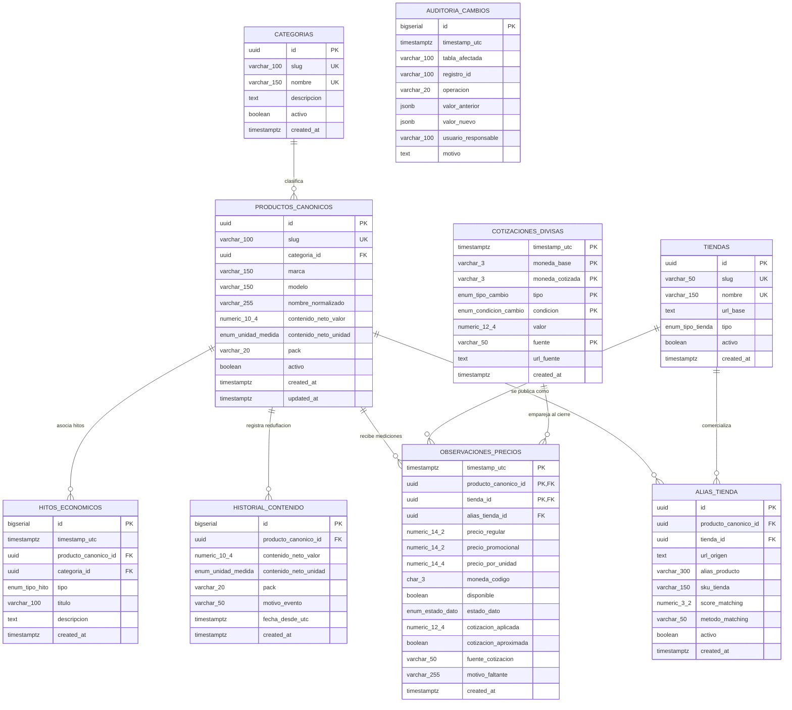

<p align="center">
  
</p>

# Especificación del Modelo de Datos y Esquema TimescaleDB
**PriceScope — Monitor de Inflación Real Multimoneda**  
*Plataforma B2B de Analítica Económica e Inteligencia de Mercado*

---

## Metadatos del Documento

| Atributo | Detalle Oficial |
| :--- | :--- |
| **Código del Documento** | `DMD-PRICESCOPE-V1.0` |
| **Proyecto** | PriceScope — Monitor de Inflación Real Multimoneda |
| **Organización / Programa** | Simulación Laboral Abierta — NoCountry |
| **Sector de Negocio** | FinTech / Analítica Económica (B2B Analytics) |
| **Versión** | 1.1 (Oficial para Revisión y Aprobación Técnica) |
| **Fecha de Emisión** | 16 de Octubre de 2026 |
| **Ubicación en Repositorio** | `docs/01-analisis/03-Data-Model-TimescaleDB.md` |
| **Documentos Vinculantes** | `01-SRS-PriceScope.md`, `02-API-Contracts-OpenAPI.md`, `04-Business-Rules-Math-Logic.md` |
| **Estado** | En Revisión y Aprobación Técnica |

---

## Control de Cambios y Aprobación Formal (Sign-Off)

### HISTORIAL DE VERSIONES
| Versión | Fecha | Autor | Descripción del Cambio |
| :--- | :--- | :--- | :--- |
| 0.1 | 2026-10-12 | Equipo PriceScope | Borrador preliminar de tablas relacionales. |
| 0.2 | 2026-10-15 | Alejandro Hernández OReilly | Propuesta técnica base con constraints de URL y estructura inicial de listings. |
| 1.0 | 2026-10-16 | Juan Camilo García | Consolidación oficial: Unificación a UUIDs contra ataques IDOR, validación de esquemas anti-cero (RN-04), normalización métrica desacoplada de empaque (RN-05), continuous aggregates para downsampling (HU-47) y soporte idempotente para seed.json (HU-00). |
| 1.1 | 2026-10-16 | Equipo PriceScope | Alineación total 100% con 01-SRS: formalización de la persistencia directa (bulk insert) sin API para Fase 1, mapeo explícito de `estado_captura` del DTO a la columna `estado_dato`, y equivalencia de `tipo_cambio_usado` (SRS HU-24) con `cotizacion_aplicada`. |

### ACTA DE APROBACIÓN TÉCNICA (SIGN-OFF)
La firma de este apartado certifica el diseño del modelo de base de datos como vinculante para las células técnicas que interactúan con el esquema de persistencia durante el ciclo de desarrollo.

| Rol | Nombre | Célula | Estado | Firma / Fecha |
| :--- | :--- | :--- | :--- | :--- |
| **Backend & DB Lead** | Luis Feliz | `E-API` | Pendiente | [ &nbsp;&nbsp;&nbsp;&nbsp; / &nbsp;&nbsp;&nbsp;&nbsp; / 2026 ] |
| **Scraping Lead** | Alejandro Hernández OReilly | `E-Scrapper` | Pendiente | [ &nbsp;&nbsp;&nbsp;&nbsp; / &nbsp;&nbsp;&nbsp;&nbsp; / 2026 ] |
| **Tech Lead / PO Review** | Gonzalo Cecchín | `E-QA` | Pendiente | [ &nbsp;&nbsp;&nbsp;&nbsp; / &nbsp;&nbsp;&nbsp;&nbsp; / 2026 ] |

---

## 1. Principios de Arquitectura, Seguridad y Calidad de Datos

El modelo de datos de PriceScope está implementado sobre **PostgreSQL 15+** potenciado por el motor de series temporales **TimescaleDB 2.x**. Su diseño resuelve integralmente las necesidades de concurrencia masiva (más de 10.000 observaciones diarias) bajo cinco principios rectores:

1. **Seguridad y Mitigación de Ataques IDOR (Uso de UUIDs):**  
   Para proteger los endpoints de lectura públicos del frontend (`/api/v1/products/{id}/traceability`) de ataques de enumeración masiva (Insecure Direct Object References), todas las tablas maestras emplean identificadores de tipo `UUID` autogenerados mediante `gen_random_uuid()`. Para mantener la idempotencia en la carga del archivo semilla (HU-00), se preserva un campo `slug VARCHAR UNIQUE` como clave natural de negocio.
2. **Cumplimiento Estricto Anti-Cero y Consistencia de Estados (RN-04):**  
   Se prohíbe persistir o exponer el valor `0` ante caídas de red, quiebres de stock u omisiones de captura. Mediante una restricción de chequeo a nivel de esquema (`chk_consistencia_dato`), un registro solo puede tener precio no nulo si su estado es `DATO_VALIDO`. Si el estado es `AGOTADO`, `ERROR_CAPTURA` o `SIN_DATO`, los campos de precio deben ser estrictamente `NULL`.
3. **Persistencia Append-Only e Inmutabilidad Forense (HU-17, HU-41):**  
   La hypertable de observaciones opera exclusivamente bajo inserciones secuenciales cronológicas. Queda deshabilitada la sentencia `UPDATE` para registros históricos. Cualquier reasignación o corrección genera una entrada en la tabla inmutable de auditoría.
4. **Desacoplamiento de Contenido y Normalización Métrica (RN-05, HU-07, HU-16):**  
   Se desacopla el valor cuantitativo (`contenido_neto_valor`), la unidad física base (`enum_unidad_medida`: `kg`, `L`, `unidad`) y la configuración comercial (`pack`: `x1`, `x3`, etc.). Esto garantiza el cálculo homogéneo de precios por unidad y habilita la detección de reduflación (HU-15).
5. **Validación de Protocolos Web (Aporte Célula Scraping):**  
   Se integran expresiones regulares para asegurar que toda URL de tienda y publicación comience estrictamente bajo protocolo seguro `^https?://`.

---

## 2. Diagrama Entidad-Relación (DER Físico y Lógico)


## 3. Diccionario de Datos y Tipos Personalizados

### 3.1 Tipos Enumerados (ENUMs)

```sql
-- Clasificación sectorial del comercio (HU-01)
CREATE TYPE enum_tipo_tienda AS ENUM (
    'supermercado', 
    'electro'
);

-- Unidades físicas de medida normalizada (RN-05 / Anexo B)
CREATE TYPE enum_unidad_medida AS ENUM (
    'kg', 
    'L', 
    'unidad'
);

-- Taxonomía estricta de estados de captura y faltantes (RN-04 / Anexo A)
CREATE TYPE enum_estado_dato AS ENUM (
    'DATO_VALIDO', 
    'AGOTADO', 
    'ERROR_CAPTURA', 
    'SIN_DATO'
);

-- Modalidades cambiarias soportadas (HU-20, HU-21)
CREATE TYPE enum_tipo_cambio AS ENUM (
    'oficial', 
    'parallel', 
    'mep', 
    'ccl'
);

-- Condición de transacción de divisas
CREATE TYPE enum_condicion_cambio AS ENUM (
    'venta', 
    'compra'
);

-- Naturaleza de eventos visuales (HU-38)
CREATE TYPE enum_tipo_hito AS ENUM (
    'AUTOMATICO', 
    'MANUAL'
);
```

---

### 3.2 Tablas Maestras Relacionales

#### Tabla: `categorias`
Clasificación de rubros para agregaciones macroeconómicas.

| Columna | Tipo de Dato | Nulo | Restricción / Default | Descripción |
| :--- | :--- | :--- | :--- | :--- |
| `id` | `UUID` | No | `PRIMARY KEY DEFAULT gen_random_uuid()` | Identificador universal inmutable contra IDOR. |
| `slug` | `VARCHAR(100)` | No | `UNIQUE` | Clave natural legible para el seed (ej. `'canasta-basica'`). |
| `nombre` | `VARCHAR(150)` | No | `UNIQUE` | Denominación oficial de la categoría. |
| `descripcion` | `TEXT` | Sí | `NULL` | Glosa descriptiva del alcance. |
| `activo` | `BOOLEAN` | No | `DEFAULT TRUE` | Estado de habilitación operativa. |
| `created_at` | `TIMESTAMPTZ` | No | `DEFAULT NOW()` | Fecha de registro en UTC. |

#### Tabla: `tiendas`
Comercios piloto de donde se extraen los precios (HU-01).

| Columna | Tipo de Dato | Nulo | Restricción / Default | Descripción |
| :--- | :--- | :--- | :--- | :--- |
| `id` | `UUID` | No | `PRIMARY KEY DEFAULT gen_random_uuid()` | Identificador universal inmutable contra IDOR. |
| `slug` | `VARCHAR(50)` | No | `UNIQUE` | Slug de negocio para seed (ej. `'carrefour'`, `'jumbo'`). |
| `nombre` | `VARCHAR(150)` | No | `UNIQUE` | Razón social o nombre comercial de la tienda. |
| `url_base` | `TEXT` | No | `CHECK (url_base ~ '^https?://')` | Dominio web protegido por validación regex. |
| `tipo` | `enum_tipo_tienda`| No | — | Clasificación: supermercado o electro. |
| `activo` | `BOOLEAN` | No | `DEFAULT TRUE` | Flag de activación para el crawler. |
| `created_at` | `TIMESTAMPTZ` | No | `DEFAULT NOW()` | Marca temporal de alta en UTC. |

#### Tabla: `productos_canonicos`
Entidad económica estandarizada e independiente de la tienda (HU-07).

| Columna | Tipo de Dato | Nulo | Restricción / Default | Descripción |
| :--- | :--- | :--- | :--- | :--- |
| `id` | `UUID` | No | `PRIMARY KEY DEFAULT gen_random_uuid()` | Identificador universal expuesto en la API. |
| `slug` | `VARCHAR(100)` | No | `UNIQUE` | Código semántico del seed (ej. `'prod-cafe-marcaA-500g'`). |
| `categoria_id` | `UUID` | No | `FK -> categorias(id)` | Categoría macro asociada. |
| `marca` | `VARCHAR(150)` | No | — | Fabricante oficial del bien. |
| `modelo` | `VARCHAR(150)` | Sí | `NULL` | Línea o modelo específico del artículo. |
| `nombre_normalizado`| `VARCHAR(255)` | No | — | Denominación homogénea limpia de promos. |
| `contenido_neto_valor`| `NUMERIC(10,4)`| No | `CHECK (contenido_neto_valor > 0)` | Magnitud cuantitativa física (ej. `0.5`, `1.0`). |
| `contenido_neto_unidad`| `enum_unidad_medida`| No | — | Unidad física: `kg`, `L` o `unidad`. |
| `pack` | `VARCHAR(20)` | No | `DEFAULT 'x1'` | Modalidad comercial: `x1`, `x3`, etc. (RN-05). |
| `activo` | `BOOLEAN` | No | `DEFAULT TRUE` | Disponibilidad del producto en los reportes. |
| `created_at` | `TIMESTAMPTZ` | No | `DEFAULT NOW()` | Fecha de registro en UTC. |
| `updated_at` | `TIMESTAMPTZ` | No | `DEFAULT NOW()` | Fecha de actualización en UTC. |

#### Tabla: `alias_tienda` (Store Listings)
Homologación de URLs y publicaciones individuales de cada comercio (HU-09).

| Columna | Tipo de Dato | Nulo | Restricción / Default | Descripción |
| :--- | :--- | :--- | :--- | :--- |
| `id` | `UUID` | No | `PRIMARY KEY DEFAULT gen_random_uuid()` | Identificador único del listing. |
| `producto_canonico_id`| `UUID` | No | `FK -> productos_canonicos(id)` | Canónico asignado. |
| `tienda_id` | `UUID` | No | `FK -> tiendas(id)` | Comercio emisor. |
| `url_origen` | `TEXT` | No | `CHECK (url_origen ~ '^https?://')` | URL directa validada por regex. |
| `alias_producto`| `VARCHAR(300)` | No | — | Título del producto publicado en la tienda. |
| `sku_tienda` | `VARCHAR(150)` | Sí | `NULL` | Código interno de stock de la tienda. |
| `score_matching`| `NUMERIC(3,2)` | Sí | `CHECK (score_matching BETWEEN 0 AND 1)` | Nivel de confianza algorítmico (HU-08). |
| `metodo_matching`| `VARCHAR(50)` | No | `DEFAULT 'MANUAL_SEED'` | Procedimiento: `'MANUAL_SEED'`, `'AUTOMATICO'`, etc. |
| `activo` | `BOOLEAN` | No | `DEFAULT TRUE` | Control para pausar la extracción de la URL. |
| `created_at` | `TIMESTAMPTZ` | No | `DEFAULT NOW()` | Marca temporal de alta en UTC. |

*Restricciones de unicidad:*  
* `UNIQUE (tienda_id, url_origen)` para impedir URLs duplicadas por comercio (HU-06).  
* `UNIQUE (tienda_id, sku_tienda)` para evitar colisiones de identificadores comerciales.

#### Tabla: `historial_contenido`
Bitácora de seguimiento de gramajes para detección de reduflación (HU-15).

| Columna | Tipo de Dato | Nulo | Restricción / Default | Descripción |
| :--- | :--- | :--- | :--- | :--- |
| `id` | `BIGSERIAL` | No | `PRIMARY KEY` | Secuencia inmutable del evento. |
| `producto_canonico_id`| `UUID` | No | `FK -> productos_canonicos(id)` | Canónico modificado. |
| `contenido_neto_valor`| `NUMERIC(10,4)`| No | `CHECK (contenido_neto_valor > 0)` | Magnitud alterada de la presentación. |
| `contenido_neto_unidad`| `enum_unidad_medida`| No | — | Unidad física de medición. |
| `pack` | `VARCHAR(20)` | No | `DEFAULT 'x1'` | Empaque comercial. |
| `motivo_evento`| `VARCHAR(50)` | No | `DEFAULT 'REDUFLACION'` | Razón: `'REDUFLACION'`, `'REEMPAQUE'`. |
| `fecha_desde_utc`| `TIMESTAMPTZ` | No | — | Inicio de vigencia del nuevo gramaje. |
| `created_at` | `TIMESTAMPTZ` | No | `DEFAULT NOW()` | Fecha de registro en UTC. |

---

### 3.3 Hypertables de Series Temporales (TimescaleDB)

#### Tabla Hypertable: `observaciones_precios`
Núcleo del sistema: captura cronológica append-only de cotizaciones comerciales (HU-03, HU-04, HU-14, HU-17, HU-18).

| Columna | Tipo de Dato | Nulo | Restricción / Default | Descripción |
| :--- | :--- | :--- | :--- | :--- |
| `timestamp_utc` | `TIMESTAMPTZ` | No | **Clave de particionamiento** | Marca temporal exacta de extracción en UTC (RN-01). |
| `producto_canonico_id`| `UUID` | No | `FK -> productos_canonicos(id)` | Canónico asignado. |
| `tienda_id` | `UUID` | No | `FK -> tiendas(id)` | Comercio emisor de la observación. |
| `alias_tienda_id`| `UUID` | Sí | `FK -> alias_tienda(id)` | Enlace a la URL específica extraída. |
| `precio_regular`| `NUMERIC(14,2)`| Sí | `CHECK (precio_regular IS NULL OR precio_regular > 0)` | Precio de lista. Prohibido el `0` (RN-04). |
| `precio_promocional`| `NUMERIC(14,2)`| Sí | `CHECK (precio_promocional IS NULL OR precio_promocional > 0)` | Precio de oferta puntual o `NULL` si no hay promo (HU-12). |
| `precio_por_unidad`| `NUMERIC(14,4)`| Sí | `CHECK (precio_por_unidad IS NULL OR precio_por_unidad > 0)` | Precio métrico en $/kg, $/L o \$/unidad (HU-16). |
| `moneda_codigo` | `CHAR(3)` | No | `DEFAULT 'ARS'` | Código de moneda local bajo norma ISO 4217. |
| `disponible` | `BOOLEAN` | No | `DEFAULT TRUE` | Disponibilidad física para compra (HU-14). |
| `estado_dato` | `enum_estado_dato`| No | — | Estado: `DATO_VALIDO`, `AGOTADO`, `ERROR_CAPTURA`, `SIN_DATO`. |
| `cotizacion_aplicada`| `NUMERIC(12,4)`| Sí | `CHECK (cotizacion_aplicada IS NULL OR cotizacion_aplicada > 0)` | Tipo de cambio fijado al cierre del mercado (HU-23, HU-24). |
| `cotizacion_aproximada`| `BOOLEAN` | No | `DEFAULT FALSE` | `TRUE` si proviene del fallback de 72h (RN-03, HU-22). |
| `fuente_cotizacion`| `VARCHAR(50)` | Sí | `NULL` | Fuente cambiaria (ej. `'DolarAPI_Blue'`, `'BCRA_Cierre'`). |
| `motivo_faltante`| `VARCHAR(255)`| Sí | `NULL` | Causa forense del quiebre de stock o fallo técnico. |
| `created_at` | `TIMESTAMPTZ` | No | `DEFAULT NOW()` | Timestamp de inserción física. |

*Clave Primaria Compuesta:* `PRIMARY KEY (timestamp_utc, producto_canonico_id, tienda_id)`.  
*Constraint Obligatorio Anti-Cero (RN-04):*
```sql
CONSTRAINT chk_consistencia_dato CHECK (
    (estado_dato = 'DATO_VALIDO' AND precio_regular IS NOT NULL AND precio_regular > 0 AND disponible = TRUE) OR
    (estado_dato IN ('AGOTADO', 'ERROR_CAPTURA', 'SIN_DATO') AND precio_regular IS NULL AND precio_promocional IS NULL)
)
```

#### Tabla Hypertable: `cotizaciones_divisas`
Almacenamiento de cotizaciones financieras horarias multimoneda (HU-20, HU-21).

| Columna | Tipo de Dato | Nulo | Restricción / Default | Descripción |
| :--- | :--- | :--- | :--- | :--- |
| `timestamp_utc` | `TIMESTAMPTZ` | No | **Clave de particionamiento** | Marca temporal de la divisa en UTC. |
| `moneda_base` | `VARCHAR(3)` | No | `DEFAULT 'USD'` | Moneda de referencia internacional. |
| `moneda_cotizada`| `VARCHAR(3)` | No | `DEFAULT 'ARS'` | Moneda local. |
| `tipo` | `enum_tipo_cambio`| No | — | Segmento: oficial, parallel (blue), mep, ccl. |
| `condicion` | `enum_condicion_cambio`| No | `DEFAULT 'venta'` | Condición comercial: venta o compra. |
| `valor` | `NUMERIC(12,4)`| No | `CHECK (valor > 0)` | Tasa de cambio nominal. |
| `fuente` | `VARCHAR(50)` | No | — | Proveedor: `'DolarAPI'`, `'Bluelytics'`, etc. |
| `url_fuente` | `TEXT` | Sí | `CHECK (url_fuente IS NULL OR url_fuente ~ '^https?://')` | Endpoint o URL de consulta financiera. |
| `created_at` | `TIMESTAMPTZ` | No | `DEFAULT NOW()` | Fecha de registro en UTC. |

*Clave Primaria Compuesta:* `PRIMARY KEY (timestamp_utc, moneda_base, moneda_cotizada, tipo, condicion, fuente)`.

---

### 3.4 Tablas de Auditoría e Hitos

#### Tabla: `hitos_economicos`
Marcadores de contexto analítico para gráficos ejecutivos (HU-38).

| Columna | Tipo de Dato | Nulo | Restricción / Default | Descripción |
| :--- | :--- | :--- | :--- | :--- |
| `id` | `BIGSERIAL` | No | `PRIMARY KEY` | Secuencia identificadora del marcador. |
| `timestamp_utc` | `TIMESTAMPTZ` | No | — | Posición temporal exacta sobre el eje de tiempo. |
| `producto_canonico_id`| `UUID` | Sí | `FK -> productos_canonicos(id)` | Canónico asignado (`NULL` si es un hito general). |
| `categoria_id` | `UUID` | Sí | `FK -> categorias(id)` | Categoría asociada (`NULL` si abarca todo el mercado). |
| `tipo` | `enum_tipo_hito` | No | `DEFAULT 'AUTOMATICO'` | Naturaleza del evento: `'AUTOMATICO'` o `'MANUAL'`. |
| `titulo` | `VARCHAR(100)` | No | — | Título del hito: `'Reduflación'`, `'CyberWeek'`, etc. |
| `descripcion` | `TEXT` | No | — | Detalle explicativo expuesto en el tooltip. |
| `created_at` | `TIMESTAMPTZ` | No | `DEFAULT NOW()` | Marca temporal de alta en UTC. |

#### Tabla: `auditoria_cambios`
Bitácora forense append-only para trazabilidad y curaduría (HU-11, HU-41).

| Columna | Tipo de Dato | Nulo | Restricción / Default | Descripción |
| :--- | :--- | :--- | :--- | :--- |
| `id` | `BIGSERIAL` | No | `PRIMARY KEY` | Secuencia de auditoría. |
| `timestamp_utc` | `TIMESTAMPTZ` | No | `DEFAULT NOW()` | Momento del cambio en UTC. |
| `tabla_afectada` | `VARCHAR(100)` | No | — | Tabla modificada (`alias_tienda`, `productos_canonicos`, etc.). |
| `registro_id` | `VARCHAR(100)` | No | — | UUID o clave del registro alterado. |
| `operacion` | `VARCHAR(20)` | No | — | Acción: `'INSERT'`, `'UPDATE'`, `'REASSIGN'`, `'EXCLUSION'`. |
| `valor_anterior` | `JSONB` | Sí | `NULL` | Snapshot JSON del estado previo. |
| `valor_nuevo` | `JSONB` | Sí | `NULL` | Snapshot JSON resultante. |
| `usuario_responsable`| `VARCHAR(100)`| No | — | Identificador del analista u operador. |
| `motivo` | `TEXT` | No | — | Justificación técnica obligatoria. |

---

## 4. Script DDL Oficial de Referencia (PostgreSQL + TimescaleDB)

```sql
-- ============================================================================
-- 00. EXTENSIONES REQUERIDAS
-- ============================================================================
CREATE EXTENSION IF NOT EXISTS "uuid-ossp";
CREATE EXTENSION IF NOT EXISTS timescaledb CASCADE;

-- ============================================================================
-- 01. CREACIÓN DE ENUMS
-- ============================================================================
CREATE TYPE enum_tipo_tienda AS ENUM ('supermercado', 'electro');
CREATE TYPE enum_unidad_medida AS ENUM ('kg', 'L', 'unidad');
CREATE TYPE enum_estado_dato AS ENUM ('DATO_VALIDO', 'AGOTADO', 'ERROR_CAPTURA', 'SIN_DATO');
CREATE TYPE enum_tipo_cambio AS ENUM ('oficial', 'parallel', 'mep', 'ccl');
CREATE TYPE enum_condicion_cambio AS ENUM ('venta', 'compra');
CREATE TYPE enum_tipo_hito AS ENUM ('AUTOMATICO', 'MANUAL');

-- ============================================================================
-- 02. TABLAS MAESTRAS RELACIONALES (CON UUIDs Y SLUGS DETERMINÍSTICOS)
-- ============================================================================
CREATE TABLE categorias (
    id UUID PRIMARY KEY DEFAULT gen_random_uuid(),
    slug VARCHAR(100) NOT NULL UNIQUE,
    nombre VARCHAR(150) NOT NULL UNIQUE,
    descripcion TEXT,
    activo BOOLEAN NOT NULL DEFAULT TRUE,
    created_at TIMESTAMPTZ NOT NULL DEFAULT NOW()
);

CREATE TABLE tiendas (
    id UUID PRIMARY KEY DEFAULT gen_random_uuid(),
    slug VARCHAR(50) NOT NULL UNIQUE,
    nombre VARCHAR(150) NOT NULL UNIQUE,
    url_base TEXT NOT NULL,
    tipo enum_tipo_tienda NOT NULL,
    activo BOOLEAN NOT NULL DEFAULT TRUE,
    created_at TIMESTAMPTZ NOT NULL DEFAULT NOW(),
    CONSTRAINT ck_tiendas_url_base CHECK (url_base ~ '^https?://')
);

CREATE TABLE productos_canonicos (
    id UUID PRIMARY KEY DEFAULT gen_random_uuid(),
    slug VARCHAR(100) NOT NULL UNIQUE,
    categoria_id UUID NOT NULL REFERENCES categorias(id) ON DELETE RESTRICT,
    marca VARCHAR(150) NOT NULL,
    modelo VARCHAR(150),
    nombre_normalizado VARCHAR(255) NOT NULL,
    contenido_neto_valor NUMERIC(10, 4) NOT NULL CHECK (contenido_neto_valor > 0),
    contenido_neto_unidad enum_unidad_medida NOT NULL,
    pack VARCHAR(20) NOT NULL DEFAULT 'x1',
    activo BOOLEAN NOT NULL DEFAULT TRUE,
    created_at TIMESTAMPTZ NOT NULL DEFAULT NOW(),
    updated_at TIMESTAMPTZ NOT NULL DEFAULT NOW()
);

CREATE TABLE alias_tienda (
    id UUID PRIMARY KEY DEFAULT gen_random_uuid(),
    producto_canonico_id UUID NOT NULL REFERENCES productos_canonicos(id) ON DELETE RESTRICT,
    tienda_id UUID NOT NULL REFERENCES tiendas(id) ON DELETE RESTRICT,
    url_origen TEXT NOT NULL,
    alias_producto VARCHAR(300) NOT NULL,
    sku_tienda VARCHAR(150),
    score_matching NUMERIC(3, 2) CHECK (score_matching BETWEEN 0 AND 1),
    metodo_matching VARCHAR(50) NOT NULL DEFAULT 'MANUAL_SEED',
    activo BOOLEAN NOT NULL DEFAULT TRUE,
    created_at TIMESTAMPTZ NOT NULL DEFAULT NOW(),
    CONSTRAINT ck_alias_url_origen CHECK (url_origen ~ '^https?://'),
    CONSTRAINT uq_alias_tienda_url UNIQUE (tienda_id, url_origen),
    CONSTRAINT uq_alias_tienda_sku UNIQUE (tienda_id, sku_tienda)
);

CREATE TABLE historial_contenido (
    id BIGSERIAL PRIMARY KEY,
    producto_canonico_id UUID NOT NULL REFERENCES productos_canonicos(id) ON DELETE RESTRICT,
    contenido_neto_valor NUMERIC(10, 4) NOT NULL CHECK (contenido_neto_valor > 0),
    contenido_neto_unidad enum_unidad_medida NOT NULL,
    pack VARCHAR(20) NOT NULL DEFAULT 'x1',
    motivo_evento VARCHAR(50) NOT NULL DEFAULT 'REDUFLACION',
    fecha_desde_utc TIMESTAMPTZ NOT NULL,
    created_at TIMESTAMPTZ NOT NULL DEFAULT NOW()
);

-- ============================================================================
-- 03. TABLAS TEMPORALES PREVIAS A HIPERTABLAS
-- ============================================================================
CREATE TABLE observaciones_precios (
    timestamp_utc TIMESTAMPTZ NOT NULL,
    producto_canonico_id UUID NOT NULL REFERENCES productos_canonicos(id) ON DELETE RESTRICT,
    tienda_id UUID NOT NULL REFERENCES tiendas(id) ON DELETE RESTRICT,
    alias_tienda_id UUID REFERENCES alias_tienda(id) ON DELETE RESTRICT,
    precio_regular NUMERIC(14, 2) CHECK (precio_regular IS NULL OR precio_regular > 0),
    precio_promocional NUMERIC(14, 2) CHECK (precio_promocional IS NULL OR precio_promocional > 0),
    precio_por_unidad NUMERIC(14, 4) CHECK (precio_por_unidad IS NULL OR precio_por_unidad > 0),
    moneda_codigo CHAR(3) NOT NULL DEFAULT 'ARS',
    disponible BOOLEAN NOT NULL DEFAULT TRUE,
    estado_dato enum_estado_dato NOT NULL,
    cotizacion_aplicada NUMERIC(12, 4) CHECK (cotizacion_aplicada IS NULL OR cotizacion_aplicada > 0),
    cotizacion_aproximada BOOLEAN NOT NULL DEFAULT FALSE,
    fuente_cotizacion VARCHAR(50),
    motivo_faltante VARCHAR(255),
    created_at TIMESTAMPTZ NOT NULL DEFAULT NOW(),
    PRIMARY KEY (timestamp_utc, producto_canonico_id, tienda_id),
    -- Regla de Integridad Anti-Cero (RN-04):
    CONSTRAINT chk_consistencia_dato CHECK (
        (estado_dato = 'DATO_VALIDO' AND precio_regular IS NOT NULL AND precio_regular > 0 AND disponible = TRUE) OR
        (estado_dato IN ('AGOTADO', 'ERROR_CAPTURA', 'SIN_DATO') AND precio_regular IS NULL AND precio_promocional IS NULL)
    )
);

CREATE TABLE cotizaciones_divisas (
    timestamp_utc TIMESTAMPTZ NOT NULL,
    moneda_base VARCHAR(3) NOT NULL DEFAULT 'USD',
    moneda_cotizada VARCHAR(3) NOT NULL DEFAULT 'ARS',
    tipo enum_tipo_cambio NOT NULL,
    condicion enum_condicion_cambio NOT NULL DEFAULT 'venta',
    valor NUMERIC(12, 4) NOT NULL CHECK (valor > 0),
    fuente VARCHAR(50) NOT NULL,
    url_fuente TEXT,
    created_at TIMESTAMPTZ NOT NULL DEFAULT NOW(),
    PRIMARY KEY (timestamp_utc, moneda_base, moneda_cotizada, tipo, condicion, fuente),
    CONSTRAINT ck_divisas_url CHECK (url_fuente IS NULL OR url_fuente ~ '^https?://')
);

-- ============================================================================
-- 04. CONVERSIÓN A HYPERTABLES (TimescaleDB)
-- ============================================================================
SELECT create_hypertable(
    'observaciones_precios', 
    'timestamp_utc', 
    chunk_time_interval => INTERVAL '7 days',
    if_not_exists => TRUE
);

SELECT create_hypertable(
    'cotizaciones_divisas', 
    'timestamp_utc', 
    chunk_time_interval => INTERVAL '30 days',
    if_not_exists => TRUE
);

-- ============================================================================
-- 05. TABLAS DE HITOS Y AUDITORÍA
-- ============================================================================
CREATE TABLE hitos_economicos (
    id BIGSERIAL PRIMARY KEY,
    timestamp_utc TIMESTAMPTZ NOT NULL,
    producto_canonico_id UUID REFERENCES productos_canonicos(id) ON DELETE SET NULL,
    categoria_id UUID REFERENCES categorias(id) ON DELETE SET NULL,
    tipo enum_tipo_hito NOT NULL DEFAULT 'AUTOMATICO',
    titulo VARCHAR(100) NOT NULL,
    descripcion TEXT NOT NULL,
    created_at TIMESTAMPTZ NOT NULL DEFAULT NOW()
);

CREATE TABLE auditoria_cambios (
    id BIGSERIAL PRIMARY KEY,
    timestamp_utc TIMESTAMPTZ NOT NULL DEFAULT NOW(),
    tabla_afectada VARCHAR(100) NOT NULL,
    registro_id VARCHAR(100) NOT NULL,
    operacion VARCHAR(20) NOT NULL,
    valor_anterior JSONB,
    valor_nuevo JSONB,
    usuario_responsable VARCHAR(100) NOT NULL,
    motivo TEXT NOT NULL
);

-- ============================================================================
-- 06. ÍNDICES DE ALTO RENDIMIENTO
-- ============================================================================
CREATE INDEX idx_obs_producto_time ON observaciones_precios (producto_canonico_id, timestamp_utc DESC);
CREATE INDEX idx_obs_tienda_time ON observaciones_precios (tienda_id, timestamp_utc DESC);
CREATE INDEX idx_obs_listing_time ON observaciones_precios (alias_tienda_id, timestamp_utc DESC);
CREATE INDEX idx_cotizaciones_tipo_time ON cotizaciones_divisas (tipo, timestamp_utc DESC);
CREATE INDEX idx_alias_url ON alias_tienda (url_origen);
CREATE INDEX idx_alias_canonico ON alias_tienda (producto_canonico_id);
CREATE INDEX idx_hitos_producto_time ON hitos_economicos (producto_canonico_id, timestamp_utc DESC);

-- ============================================================================
-- 07. POLÍTICA DE COMPRESIÓN (TimescaleDB)
-- ============================================================================
ALTER TABLE observaciones_precios SET (
    timescaledb.compress,
    timescaledb.compress_segmentby = 'producto_canonico_id, tienda_id',
    timescaledb.compress_orderby = 'timestamp_utc DESC'
);

SELECT add_compression_policy('observaciones_precios', INTERVAL '30 days');
```

---

## 5. Lógica de Base de Datos para Reglas de Negocio

### 5.1 Downsampling Algorítmico (HU-47) con Continuous Aggregates
Para cumplir con la **HU-47** y garantizar que consultas superiores a 90 días no excedan 52 puntos anuales (renderizado a 60 FPS), TimescaleDB consolida agregaciones semanales utilizando la mediana:

```sql
CREATE MATERIALIZED VIEW agg_precios_semanales
WITH (timescaledb.continuous) AS
SELECT 
    time_bucket('1 week', timestamp_utc) AS semana_utc,
    producto_canonico_id,
    tienda_id,
    percentile_cont(0.5) WITHIN GROUP (ORDER BY precio_regular) AS precio_regular_mediana,
    percentile_cont(0.5) WITHIN GROUP (ORDER BY precio_por_unidad) AS precio_unidad_mediana,
    percentile_cont(0.5) WITHIN GROUP (ORDER BY (precio_regular / cotizacion_aplicada)) AS precio_usd_mediana,
    COUNT(*) FILTER (WHERE estado_dato = 'DATO_VALIDO') AS mediciones_validas,
    COUNT(*) FILTER (WHERE estado_dato = 'AGOTADO') AS mediciones_agotado,
    COUNT(*) FILTER (WHERE estado_dato = 'ERROR_CAPTURA') AS mediciones_error
FROM observaciones_precios
GROUP BY semana_utc, producto_canonico_id, tienda_id
WITH NO DATA;

-- Política de refresco automático
SELECT add_continuous_aggregate_policy('agg_precios_semanales',
    start_offset => INTERVAL '1 month',
    end_offset => INTERVAL '1 day',
    schedule_interval => INTERVAL '1 day');
```

---

### 5.2 Consulta para la Mediana por Categoría (RN-02 / HU-30)
Para entregar la variación acumulada por categoría sin distorsiones por artículos con subidas desproporcionadas (outliers):

```sql
WITH variaciones_individuales AS (
    SELECT 
        p.categoria_id,
        o_fin.producto_canonico_id,
        ((o_fin.precio_regular - o_ini.precio_regular) / o_ini.precio_regular) * 100.0 AS variacion_pct
    FROM observaciones_precios o_ini
    JOIN observaciones_precios o_fin 
      ON o_ini.producto_canonico_id = o_fin.producto_canonico_id 
     AND o_ini.tienda_id = o_fin.tienda_id
    JOIN productos_canonicos p 
      ON o_ini.producto_canonico_id = p.id
    WHERE o_ini.timestamp_utc::DATE = '2026-09-15'::DATE
      AND o_fin.timestamp_utc::DATE = '2026-10-15'::DATE
      AND o_ini.estado_dato = 'DATO_VALIDO'
      AND o_fin.estado_dato = 'DATO_VALIDO'
)
SELECT 
    categoria_id,
    ROUND(percentile_cont(0.5) WITHIN GROUP (ORDER BY variacion_pct)::numeric, 2) AS variacion_mediana_pct,
    COUNT(*) AS cantidad_productos,
    ROUND((COUNT(*)::numeric / NULLIF(c.total_esperado, 0)) * 100.0, 1) AS cobertura_pct
FROM variaciones_individuales v
LEFT JOIN (
    SELECT categoria_id, COUNT(*) AS total_esperado 
    FROM productos_canonicos WHERE activo = TRUE GROUP BY categoria_id
) c USING (categoria_id)
GROUP BY categoria_id, c.total_esperado;
```

---

### 5.3 Lógica de Sincronización Cambiaria "Cierre del Día" y Fallback TTL 72h (RN-01, RN-03, HU-22, HU-23)
Función que localiza la última cotización previa a las 23:59:59 de la hora local (ART = UTC-3) con ventana límite de 72 horas:

```sql
CREATE OR REPLACE FUNCTION fn_obtener_cotizacion_cierre(
    p_fecha_captura TIMESTAMPTZ,
    p_tipo_cambio enum_tipo_cambio DEFAULT 'parallel'
)
RETURNS TABLE (
    cotizacion_aplicada NUMERIC(12,4),
    cotizacion_aproximada BOOLEAN,
    fuente_cotizacion VARCHAR(50),
    estado_sincronizacion VARCHAR(20)
) AS $$
DECLARE
    v_cierre_local_utc TIMESTAMPTZ;
    v_limite_ttl_utc TIMESTAMPTZ;
BEGIN
    -- 1. Calcular las 23:59:59 de la fecha de captura en hora de Argentina (ART = UTC-3) convertida a UTC
    v_cierre_local_utc := (
        (timezone('America/Argentina/Buenos_Aires', p_fecha_captura)::DATE || ' 23:59:59')::TIMESTAMP
    ) AT TIME ZONE 'America/Argentina/Buenos_Aires';

    -- 2. Fijar ventana de tolerancia máxima de 72 horas (RN-03 / HU-22)
    v_limite_ttl_utc := v_cierre_local_utc - INTERVAL '72 hours';

    -- 3. Buscar cotización de cierre dentro del rango
    RETURN QUERY
    SELECT 
        c.valor,
        (c.timestamp_utc < (v_cierre_local_utc - INTERVAL '24 hours')) AS cotizacion_aproximada,
        c.fuente,
        'OK'::VARCHAR(20) AS estado_sincronizacion
    FROM cotizaciones_divisas c
    WHERE c.tipo = p_tipo_cambio
      AND c.condicion = 'venta'
      AND c.timestamp_utc <= v_cierre_local_utc
      AND c.timestamp_utc >= v_limite_ttl_utc
    ORDER BY c.timestamp_utc DESC
    LIMIT 1;

    -- 4. Si supera las 72h sin cotización, retorna nulo (provocando SIN_DATO en el backend)
    IF NOT FOUND THEN
        RETURN QUERY SELECT NULL::NUMERIC(12,4), FALSE, NULL::VARCHAR(50), 'SIN_DATO'::VARCHAR(20);
    END IF;
END;
$$ LANGUAGE plpgsql STABLE;
```

---

## 6. Especificación del Archivo Semilla (`seed.json`) y Migración (HU-00)

### 6.1 Estructura Oficial de `seed.json`
El archivo reside en `data/seed.json` y utiliza los slugs semánticos para la vinculación determinística:

```json
{
  "version_schema": "1.0",
  "tiendas_piloto": [
    { "slug": "carrefour", "nombre": "Carrefour", "url_base": "https://www.carrefour.com.ar", "tipo": "supermercado" },
    { "slug": "jumbo", "nombre": "Jumbo", "url_base": "https://www.jumbo.com.ar", "tipo": "supermercado" },
    { "slug": "fravega", "nombre": "Frávega", "url_base": "https://www.fravega.com", "tipo": "electro" },
    { "slug": "musimundo", "nombre": "Musimundo", "url_base": "https://www.musimundo.com", "tipo": "electro" }
  ],
  "categorias": [
    { "slug": "canasta-basica", "nombre": "Canasta Básica", "descripcion": "Alimentos y artículos de primera necesidad" },
    { "slug": "bienes-durables", "nombre": "Bienes Durables", "descripcion": "Electrodomésticos y tecnología para el hogar" }
  ],
  "productos_canonicos": [
    {
      "slug": "prod-cafe-marcaA-500g",
      "categoria_slug": "canasta-basica",
      "marca": "Marca A",
      "modelo": null,
      "nombre_normalizado": "Café tostado molido clásico",
      "contenido_neto": {
        "valor": 0.5,
        "unidad": "kg"
      },
      "pack": "x1",
      "tiendas": [
        {
          "tienda_slug": "carrefour",
          "alias_producto": "Café molido Marca A 500g",
          "sku_tienda": "CAR-12345",
          "url_origen": "https://www.carrefour.com.ar/cafe-molido-marca-a-500g"
        },
        {
          "tienda_slug": "jumbo",
          "alias_producto": "Café tostado molido Marca A paq 500 gr",
          "sku_tienda": "JUM-98765",
          "url_origen": "https://www.jumbo.com.ar/cafe-tostado-molido-marca-a-paq-500-gr"
        }
      ]
    },
    {
      "slug": "prod-smarttv-marcaB-55",
      "categoria_slug": "bienes-durables",
      "marca": "Marca B",
      "modelo": "B-55-4K",
      "nombre_normalizado": "Smart TV 55 pulgadas 4K UHD",
      "contenido_neto": {
        "valor": 1.0,
        "unidad": "unidad"
      },
      "pack": "x1",
      "tiendas": [
        {
          "tienda_slug": "fravega",
          "alias_producto": "Smart TV Marca B 55 4K UHD",
          "sku_tienda": "FRA-55443",
          "url_origen": "https://www.fravega.com/smart-tv-marca-b-55-4k"
        },
        {
          "tienda_slug": "musimundo",
          "alias_producto": "Televisor Smart TV B 55 pulgadas UHD",
          "sku_tienda": "MUS-11223",
          "url_origen": "https://www.musimundo.com/tv-marca-b-55"
        }
      ]
    }
  ]
}
```

### 6.2 Procedimiento de Migración Idempotente por Claves Semánticas

```sql
-- 1. Inserción de Categorías
INSERT INTO categorias (slug, nombre, descripcion)
VALUES ('canasta-basica', 'Canasta Básica', 'Alimentos y artículos de primera necesidad')
ON CONFLICT (slug) DO UPDATE SET nombre = EXCLUDED.nombre;

-- 2. Inserción de Tiendas Piloto
INSERT INTO tiendas (slug, nombre, url_base, tipo)
VALUES ('carrefour', 'Carrefour', 'https://www.carrefour.com.ar', 'supermercado')
ON CONFLICT (slug) DO UPDATE SET url_base = EXCLUDED.url_base;

-- 3. Inserción de Canónicos vinculando el UUID por subquery
INSERT INTO productos_canonicos (slug, categoria_id, marca, modelo, nombre_normalizado, contenido_neto_valor, contenido_neto_unidad, pack)
VALUES (
    'prod-cafe-marcaA-500g', 
    (SELECT id FROM categorias WHERE slug = 'canasta-basica'), 
    'Marca A', 
    NULL, 
    'Café tostado molido clásico', 
    0.5, 
    'kg', 
    'x1'
)
ON CONFLICT (slug) DO UPDATE SET 
    nombre_normalizado = EXCLUDED.nombre_normalizado,
    contenido_neto_valor = EXCLUDED.contenido_neto_valor,
    updated_at = NOW();

-- 4. Inserción de Listings / Alias
INSERT INTO alias_tienda (producto_canonico_id, tienda_id, alias_producto, sku_tienda, url_origen, metodo_matching)
VALUES (
    (SELECT id FROM productos_canonicos WHERE slug = 'prod-cafe-marcaA-500g'),
    (SELECT id FROM tiendas WHERE slug = 'carrefour'),
    'Café molido Marca A 500g',
    'CAR-12345',
    'https://www.carrefour.com.ar/cafe-molido-marca-a-500g',
    'MANUAL_SEED'
)
ON CONFLICT (tienda_id, url_origen) DO UPDATE SET 
    alias_producto = EXCLUDED.alias_producto,
    sku_tienda = EXCLUDED.sku_tienda;
```

---

## 7. Matriz de Trazabilidad (SRS vs. Modelo de Datos)

| Requerimiento SRS | Objeto en Base de Datos | Atributo o Restricción | Propósito Técnico |
| :--- | :--- | :--- | :--- |
| **RN-01 / HU-04** | `observaciones_precios` | `timestamp_utc TIMESTAMPTZ` | Persistencia en UTC bajo norma ISO 8601. |
| **RN-01 / HU-23** | `observaciones_precios` | `cotizacion_aplicada`, `fn_obtener_cotizacion_cierre()` | Cruce cambiario al cierre local antes de las 23:59:59. |
| **RN-01 / HU-24** | `observaciones_precios` | `cotizacion_aplicada` (equiv. `tipo_cambio_usado` SRS) | Persistencia inmutable de la tasa de cambio efectivamente utilizada. |
| **RN-02 / HU-30** | Agregaciones API | `percentile_cont(0.5) WITHIN GROUP (...)` | Mediana por categoría sin distorsión por outliers. |
| **RN-03 / HU-22** | `observaciones_precios` | `cotizacion_aproximada BOOLEAN` | Indicador visual de advertencia por fallback de 72h. |
| **RN-04 / HU-14, 18**| `observaciones_precios` | `chk_consistencia_dato` | Prohibición del cero y obligatoriedad de valores nulos. |
| **RN-05 / HU-07, 15**| `productos_canonicos`, `historial_contenido` | `contenido_neto_valor`, `contenido_neto_unidad`, `pack` | Desacoplamiento métrico y registro de reduflación. |
| **RN-05 / HU-16** | `observaciones_precios` | `precio_por_unidad` | Valor normalizado en $/kg, $/L o $/unidad. |
| **RN-06 / HU-46** | Consultas API | `LIMIT 50 OFFSET ((page - 1) * 50)` | Paginación obligatoria contra bloqueo del navegador. |
| **RN-07 / HU-47** | `agg_precios_semanales`| `time_bucket('1 week', timestamp_utc)` | Continuous aggregate semanal para 60 FPS. |
| **HU-00** | Tablas Maestras | `slug VARCHAR UNIQUE` | Ingesta inicial determinística por `seed.json`. |
| **HU-06** | `alias_tienda` | `uq_alias_tienda_url UNIQUE` | Prevención de duplicados por comercio y URL. |
| **HU-11 / HU-41**| `auditoria_cambios` | `operacion`, `valor_anterior`, `valor_nuevo` | Bitácora inmutable append-only. |

---

## 8. Guía de Ejecución para las Células de Trabajo

### Para `E-Scrapper` (Alejandro, Anthony, Sebastian):
1. **Regla de Prioridad y Operación (Fase 1 vs. Fase 1.5):**  
   Durante la **Fase 1 (MVP Esencial)**, el scraper opera de forma autónoma: extrae los datos usando las URLs fijas precargadas desde `data/seed.json` o consultando los listings activos de `alias_tienda`, y **persiste directamente en la base de datos** mediante sentencias SQL masivas (`bulk insert`). No se utiliza ningún endpoint HTTP intermediario para evitar dependencias o bloqueos con el equipo de API. La migración hacia un endpoint `POST /api/v1/ingest/observations` solo se evaluará en la Fase 1.5 si resta tiempo tras completar el tablero.
2. **Extracción de Listings Activos:** Para saber qué URLs consultar, realizar la consulta:
```sql
SELECT a.id AS alias_id, a.url_origen, a.sku_tienda, p.id AS canonico_id, t.id AS tienda_id
FROM alias_tienda a
JOIN tiendas t ON a.tienda_id = t.id
JOIN productos_canonicos p ON a.producto_canonico_id = p.id
WHERE a.activo = TRUE AND t.slug = 'carrefour';
```
3. **Inserción Masiva (Bulk Insert) y Mapeo del DTO:** Al completar la recolección diaria, insertar directamente en `observaciones_precios`. El campo `estado_captura` del DTO de extracción se inserta de forma directa en la columna `estado_dato` de la base de datos.
4. **Manejo Estricto de Faltantes (RN-04):** Si una publicación no tiene stock, enviar `estado_dato = 'AGOTADO'`, `disponible = FALSE` y `precio_regular = NULL`. Si hay un error HTTP 5xx o bloqueo de red, enviar `estado_dato = 'ERROR_CAPTURA'` con precio `NULL`. **Nunca insertar precio en cero (`0`)**.

### Para `E-API` (Luis, Yenny):
1. **Inicialización del Schema:** Correr el script DDL de la Sección 4 sobre la base de datos PostgreSQL con TimescaleDB.
2. **Ejecución del Seed:** Implementar el script de carga que lea `data/seed.json` y ejecute las inserciones idempotentes detalladas en la Sección 6.2.
3. **Exposición de Contratos:** Construir los endpoints (`/dashboard`, `/alerts`, `/products/{id}/traceability`) garantizando que los UUIDs se expongan como identificadores primarios y que los datos temporales largos consuman la vista `agg_precios_semanales`.

### Para `E-F/UX/UI` (Juan Camilo García):
1. **Consumo de Identificadores UUID:** Tratar el campo `id` de las entidades maestras (`productos_canonicos`, `tiendas`) como cadenas UUID opacas para armar rutas dinámicas en React (ej. `/products/[uuid]/traceability`), eliminando el riesgo de enumeración secuencial.
2. **Mapeo de Estados y Valores Nulos:** En las series de precios, interpretar los valores `null` de `precio_regular` como cortes físicos (*gaps*) en las curvas de Chart.js o Recharts. Utilizar la columna `estado_dato` para pintar la `banda_calidad_diaria` en verde (`DATO_VALIDO`), amarillo (`AGOTADO`) o rojo (`ERROR_CAPTURA` / `SIN_DATO`).
3. **Formateo de Marcas Temporales:** Toda estampa viene en formato UTC bajo ISO 8601. El frontend es el único responsable de parsear y formatear la fecha a la zona horaria del cliente local (ej. ART / UTC-3).
4. **Bandera de Tolerancia Cambiaria:** Si el payload incluye `"cotizacion_aproximada": true`, renderizar el ícono de alerta (⚠️) junto a los valores convertidos a USD.

### Para `E-QA` (Gonzalo Cecchín, Karina Luvianos):
1. **Prueba de Inyección del Valor Cero (Anti-Cero RN-04):** Intentar insertar manualmente registros en `observaciones_precios` con `precio_regular = 0` o con `estado_dato = 'AGOTADO'` y precio numérico. La base de datos debe rechazar la transacción arrojando violación del constraint `chk_consistencia_dato`.
2. **Validación de Protocolo Seguro (Regex):** Verificar que la tabla `tiendas` y `alias_tienda` rechacen URLs que no inicien con `http://` o `https://`.
3. **Validación de la Ventana TTL de 72h:** Ejecutar la función `fn_obtener_cotizacion_cierre()` simulando una fecha de captura con cotizaciones financieras registradas a 24h, 48h, 72h y 96h de antigüedad. Certificar que a las 96h retorne `SIN_DATO`.
4. **Verificación de la Mediana en Muestras Pares e Impares:** Comprobar que las consultas sobre `agg_precios_semanales` y la función de variación por categoría apliquen `percentile_cont(0.5)` y no promedios simples.

---

## 9. Checklist de Verificación y Criterios de Aceptación (Definition of Done)

Para considerar la base de datos oficialmente lista para el inicio del desarrollo, la célula `E-API` junto a `E-QA` deben certificar el cumplimiento de los siguientes puntos en el entorno de desarrollo:

- [ ] **Extensiones Habilitadas:** `uuid-ossp` y `timescaledb` activadas y operativas en PostgreSQL 15+.
- [ ] **Conversión a Hypertables Exitosa:** Las tablas `observaciones_precios` (intervalo de 7 días) y `cotizaciones_divisas` (intervalo de 30 días) particionan correctamente por `timestamp_utc`.
- [ ] **Población Inicial Idempotente:** El script de carga procesa `data/seed.json` insertando las 4 tiendas piloto (Carrefour, Jumbo, Frávega, Musimundo), las 2 categorías y los productos canónicos de prueba sin errores de duplicidad al reejecutarse (HU-00).
- [ ] **Integridad Anti-Cero Verificada:** Confirmado que ninguna tupla puede alojar precios en cero bajo ningún estado de captura (RN-04).
- [ ] **Continuous Aggregate Compilado:** La vista materializada `agg_precios_semanales` se crea sin errores y su política de refresco diario queda registrada (HU-47).
- [ ] **Índices de Rendimiento Operativos:** Los índices compuestos (`idx_obs_producto_time`, `idx_obs_tienda_time`, `idx_cotizaciones_tipo_time`) existen y son utilizados por el planificador de consultas (`EXPLAIN ANALYZE`).
- [ ] **Aprobación de Ambas Células:** Firma de conformidad técnica registrada en el control de cambios por los leads de `E-API` (Luis Feliz) y `E-Scrapper` (Alejandro Hernández).