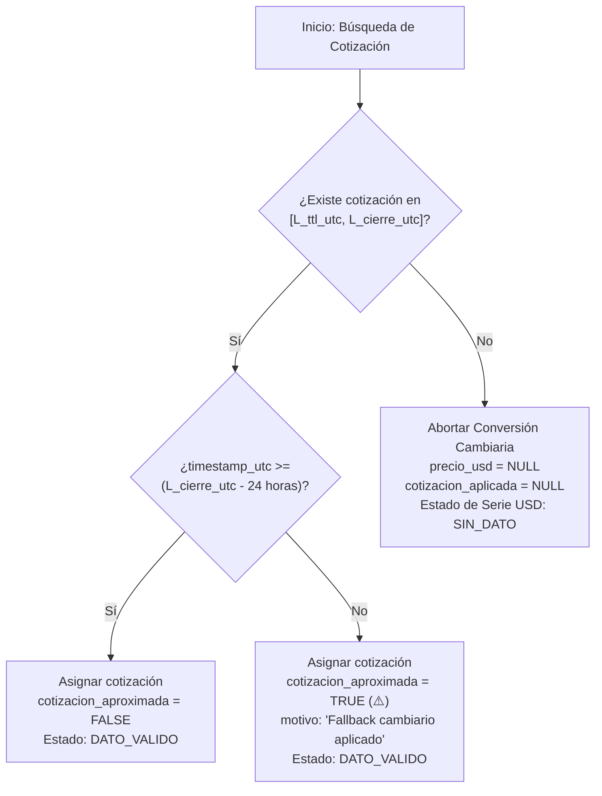

<p align="center">
  
</p>

# Especificación de Reglas de Negocio y Lógica Matemática
**PriceScope — Monitor de Inflación Real Multimoneda**  
*Plataforma B2B de Analítica Económica e Inteligencia de Mercado*

---

## Metadatos del Documento

| Atributo | Detalle Oficial |
| :--- | :--- |
| **Código del Documento** | `BRM-PRICESCOPE-V1.0` |
| **Proyecto** | PriceScope — Monitor de Inflación Real Multimoneda |
| **Organización / Programa** | Simulación Laboral Abierta — NoCountry |
| **Sector de Negocio** | FinTech / Analítica Económica (B2B Analytics) |
| **Versión** | 1.0 (Oficial para Desarrollo y Certificación QA) |
| **Fecha de Emisión** | 16 de Octubre de 2026 |
| **Ubicación en Repositorio** | `docs/01-analisis/04-Business-Rules-Math-Logic.md` |
| **Documentos Vinculantes** | `01-SRS-PriceScope.md`, `02-API-Contracts-OpenAPI.md`, `03-Data-Model-TimescaleDB.md` |
| **Estado** | En Revisión y Aprobación Técnica por Células Operativas |

---

## Control de Cambios y Aprobación Formal (Sign-Off)

### HISTORIAL DE VERSIONES
| Versión | Fecha | Autor | Descripción del Cambio |
| :--- | :--- | :--- | :--- |
| **1.0** | 2026-10-16 | Equipo PriceScope | Formalización exhaustiva de algoritmos, formulaciones matemáticas, pseudocódigo y matrices de pruebas unitarias para Backend (`E-API`) y Aseguramiento de Calidad (`E-QA`). |

### ACTA DE APROBACIÓN TÉCNICA (SIGN-OFF)
La firma de este documento certifica que las fórmulas, algoritmos, constantes y casos límite aquí descritos constituyen el estándar matemático vinculante para las células encargadas de su codificación y certificación. Queda prohibida cualquier alteración a las fórmulas sin aprobación explícita del Tech Lead.

| Rol Operativo | Célula de Trabajo | Integrante Asignado | Estado de Revisión | Firma / Fecha |
| :--- | :--- | :--- | :--- | :--- |
| **Tech Lead / PO Review** | `E-QA` | Gonzalo Cecchín | Pendiente | [ &nbsp;&nbsp;&nbsp;&nbsp; / &nbsp;&nbsp;&nbsp;&nbsp; / 2026 ] |
| **Backend Lead (`E-API`)** | `E-API` | Luis Feliz | Pendiente | [ &nbsp;&nbsp;&nbsp;&nbsp; / &nbsp;&nbsp;&nbsp;&nbsp; / 2026 ] |
| **Analista QA Matemático** | `E-QA` | Karina Luvianos | Pendiente | [ &nbsp;&nbsp;&nbsp;&nbsp; / &nbsp;&nbsp;&nbsp;&nbsp; / 2026 ] |

---

## 1. Alcance, Propósito y Principios Numéricos Rectores

Este documento establece el **manual algorítmico y matemático oficial** de PriceScope. Su meta es eliminar cualquier ambigüedad de interpretación entre el equipo de desarrollo de Backend (`E-API`) y el equipo de control de calidad (`E-QA`), garantizando que los cálculos financieros y macroeconómicos expuestos a clientes corporativos sean exactos, determinísticos, reproducibles y auditables.

### Principios Numéricos Rectores:
1. **Precisión Numérica en Almacenamiento y Cómputo:**
   * En base de datos PostgreSQL, los montos monetarios se almacenan bajo el tipo `NUMERIC(14, 2)` para precios nominales y `NUMERIC(14, 4)` para precios métricos por unidad normalizada.
   * Los tipos de cambio y cotizaciones de divisas utilizan `NUMERIC(12, 4)`.
   * En memoria y capas de servicio Backend en NestJS / TypeScript (`apps/api`), los cálculos se realizan utilizando aritmética decimal de punto fijo o de precisión arbitraria (mediante librerías como `decimal.js` o `bignumber.js`), **prohibiendo el uso de tipos de coma flotante estándar binarios (`float` o `double`) para operaciones monetarias acumuladas**, a fin de evitar errores de redondeo IEEE 754.
2. **Determinismo Temporal en UTC:**
   * Toda estampa de tiempo interna se manipula en UTC bajo la norma ISO 8601 (`YYYY-MM-DDTHH:MM:SSZ`).
   * Los cierres contables y cambiarios se basan en una definición fija de fin de jornada del mercado local (23:59:59 ART = UTC-3).
3. **Prohibición Estricta del Cero Falso (RN-04):**
   * El valor numérico `0` está terminantemente prohibido para denotar ausencias, fallas de captura o falta de stock. Un producto sin precio se computa y serializa como `null`.
4. **Respeto a la Taxonomía Forense:**
   * Todo registro no válido debe portar su estado explícito: `AGOTADO`, `ERROR_CAPTURA` o `SIN_DATO`.

---

## 2. Algoritmo de Agregación de Categorías Mediante la Mediana (RN-02 / HU-30)

### 2.1 Justificación Matemática y Prohibición del Promedio Simple
En un sistema de analítica de precios basado en web scraping externo de múltiples fuentes minoristas, no se cuenta con los volúmenes de venta reales de cada transacción física para ponderar un índice de Laspeyres o Paasche tradicional. 

Bajo estas condiciones:
* **El uso de la media aritmética (promedio simple) está terminantemente prohibido.**
* **Motivo:** El promedio simple es sumamente vulnerable a perturbaciones asimétricas y *outliers*. En una canasta de bienes durables compuesta por televisores de \$800.000 que subieron un +5% y un cable HDMI de \$3.000 que subió un +100%, el promedio simple reportaría erróneamente un alza de la categoría superior al +52%, distorsionando por completo la percepción macroeconómica del cliente corporativo.
* **La Mediana Estadística** proporciona un estimador robusto de tendencia central con un punto de quiebre (*breakdown point*) del 50%, lo que significa que hasta la mitad de las observaciones pueden ser extremas sin corromper el índice de la categoría.

### 2.2 Algoritmo de Cálculo Paso a Paso

Sea una categoría $C$ evaluada entre la fecha inicial $t_0$ y la fecha final $t_1$.

#### Paso 1: Filtrado de Observaciones Válidas
Para cada producto canónico $p \in C$, se obtienen los precios regulares efectivos $P_{p}(t_0)$ y $P_{p}(t_1)$ aplicando el método LOCF (Sección 6).
Se descartan aquellos productos que no posean precio válido en ambos extremos:
$$\text{Muestra Válida } S = \{ p \in C \mid P_p(t_0) > 0 \land P_p(t_1) > 0 \land \text{estado}(p) = \text{'DATO\_VALIDO'} \}$$

#### Paso 2: Cálculo de la Variación Porcentual Individual
Para cada producto $p \in S$, se computa su variación nominal en porcentaje con precisión decimal:
$$v_p = \left( \frac{P_p(t_1) - P_p(t_0)}{P_p(t_0)} \right) \times 100$$

#### Paso 3: Ordenamiento de la Muestra
Sea $N = |S|$ el número total de productos con variación calculable. Se ordenan los valores en secuencia ascendente:
$$v_{(1)} \le v_{(2)} \le v_{(3)} \le \dots \le v_{(N)}$$

#### Paso 4: Determinación de la Mediana

* **Caso 1: Muestra Impar ($N$ es impar):**
  El valor de la mediana corresponde exactamente al elemento central en la posición indexada $\frac{N+1}{2}$:
  $$\text{Mediana}(C) = v_{\left(\frac{N+1}{2}\right)}$$

* **Caso 2: Muestra Par ($N$ es par):**
  La mediana corresponde a la media aritmética de los dos elementos centrales ubicados en las posiciones $\frac{N}{2}$ y $\frac{N}{2} + 1$:
  $$\text{Mediana}(C) = \frac{v_{\left(\frac{N}{2}\right)} + v_{\left(\frac{N}{2} + 1\right)}}{2}$$

#### Paso 5: Cálculo de Cobertura Muestral
Sea $T_C$ el total de productos canónicos activos dados de alta en la categoría $C$:
$$\text{cobertura\_pct} = \left( \frac{N}{T_C} \right) \times 100$$

Si $N = 0$, la API retorna `variacion_mediana_pct: null`, `cantidad_productos: 0`, `cobertura_pct: 0.0` y estado `SIN_DATOS_SUFICIENTES`.

### 2.3 Implementación Oficial de Backend (TypeScript / NestJS)

```typescript
import { Decimal } from 'decimal.js';

export function calcularMedianaCategoria(variaciones: Decimal[]): Decimal | null {
  const n = variaciones.length;
  if (n === 0) {
    return null;
  }

  // Ordenamiento ascendente determinístico sin mutar el arreglo original
  const ordenados = [...variaciones].sort((a, b) => a.comparedTo(b));

  const mitad = Math.floor(n / 2);
  if (n % 2 !== 0) {
    // Muestra impar: posición central exacta
    return ordenados[mitad].toDecimalPlaces(2, Decimal.ROUND_HALF_UP);
  } else {
    // Muestra par: promedio aritmético de los dos valores centrales
    const sumaCentral = ordenados[mitad - 1].plus(ordenados[mitad]);
    return sumaCentral.dividedBy(2).toDecimalPlaces(2, Decimal.ROUND_HALF_UP);
  }
}
```

---

## 3. Sincronización Cambiaria al "Cierre del Día" (RN-01 / HU-23 / HU-24)

### 3.1 Marco Teórico y Zona Horaria de Referencia
Los portales de e-commerce en Argentina actualizan precios durante la jornada laboral diurna, mientras que el mercado cambiario financiero opera hasta media tarde y fija su cotización de cierre. 

Para normalizar la comparación de precios sin sesgos intradiarios:
* **Mercado Objetivo:** Argentina (Huso Horario Oficial: `America/Argentina/Buenos_Aires`, ART = UTC-3 sin horario de verano).
* **Definición de Fin de Día:** La jornada comercial de una fecha calendario local $D$ concluye formalmente a las **23:59:59 ART**, equivalente a las **02:59:59 UTC del día $D+1$**.
* **Cotización de Cierre Aplicable:** Es la última cotización cambiaria de tipo `venta` registrada por el proveedor financiero cuya marca temporal sea menor o igual a las 23:59:59 ART de la fecha local de la observación.

### 3.2 Algoritmo Determinístico de Cruce Temporal

Sea una observación de precio $O$ con marca temporal $T_{\text{obs}}$ registrada en UTC.

#### Paso 1: Conversión al Calendario Local
$$T_{\text{local}} = \text{timezone\_convert}(T_{\text{obs}}, \text{'America/Argentina/Buenos\_Aires'})$$
$$\text{Fecha Local } D = \text{date\_part}(T_{\text{local}})$$

#### Paso 2: Determinación del Límite de Cierre en UTC
Se construye la estampa de corte local:
$$L_{\text{local}} = D \text{ a las 23:59:59}$$
Se convierte dicha estampa a UTC:
$$L_{\text{cierre\_utc}} = \text{timezone\_convert}(L_{\text{local}}, \text{'UTC'})$$

#### Paso 3: Selección de la Cotización Efectiva
En la hypertable `cotizaciones_divisas`, se busca el registro $C$ que satisfaga:
1. `moneda_base = 'USD'` y `moneda_cotizada = 'ARS'`.
2. `tipo = 'parallel'` (Dólar Blue) o el tipo solicitado por la consulta.
3. `condicion = 'venta'`.
4. `timestamp_utc <= L_cierre_utc`.
5. Se toma la tupla con el mayor `timestamp_utc` (orden descendente, `LIMIT 1`).

#### Paso 4: Persistencia y Exposición Inmutable (HU-24)
La cotización obtenida se asigna en la columna `cotizacion_aplicada` de la observación procesada.
El precio en dólares se calcula mediante la fórmula de conversión directa:
$$\text{precio\_usd} = \frac{\text{precio\_regular}}{\text{cotizacion\_aplicada}}$$
Ambos montos se conservan para auditoría y visualización.

---

## 4. Política de Fallback Cambiario y Ventana TTL de 72 Horas (RN-03 / HU-22)

### 4.1 Definición de la Ventana de Tolerancia
Ante fines de semana, feriados bancarios o contingencias técnicas en APIs financieras externas (ej. caídas temporales de DolarAPI):
* Se establece un **Time-To-Live (TTL) estricto de 72 horas** hacia atrás desde el límite de cierre del día evaluado.
* **Prohibición:** Queda terminantemente prohibido extrapolar cotizaciones financieras con más de 72 horas de antigüedad, ya que en economías de alta inflación esto desvirtuaría los cálculos de variación en dólares.

### 4.2 Lógica de Decisión y Activación de Banderas

Sea $L_{\text{cierre\_utc}}$ el límite del cierre del día calculado en la Sección 3.2.
Se define el límite inferior de búsqueda:
$$L_{\text{ttl\_utc}} = L_{\text{cierre\_utc}} - 72 \text{ horas}$$

Se evalúa la tupla de cotización candidata más reciente $C_{\text{cand}}$:



### 4.3 Matriz de Comportamiento Técnico ante Fallback

| Antigüedad de la Cotización Localizada | Valor `cotizacion_aproximada` | Acción en Backend | Representación en Frontend |
| :--- | :--- | :--- | :--- |
| **0 a 24 horas** | `false` | Conversión estándar. | Renderizado normal sin advertencias. |
| **24 a 72 horas** | `true` | Conversión ejecutada con bandera de tolerancia. | Icono de advertencia visual (⚠️) en tooltip y tabla. |
| **Mayor a 72 horas** | *N/A (Nulo)* | Conversión abortada; `precio_usd = null`. | Corte visual (*gap*) en la serie USD de la gráfica. |

---

## 5. Algoritmo de Downsampling en Series Temporales (RN-07 / HU-47)

### 5.1 Justificación de Rendimiento y Experiencia de Usuario (60 FPS)
Cuando un cliente corporativo consulta series anuales completas de múltiples productos canónicos (365 días $\times$ múltiples tiendas piloto), transferir y renderizar cientos de miles de puntos vectoriales en SVG/Canvas satura la memoria del navegador y bloquea el hilo principal de JavaScript (*Main Thread*), reduciendo la tasa de refresco por debajo de los 30 cuadros por segundo y generando gráficos ilegibles con sobrecarga visual ("manchas de tinta").

Para garantizar que el tablero en React renderice de forma instantánea a **60 FPS estables**, se aplica un algoritmo de downsampling determinístico en base de datos.

### 5.2 Regla de Activación y Umbrales Temporales
Sea $\Delta T = \text{fecha\_hasta} - \text{fecha\_desde}$ la amplitud en días calendario del período solicitado:

$$\text{Downsampling} = \begin{cases} 
\text{DESACTIVADO (Serie Diaria Continua, 1d)} & \text{si } \Delta T \le 90 \text{ días} \\ 
\text{ACTIVADO (Agrupación Semanal por Mediana, 1w)} & \text{si } \Delta T > 90 \text{ días} 
\end{cases}$$

### 5.3 Agregación Semanal Continua con TimescaleDB
Bajo downsampling activado:
1. El backend agrupa las observaciones diarias en cubos de tiempo de una semana calendario (`time_bucket('1 week', timestamp_utc)`).
2. Para cada cubo semanal, se calcula la **mediana** de los precios regulares registrados en esa semana:
   $$\text{precio\_semanal} = \text{percentile\_cont}(0.5) \text{ WITHIN GROUP (ORDER BY precio\_regular)}$$
3. Una consulta anual de 365 días retorna exactamente un máximo de **52 puntos consolidados por serie**, reduciendo el volumen de transferencia en un 85.7%.
4. En el payload JSON se emiten obligatoriamente las banderas:
   * `"downsampling_aplicado": true`
   * `"intervalo_agrupacion": "1w"`

---

## 6. Método LOCF y Normalización Métrico-Comercial (RN-04, RN-05 / HU-16)

### 6.1 Método LOCF (*Last Observation Carried Forward*) ante Faltantes
Para calcular la variación porcentual acumulada entre dos fechas extremas ($t_0$ y $t_1$) cuando en una de ellas no se extrajo información debido a un feriado o error de red:
* **Regla LOCF:** Se busca la última observación válida previa al extremo evaluado dentro de una tolerancia de hasta 5 días hábiles.
* **Restricción:** El método LOCF solo se utiliza para rellenar los extremos de cálculo de los KPIs globales. **Queda terminantemente prohibido usar LOCF para inventar puntos intermedios en la gráfica de líneas**. Los huecos intermedios se presentan como cortes (*gaps*) físicos para preservar la honestidad estadística (RN-04 / Anexo A).

### 6.2 Normalización de Precio por Unidad Métrica (HU-16)
Para comparar precios de manera transparente entre comercios que ofrecen distintas presentaciones comerciales (ej. pote de 500g vs. paquete de 1kg, o botellas individuales vs. packs):

#### Atributos Canónicos Requeridos:
* $V_{\text{neto}}$: Valor numérico del contenido neto (`NUMERIC(10, 4)`).
* $U_{\text{base}}$: Unidad base normalizada (`enum_unidad_medida`: `'kg'`, `'L'`, `'unidad'`).
* $K_{\text{pack}}$: Multiplicador entero derivado de la configuración comercial `pack` (ej. `'x1'` $\rightarrow 1$, `'x3'` $\rightarrow 3$, `'x6'` $\rightarrow 6$).

#### Fórmula de Contenido Total Normalizado:
$$\text{Contenido Total} = V_{\text{neto}} \times K_{\text{pack}}$$

#### Fórmula de Precio por Unidad Métrica:
$$\text{Precio por Unidad} = \frac{\text{Precio Regular}}{\text{Contenido Total}}$$

* **Unidades de Salida Permitidas:**
  * Alimentos sólidos y polvos: Pesos por kilogramo ($\text{ARS/kg}$).
  * Líquidos: Pesos por litro ($\text{ARS/L}$).
  * Bienes durables y unitarios: Pesos por unidad ($\text{ARS/unidad}$).

---

## 7. Detección Heurística de Reduflación (RN-05 / HU-15 / HU-38)

La reduflación (*shrinkflation*) ocurre cuando un fabricante reduce discretamente el contenido neto o gramaje de un producto manteniendo o incrementando su precio de venta al público.

### 7.1 Algoritmo de Detección
Al procesar una nueva observación de un producto canónico $p$ en la fecha $t$:
1. Se consulta el último registro del producto en la tabla `historial_contenido`:
   * Contenido previo: $V_{\text{previo}}$
   * Unidad previa: $U_{\text{previo}}$
2. Se evalúa el contenido actual extraído de la publicación: $V_{\text{actual}}$
3. **Condición de Disparo:**
   $$\text{Reduflación Detectada} \iff (U_{\text{actual}} = U_{\text{previo}}) \land (V_{\text{actual}} < V_{\text{previo}}) \land (P_{\text{regular}}(t) \ge P_{\text{regular}}(t - 1))$$
4. **Acciones del Sistema:**
   * Inserción automática de un registro en `historial_contenido` con motivo `'REDUFLACION'`.
   * Generación de un evento en `hitos_economicos` de tipo `'AUTOMATICO'` con título `'Reduflación Detectada'`.
   * El hito se expone como un marcador interactivo vertical en la gráfica de evolución temporal (HU-38).

---

## 8. Formulación de Alertas Inflacionarias vs. Devaluación (HU-28 / HU-37)

### 8.1 Cálculo del Diferencial de Puntos
El indicador de alerta económica detecta cuando los precios de consumo interno crecen por encima de la depreciación de la moneda local frente a la divisa de referencia.

#### Variables:
* $v_{\text{precio}}$: Variación porcentual acumulada del precio regular del producto canónico en el período.
* $v_{\text{divisa}}$: Variación porcentual acumulada de la cotización de cierre de la divisa en el mismo período.

#### Fórmula del Diferencial:
$$\Delta_{\text{puntos}} = v_{\text{precio}} - v_{\text{divisa}}$$

### 8.2 Criterio de Disparo de Alerta
Se genera una alerta y se lista en el endpoint `/api/v1/alerts` si y solo si:
$$\Delta_{\text{puntos}} > 0 \iff v_{\text{precio}} > v_{\text{divisa}}$$

#### Ejemplo Numérico de Referencia:
* Precio regular inicial: \$10.000 $\rightarrow$ Precio final: \$12.500 ($v_{\text{precio}} = +25.0\%$).
* Cotización inicial: \$1.000 $\rightarrow$ Cotización final: \$1.200 ($v_{\text{divisa}} = +20.0\%$).
* Diferencial: $\Delta_{\text{puntos}} = 25.0 - 20.0 = +5.0 \text{ puntos}$.
* **Resultado:** Se emite alerta informando que el producto aumentó 5.0 puntos porcentuales por encima del dólar.

---

## 9. Algoritmo de Matching Canónico y Umbrales de Zona Gris (HU-08 / HU-10 / Anexo B)

### 9.1 Justificación y Pipeline de Similitud
Para asociar automáticamente publicaciones extraídas a un producto canónico sin generar falsos positivos (como asociar un televisor de 55" con uno de 65" o café soluble con café en grano):
* El motor calcula un **score de confianza normalizado** $S \in [0.00, 1.00]$.
* El score consolida: correspondencia exacta de marca/modelo ($40\%$), coincidencia de contenido neto normalizado ($30\%$) y similitud semántica o tokenizada del título ($30\%$).

### 9.2 Umbrales Matemáticos de Clasificación
Sea $S$ el score de similitud calculado para un par $(\text{publicación\_extraída}, \text{producto\_canónico})$:

$$S = w_{\text{marca}} \cdot s_{\text{marca}} + w_{\text{contenido}} \cdot s_{\text{contenido}} + w_{\text{texto}} \cdot s_{\text{texto}}$$

$$\text{Decisión Algorítmica} = \begin{cases}
\text{APROBACIÓN AUTOMÁTICA (Banda Alta)} & \text{si } S \ge 0.85 \\
\text{ZONA GRIS (Revisión Humana Obligatoria)} & \text{si } 0.41 \le S \le 0.84 \\
\text{DESCARTE AUTOMÁTICO (Banda Baja)} & \text{si } S \le 0.40
\end{cases}$$

* **Regla de Inmutabilidad de la Zona Gris (HU-10):** Ninguna propuesta que caiga en el rango $0.41 \le S \le 0.84$ puede confirmarse automáticamente en la base de datos ni exponerse como serie activa en el tablero sin la aprobación explícita de un analista humano vía el endpoint `POST /api/v1/matching/approve`.

---

## 10. Rigor Terminológico Macroeconómico y Estándar de Redondeo (RN-08)

### 10.1 Prohibición del Término "Inflación Real" sin Calificar
Queda estrictamente prohibido utilizar la frase "inflación real" en títulos de pantallas, respuestas JSON de la API o reportes sin especificar de cuál de los tres cálculos se trata:
1. **Variación Acumulada en Pesos ($v_{\text{pesos}}$):** Variación porcentual nominal del precio regular en moneda local (ARS).
2. **Variación Acumulada en USD ($v_{\text{usd}}$):** Variación porcentual del precio convertido a dólares, informando obligatoriamente la cotización de cierre aplicada (ej. Dólar Blue).
3. **Diferencial vs. Devaluación ($\Delta_{\text{puntos}}$):** Puntos porcentuales netos de diferencia entre el aumento de precios y la variación cambiaria.

### 10.2 Estándar de Redondeo y Tolerancia Numérica
Para asegurar consistencia total entre Backend, Base de Datos y Frontend:
* **Montos Monetarios Nominales:** Se redondean a **2 decimales** utilizando el método *Round Half to Even* (Redondeo Bancario) o *Round Half Up* estándar bancario: `ROUND(valor, 2)`.
* **Precios por Unidad Métrica ($/kg, $/L):** Se calculan y conservan a **4 decimales** (`NUMERIC(14, 4)`), redondeando a 2 decimales solo en la capa final de presentación UI.
* **Variaciones Porcentuales e Indicadores:** Se redondean estrictamente a **1 o 2 decimales** según el contrato de API (`quantize(Decimal('0.01'))`), evitando colas infinitas de decimales periódicos (`5.33333333%` $\rightarrow$ `5.33%`).

---

## 11. Matriz de Casos de Prueba Límite para Certificación QA (`E-QA`)

Esta matriz detalla los escenarios de prueba unitaria y de integración que la célula de calidad (`E-QA`) debe automatizar y verificar para emitir la conformidad técnica del sistema.

| ID Prueba | Módulo / Regla | Escenario de Entrada | Resultado Esperado | Criterio de Aprobación |
| :--- | :--- | :--- | :--- | :--- |
| **TC-MATH-01** | Mediana (HU-30) | Muestra impar de 5 productos: `[+4.0%, +5.0%, +5.0%, +6.0%, +100.0%]` (Outlier severo). | Mediana exacta: `+5.00%`. (El promedio simple daría erróneamente `+24.0%`). | Error relativo $= 0\%$. Prohibición de promedio simple confirmada. |
| **TC-MATH-02** | Mediana (HU-30) | Muestra par de 4 productos: `[+2.0%, +4.0%, +6.0%, +8.0%]`. | Mediana exacta: $\frac{4.0 + 6.0}{2} = +5.00\%$. | Cálculo idéntico en Backend y consulta SQL. |
| **TC-MATH-03** | Cierre UTC (HU-23)| Precio capturado el 2026-10-16 a las 11:30 ART (14:30 UTC). Cotizaciones a las 15:00 ART (\$1.200) y 23:30 ART (\$1.210). | Empareja con la cotización de las 23:30 ART (\$1.210) por ser la última previa a las 23:59:59 ART. | Cierre del día local respetado determinísticamente. |
| **TC-MATH-04** | Fallback 48h (HU-22)| Domingo sin cotización financiera. Última cotización válida registrada el viernes anterior a las 18:00 (48h atrás). | Conversión en USD ejecutada con `"cotizacion_aproximada": true`. | Bandera booleana activa; frontend muestra icono ⚠️. |
| **TC-MATH-05** | TTL 72h (HU-22) | Caída de API financiera por 96 horas continuas. | Conversión en USD abortada; `precio_usd = null`, `estado_dato = 'SIN_DATO'`. | Se genera corte físico (*gap*) en la serie temporal. |
| **TC-MATH-06** | Anti-Cero (RN-04) | Inserción simulada con `precio_regular = 0.00` o `estado_dato = 'AGOTADO'` y precio no nulo. | Base de datos aborta la transacción arrojando violación del constraint `chk_consistencia_dato`. | Cero estricto bloqueado en base de datos y API. |
| **TC-MATH-07** | Downsampling (HU-47)| Consulta temporal sobre rango de 180 días (6 meses). | Backend agrupa con `agg_precios_semanales`, emitiendo `~26` puntos con flag `downsampling_aplicado: true`. | Rendimiento validado a 60 FPS en navegador. |
| **TC-MATH-08** | Precio Métrica (HU-16)| Café molido Marca A con empaque de 500g ($0.5\text{ kg}$) vendido a \$12.000 ARS en pack `x1`. | $\text{Precio por Unidad} = \frac{12000}{0.5} = \$24.000,00/\text{kg}$. | Normalización a unidad base correcta. |
| **TC-MATH-09** | Paginación (HU-46) | Petición a `/alerts` con parámetro `limit=100`. | Servidor rechaza con HTTP 422 RFC 7807 indicando exceso del máximo permitido de 50. | Protección de memoria del cliente operativa. |
| **TC-MATH-10** | Zona Gris (HU-10) | Publicación extraída con score $S = 0.76$ frente a un canónico. | Se deriva a la cola de pendientes (`/api/v1/matching/pending`); no se auto-vincula. | Bloqueo de auto-matching en zona intermedia. |
| **TC-MATH-11** | Diferencial (HU-28) | Precio sube $+25.0\%$, divisa sube $+20.0\%$. | $\Delta_{\text{puntos}} = +5.0 \text{ pts}$. Se emite alerta económica. | Disparo determinístico de alerta validado. |

