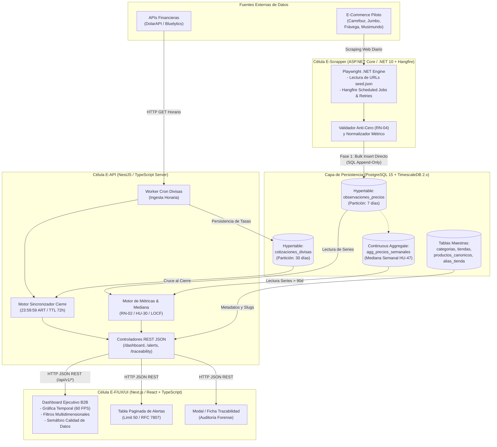
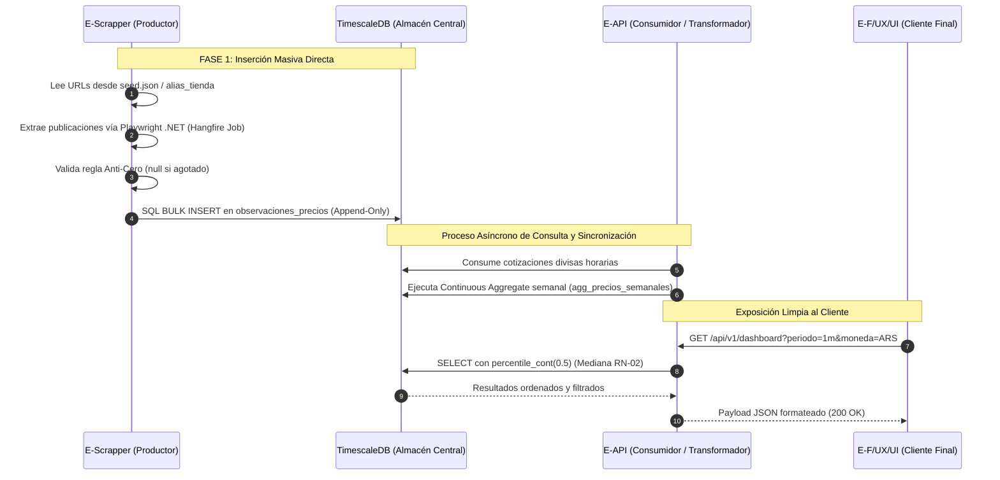
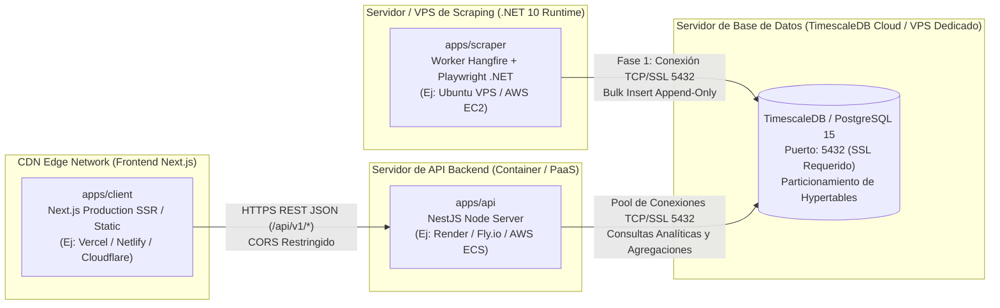

<p align="center">
  
</p>

# Especificación de Arquitectura de Software y Pipeline de Datos
**PriceScope — Monitor de Inflación Real Multimoneda**  
*Plataforma B2B de Analítica Económica e Inteligencia de Mercado*

---

## Metadatos del Documento

| Atributo | Detalle Oficial |
| :--- | :--- |
| **Código del Documento** | **`SAD-PRICESCOPE-V1.0`** |
| **Proyecto** | PriceScope — Monitor de Inflación Real Multimoneda |
| **Organización / Programa** | Simulación Laboral Abierta — NoCountry |
| **Sector de Negocio** | FinTech / Analítica Económica (B2B Analytics) |
| **Versión** | **1.0** (Oficial para Desarrollo e Integración Continua) |
| **Fecha de Emisión** | 16 de Octubre de 2026 |
| **Ubicación en Repositorio** | `docs/01-analisis/05-Software-Architecture-Pipeline.md` |
| **Documentos Vinculantes** | `01-SRS-PriceScope.md`, `02-API-Contracts-OpenAPI.md`, `03-Data-Model-TimescaleDB.md`, `04-Business-Rules-Math-Logic.md` |
| **Estado** | En Revisión y Aprobación Técnica por Células Operativas |

---

## Control de Cambios y Aprobación Formal (Sign-Off)

### HISTORIAL DE VERSIONES
| Versión | Fecha | Autor | Descripción del Cambio |
| :--- | :--- | :--- | :--- |
| **1.0** | 2026-10-16 | Equipo PriceScope | Formalización exhaustiva de la arquitectura del monorepo, topología de despliegue, patrón Productor-Consumidor sobre TimescaleDB compartida, cron jobs y orquestación del pipeline de datos. |

### ACTA DE APROBACIÓN TÉCNICA (SIGN-OFF)
La firma de este documento formaliza los límites arquitectónicos, la delimitación de directorios, las convenciones de ramas git y la estrategia de persistencia como vinculantes para los 8 integrantes del equipo.

| Rol Operativo | Célula de Trabajo | Integrante Asignado | Estado de Revisión | Firma / Fecha |
| :--- | :--- | :--- | :--- | :--- |
| **Tech Lead / PO Review** | `E-QA` | Gonzalo Cecchín | Pendiente | [ &nbsp;&nbsp;&nbsp;&nbsp; / &nbsp;&nbsp;&nbsp;&nbsp; / 2026 ] |
| **Backend & DB Lead** | `E-API` | Luis Feliz | Pendiente | [ &nbsp;&nbsp;&nbsp;&nbsp; / &nbsp;&nbsp;&nbsp;&nbsp; / 2026 ] |
| **Scraping Lead** | `E-Scrapper` | Alejandro Hernández OReilly | Pendiente | [ &nbsp;&nbsp;&nbsp;&nbsp; / &nbsp;&nbsp;&nbsp;&nbsp; / 2026 ] |
| **Frontend Lead & UX/UI** | `E-F/UX/UI` | Juan Camilo García | Aprobado | 16/10/2026 |

---

## 1. Visión General y Objetivos Arquitectónicos

La arquitectura de **PriceScope** está concebida bajo el paradigma de **Monorepo Modular Desacoplado**, diseñado para permitir el desarrollo concurrente y autónomo de cuatro células de trabajo especializadas sin generar bloqueos operativos entre ellas.



---

## 2. Estructura del Monorepo y Delimitación de Microservicios (`apps/`)

Para desacoplar el ciclo de vida, dependencias y despliegues independientes de cada microservicio en servidores físicos o cloud diferenciados, el repositorio adopta formalmente la arquitectura estándar de **Monorepo de Microservicios bajo `apps/`**:

```text
pricescope-monorepo/
├── .github/
│   ├── PULL_REQUEST_TEMPLATE.md  # Plantilla obligatoria de control de calidad para PRs
│   └── workflows/                # Pipelines de CI/CD independientes por servicio
│       ├── ci-scraper.yml        # Trigger: on push/pr en apps/scraper/**
│       ├── ci-api.yml            # Trigger: on push/pr en apps/api/**
│       └── ci-client.yml         # Trigger: on push/pr en apps/client/**
├── apps/                         # Código fuente dividido por microservicios autónomos
│   ├── scraper/                  # Microservicio de Extracción (E-Scrapper: ASP.NET Core / C# / Hangfire / Playwright .NET)
│   │   ├── src/                  # Background jobs por tienda, spiders y parsers
│   │   ├── seed.json             # Copia local de trabajo o referencia determinística
│   │   ├── *.csproj / *.sln      # Solución y paquetes NuGet aislados del worker
│   │   └── README.md             # Guía de ejecución del worker y dashboard Hangfire
│   ├── api/                      # Microservicio Backend REST (E-API: NestJS / TypeScript / TypeORM o Prisma)
│   │   ├── src/
│   │   │   ├── controllers/      # Controladores REST (/dashboard, /alerts, /traceability)
│   │   │   ├── services/         # Algoritmos: Mediana (HU-30), Cierre UTC 23:59:59, TTL 72h, LOCF
│   │   │   ├── models/           # Definición de tablas y Hypertables TimescaleDB
│   │   │   └── routes/           # Mapeo de rutas HTTP
│   │   ├── package.json          # Dependencias aisladas de la API
│   │   └── README.md
│   └── client/                   # Aplicación Web Frontend SPA / SSR (E-F/UX/UI: Next.js 14+ / React / TypeScript)
│       ├── src/
│       │   ├── components/       # Gráficos Recharts/Chart.js (60 FPS), BandaCalidad, Filtros
│       │   ├── pages/            # Vistas ejecutivas: Dashboard, Alertas, Ficha Trazabilidad
│       │   ├── services/         # Clientes HTTP y mocks tipados
│       │   └── types/            # Contratos de interfaz TypeScript (api.ts)
│       ├── package.json          # Dependencias aisladas del cliente web
│       └── README.md
├── docs/                         # Documentación técnica oficial y auditable de ingeniería
│   ├── assets/                   # Recursos gráficos e imagotipos corporativos
│   │   ├── imagotipo.png         # Logo horizontal oficial (símbolo + texto PriceScope)
│   │   ├── isotipo.png           # Isotipo centrado / diamante con diana (favicon / icono)
│   │   ├── diagrams/             # Diagramas exportados (ERD, arquitectura, secuencias para slides)
│   │   └── wireframes/           # Capturas @2x de pantallas base para documentación visual
│   ├── 01-analisis/              # Especificaciones formales del sistema y diseño
│   │   ├── 01-SRS-PriceScope.md
│   │   ├── 02-API-Contracts-OpenAPI.md
│   │   ├── 03-Data-Model-TimescaleDB.md
│   │   ├── 04-Business-Rules-Math-Logic.md
│   │   ├── 05-Software-Architecture-Pipeline.md
│   │   ├── 06-QA-Test-Matrix.md
│   │   └── 07-Frontend-UX-UI-Specs.md
│   ├── 02-planeacion/            # Gestión del Proyecto, Cronograma y Contingencias
│   │   ├── 01-Plan-Operativo-Roadmap.md
│   │   └── 02-matriz-riesgos.md
│   └── 03-qa/                    # Espacio de trabajo vivo para célula E-QA
│       ├── README.md             # Guía operativa para evidencias y reportes de certificación
│       ├── 01-matriz-casos-prueba.md   # Bitácora viva de ejecución de pruebas (Generado por E-QA)
│       └── 02-reportes-stress-test.md  # Reportes de carga 10.000+ y rendimiento 60 FPS (Generado por E-QA)
├── seed.json                     # Archivo semilla MVP oficial (URLs piloto normalizadas HU-00)
├── docker-compose.yml            # Infraestructura local compartida (TimescaleDB / PostgreSQL)
├── .gitignore                    # Exclusión de node_modules, .venv, .env, cachés
└── README.md                     # Portada institucional del repositorio
```

### Acuerdos de Trabajo y Despliegue entre Células
1. **Microservicios Desplegables de Forma Autónoma:** Cada carpeta dentro de `apps/` tiene su propio proceso de build y despliegue (ej. `client` en Vercel/Netlify, `api` en Render/Fly.io/AWS EC2, `scraper` en un VPS/Worker cron independiente, y `timescaledb` en una instancia dedicada o gestionada).
2. **CI/CD por Rutas de Microservicio (`Path Filtering`):** Los flujos de GitHub Actions se activan únicamente para el microservicio que sufrió modificaciones. Si se modifica `apps/client/**`, no se redeploya la API ni los scrapers.
3. **Convención de Ramas Git (GitFlow Simplificado):**
   * Rama `main`: Código de producción estable y verificado.
   * Rama `develop`: Rama central de integración continua.
   * Ramas funcionales: `feature/scraper-[tienda]`, `feature/api-[endpoint]`, `feature/ui-[vista]`.
4. **Mocks de Frontend Desacoplados:** En la primera semana de desarrollo, `E-F/UX/UI` maquetará contra los tipos definidos en [**02-API-Contracts-OpenAPI.md**](file:///e:/S10-26-EQUIPO-2-PriceScope/docs/01-analisis/02-API-Contracts-OpenAPI.md), permitiendo que la interfaz avance sin importar el estado del despliegue del servidor de API.

---

## 3. Patrón Productor-Consumidor sobre Base de Datos Compartida

### 3.1 Justificación Arquitectónica del Patrón (Fase 1 vs. Microservicios)
En proyectos con cronogramas de entrega exigentes (4 semanas) y equipos multidisciplinarios concurrentes, forzar la comunicación síncrona a través de una API HTTP (`POST /ingest`) en la primera semana genera un cuello de botella crítico: si la API sufre demoras o cambios en su interfaz, el equipo de extracción se bloquea completamente.

Por este motivo, se implementa el patrón **Productor-Consumidor Desacoplado sobre Base de Datos Compartida**:



### 3.2 Reglas de Convivencia sobre la Hypertable
1. **Operación Append-Only Estricta:** `E-Scrapper` tiene permisos de `INSERT` sobre `observaciones_precios`. Queda deshabilitada la instrucción `UPDATE` para registros históricos.
2. **Idempotencia por Clave Compuesta:** La tupla de clave primaria `(timestamp_utc, producto_canonico_id, tienda_id)` garantiza que si un lote de scraping se reejecuta en el mismo minuto, la base de datos descarte o ignore duplicados mediante la cláusula:
   ```sql
   INSERT INTO observaciones_precios (...) VALUES (...)
   ON CONFLICT (timestamp_utc, producto_canonico_id, tienda_id) DO NOTHING;
   ```
3. **Mapeo de Campos del DTO:** El scraper emite el campo `estado_captura`, el cual se inserta directamente en la columna `estado_dato` de la base de datos (`DATO_VALIDO`, `AGOTADO`, `ERROR_CAPTURA`, `SIN_DATO`).

---

## 4. Planificación de Tareas Programadas (Cron Jobs y Orquestación)

El pipeline de ingesta opera de manera continua y desatendida a través de dos rutinas cronometradas independientes:

### 4.1 Matriz de Tareas Programadas

| Tarea Programada | Célula Responsable | Frecuencia | Horario de Disparo (ART / UTC) | Propósito Técnico |
| :--- | :--- | :--- | :--- | :--- |
| **Ingesta de Divisas** | `E-API` | Cada 1 hora | `0 * * * *` (Minuto 0 de cada hora) | Consultar DolarAPI/Bluelytics (Dólar Oficial y Blue), registrando la cotización en `cotizaciones_divisas`. |
| **Scraping Carrefour** | `E-Scrapper` | Diaria | `0 03 * * *` (03:00 ART / 06:00 UTC) | Recolectar catálogo de Canasta Básica antes de la apertura del e-commerce. |
| **Scraping Jumbo** | `E-Scrapper` | Diaria | `30 03 * * *` (03:30 ART / 06:30 UTC) | Recolección escalonada para evitar bloqueos por concurrencia. |
| **Scraping Frávega** | `E-Scrapper` | Diaria | `0 04 * * *` (04:00 ART / 07:00 UTC) | Recolectar catálogo de Bienes Durables / Electrodomésticos. |
| **Scraping Musimundo** | `E-Scrapper` | Diaria | `30 04 * * *` (04:30 ART / 07:30 UTC) | Recolectar catálogo de Bienes Durables / Electrodomésticos. |
| **Refresco Continuous Aggregates** | Base de Datos | Diaria | `0 06 * * *` (06:00 ART / 09:00 UTC) | Consolidar la vista materializada semanal (`agg_precios_semanales`) en TimescaleDB. |
| **Cálculo de Cierre Cambiario** | `E-API` | Diaria | `01 00 * * *` (00:01 ART del día $D+1$) | Fijar la tasa de cierre del día anterior y emparejar observaciones (HU-23). |

---

## 5. Estrategia de Ingesta Híbrida y Buffer Condicional (Fase 1 vs. Fase 1.5)

Para asegurar la entrega a tiempo y proteger el alcance comprometido con el negocio, el sistema implementa una **estrategia de phasing estricta**:

```text
========================================================================================
FASE 1: MVP CRÍTICO Y FUNCIONALIDAD TRONCAL (Semanas 1 a 4) — PRIORIDAD MÁXIMA
========================================================================================
  [Ingesta Determinística]
   ├── Archivo Maestro `data/seed.json` con URLs directas normalizadas (HU-00).
   ├── Inicialización idempotente de BD mediante claves semánticas (slugs).
   └── E-Scrapper ejecuta scrapers diarios y guarda vía Bulk Insert directo en TimescaleDB.

  [Motor Analítico & API]
   ├── Ingesta horaria de divisas y sincronización al cierre (23:59:59 ART / TTL 72h).
   ├── Endpoints troncales GET (/dashboard, /alerts, /products/{id}/traceability).
   └── Paginación obligatoria (limit=50) y downsampling semanal por mediana (HU-47).

  [Tablero de Control UI]
   ├── Visualización interactiva en React a 60 FPS con franja de calidad (verde/amarillo/rojo).
   └── Filtros multidimensionales (tienda, categoría, moneda, período libre y presets).

========================================================================================
FASE 1.5: BUFFER CONDICIONAL (Semanas 3 a 4) — ACTIVACIÓN CONDICIONAL TRAS ESTABILIZACIÓN
========================================================================================
  [Condición de Entrada]: Tablero, Alertas y Pipeline Base operando al 100% sin incidencias.

  [Módulo de Desacoplamiento de Ingesta HTTP]
   └── Activación del endpoint `POST /api/v1/ingest/observations` como refactor de scraping.

  [Módulo de Administración Dinámica]
   └── Activación del Panel Web de Configuración de Tiendas (`POST /api/v1/admin/stores`, HU-01).

  [Módulo de Curaduría de Datos]
   └── Activación de la Cola de Revisión de Zona Gris (`GET /matching/pending` y `POST /matching/approve`, HU-10).
```

### Principio de No Afectación:
Si el tiempo de desarrollo no resulta suficiente para implementar los componentes de la Fase 1.5, **el valor central de la plataforma no se ve afectado**: el sistema continuará recolectando precios, calculando la inflación real multimoneda y exponiendo el tablero corporativo con total normalidad a partir del `seed.json` y la persistencia directa.

---

## 6. Monitoreo Operativo y Observabilidad del Pipeline (HU-43, HU-44, HU-45)

Para que el analista interno conozca la salud técnica del sistema en todo momento:

1. **Indicador de Frescura Temporal (`frescura_datos_utc`):**
   * Toda respuesta de `/dashboard` y `/pipeline/status` expone la estampa de la última extracción completada.
   * **Alerta de Datos Atrasados (HU-45):** Si transcurren más de 24 horas continuas sin una corrida exitosa, la API activa `"alerta_atraso_24h": true` y el Frontend despliega un banner de advertencia visual en la cabecera.
2. **Registro de Fallos Técnicos:**
   * Las capturas fallidas por bloqueos de red o caídas de servidor HTTP 5xx se registran de forma obligatoria en la base de datos con `estado_dato = 'ERROR_CAPTURA'`, conservando la URL de origen para facilitar tareas de mantenimiento sobre los selectores CSS de los extractores.

---

## 7. Topología de Despliegue en Servidores Independientes (Microservicios)

Dado que cada componente opera como un microservicio independiente, la arquitectura de despliegue en entornos de staging y producción distribuye las cargas en servidores y plataformas especializadas:



### Matriz de Infraestructura por Microservicio
* **`apps/client` (Frontend Next.js):** Aplicación Next.js servida a través de CDN global (Vercel / Cloudflare Pages) para latencia menor a 50ms en la entrega de assets interactivos.
* **`apps/api` (Backend REST NestJS & Divisas):** Desplegado en un servidor de aplicaciones PaaS/Container (Render, Fly.io o AWS ECS) con escalado horizontal y variables de entorno seguras (`DATABASE_URL`, tokens de servicio).
* **`apps/scraper` (Worker Hangfire & Playwright .NET):** Aplicación ASP.NET Core (.NET 10) alojada en un worker independiente con Hangfire Server y Playwright .NET para orquestar y reintentar ejecuciones headless de Chromium sin impactar el servidor de la API web.
* **`timescaledb` (Capa de Persistencia):** Instancia dedicada de PostgreSQL 15 con la extensión TimescaleDB activada, accesible vía TLS/SSL restringido por whitelist de IPs (solo el worker de scraping y el backend tienen acceso al puerto 5432).

### Infraestructura Local para Desarrollo (`docker-compose.yml`)
Para reproducir la base de datos de manera uniforme en local para los 8 desarrolladores:

```yaml
version: '3.8'

services:
  timescaledb:
    image: timescale/timescaledb:latest-pg15
    container_name: pricescope-db
    restart: always
    environment:
      POSTGRES_DB: pricescope
      POSTGRES_USER: postgres
      POSTGRES_PASSWORD: password_dev_pricescope
    ports:
      - "5432:5432"
    volumes:
      - pgdata:/var/lib/postgresql/data
      - ./apps/api/src/database/init.sql:/docker-entrypoint-initdb.d/init.sql

volumes:
  pgdata:
    driver: local
```

---

## 8. Estrategia de CI/CD, Calidad Automatizada y Phasing de Despliegue

Para optimizar recursos y evitar el agotamiento de cuotas en plataformas cloud gratuitas durante el desarrollo activo, el proyecto adopta una **estrategia de integración continua Local-First**:

### 8.1 Enfoque "Local-First" y Despliegue Escalonado
1. **Fase 1 (Semanas 1 a 3 — Desarrollo y Validación en Local):**
   * Todo el desarrollo, pruebas de scraping, cómputos de base de datos y maquetación web se ejecutan de manera local utilizando Docker Compose para la base de datos compartida y los entornos de ejecución locales de Node.js (Next.js / NestJS) y .NET SDK (.NET 10).
   * **Cero Consumo Cloud Innecesario:** No se despliegan contenedores ni servidores en la nube de forma prematura, previniendo problemas de *cold starts* (apagado por inactividad de 15 minutos en tiers gratuitos) y errores de memoria por ejecución de Chromium/Playwright.
2. **Cierre de Fase 1 (Semana 3 — Despliegue del MVP Esencial):**
   * Una vez que el flujo funcional de punta a punta (Scraper $\rightarrow$ Base de Datos $\rightarrow$ API $\rightarrow$ Dashboard) esté 100% probado y certificado por QA en local, se realiza el **despliegue formal del MVP** a los servidores gratuitos (Vercel para `apps/client`, Render/Fly.io para `apps/api`, Timescale Cloud/Render PostgreSQL para persistencia).
3. **Fase 1.5 (Semanas 3 a 4 — Despliegue del Buffer Condicional):**
   * Con el MVP ya activo en producción, se desarrollan e integran modularmente el Panel de Tiendas (HU-01) y la Zona Gris (HU-10).

### 8.2 Matriz de Pipelines de CI (GitHub Actions por Path Filtering)
Aunque el despliegue automático a la nube está programado para el hito de cierre de Fase 1, la **Integración Continua (CI) de Calidad** opera desde el día uno sobre cada Pull Request hacia la rama `main` y las ramas troncales de célula (`frontend`, `backend`, `backend-scrapers`):

| Pipeline Workflow | Archivo | Triggers de Ruta (`paths`) | Validaciones Ejecutadas en CI |
| :--- | :--- | :--- | :--- |
| **CI - Client Frontend** | `.github/workflows/ci-client.yml` | `apps/client/**` | Validación de tipos TypeScript (`tsc --noEmit`), chequeo de dependencias limpias y compilación de producción Next.js (`npm run build`). |
| **CI - API Backend** | `.github/workflows/ci-api.yml` | `apps/api/**` | Chequeo de sintaxis/linter (`npm run lint`), compilación NestJS (`npm run build`) y ejecución de tests unitarios matemáticos (`npm test`). |
| **CI - Scrapers Engine** | `.github/workflows/ci-scraper.yml` | `apps/scraper/**` | Restauración de paquetes NuGet, compilación en Release con .NET SDK (`dotnet build`), tests unitarios de parsers y validación del DTO de extracción. |

### 8.3 Gobernanza de Ramas y Pull Requests
* **Protección Estricta de `main`:** Ningún integrante puede realizar `push` directo ni `force push`.
* **Requisito de Status Checks:** La rama `main` exige que el pipeline de GitHub Actions correspondiente al microservicio modificado finalice en estado exitoso (verde) antes de habilitar el botón de `Merge`.
* **Plantilla de Revisión (`PULL_REQUEST_TEMPLATE.md`):** Todo PR exige completar el checklist de Definition of Done, confirmando la verificación en local y el cumplimiento de la regla anti-cero (RN-04).

