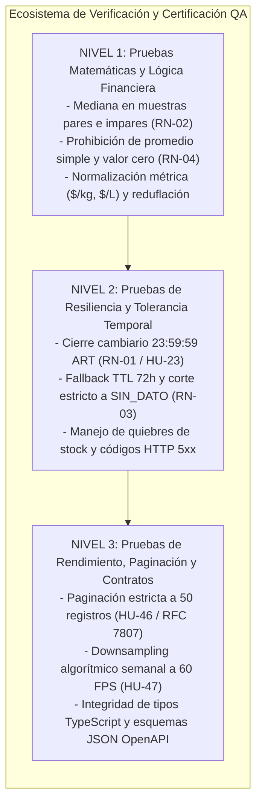
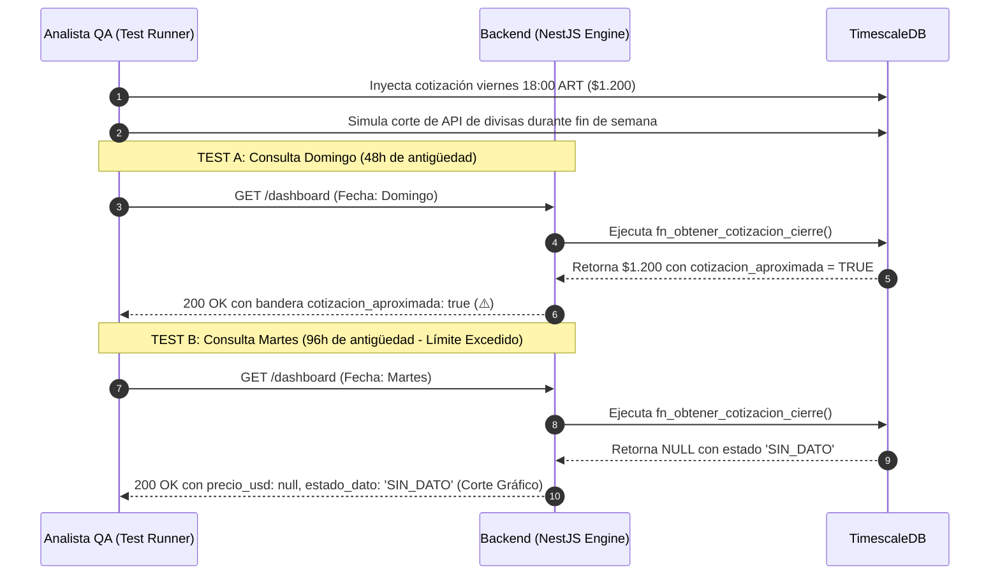

<p align="center">
  
</p>

# Matriz de Casos de Prueba y Criterios de Aceptación (QA Analysis)
**PriceScope — Monitor de Inflación Real Multimoneda**  
*Plataforma B2B de Analítica Económica e Inteligencia de Mercado*

---

## Metadatos del Documento

| Atributo | Detalle Oficial |
| :--- | :--- |
| **Código del Documento** | **`QTM-PRICESCOPE-V1.0`** |
| **Proyecto** | PriceScope — Monitor de Inflación Real Multimoneda |
| **Organización / Programa** | Simulación Laboral Abierta — NoCountry |
| **Sector de Negocio** | FinTech / Analítica Económica (B2B Analytics) |
| **Versión** | **1.0** (Oficial para Homologación y Certificación de Calidad) |
| **Fecha de Emisión** | 16 de Octubre de 2026 |
| **Ubicación en Repositorio** | `docs/01-analisis/06-QA-Test-Matrix.md` |
| **Documentos Vinculantes** | `01-SRS-PriceScope.md`, `02-API-Contracts-OpenAPI.md`, `03-Data-Model-TimescaleDB.md`, `04-Business-Rules-Math-Logic.md`, `05-Software-Architecture-Pipeline.md` |
| **Estado** | En Revisión y Aprobación Técnica por Células Operativas |

---

## Control de Cambios y Aprobación Formal (Sign-Off)

### HISTORIAL DE VERSIONES
| Versión | Fecha | Autor | Descripción del Cambio |
| :--- | :--- | :--- | :--- |
| **1.0** | 2026-10-16 | Equipo PriceScope | Formalización exhaustiva de la estrategia de aseguramiento de calidad (QA), suites de pruebas matemáticas, tolerancia cambiaria, resiliencia ante faltantes, rendimiento (60 FPS / paginación) y contratos de API para certificar el MVP antes del despliegue. |

### ACTA DE APROBACIÓN TÉCNICA (SIGN-OFF)
La firma de este documento certifica que los casos de prueba, datasets sintéticos, umbrales de rendimiento y criterios de aceptación constituyen el marco de homologación oficial y vinculante para el pase a producción.

| Rol Operativo | Célula de Trabajo | Integrante Asignado | Estado de Revisión | Firma / Fecha |
| :--- | :--- | :--- | :--- | :--- |
| **Tech Lead / PO Review** | `E-QA` | Gonzalo Cecchín | Pendiente | [ &nbsp;&nbsp;&nbsp;&nbsp; / &nbsp;&nbsp;&nbsp;&nbsp; / 2026 ] |
| **Analista QA Matemático** | `E-QA` | Karina Luvianos | Pendiente | [ &nbsp;&nbsp;&nbsp;&nbsp; / &nbsp;&nbsp;&nbsp;&nbsp; / 2026 ] |
| **Backend & DB Lead** | `E-API` | Luis Feliz | Pendiente | [ &nbsp;&nbsp;&nbsp;&nbsp; / &nbsp;&nbsp;&nbsp;&nbsp; / 2026 ] |
| **Frontend Lead & UX/UI** | `E-F/UX/UI` | Juan Camilo García | Aprobado | 16/10/2026 |

---

## 1. Estrategia y Objetivos de Aseguramiento de Calidad (QA)

La célula `E-QA` (liderada por **Gonzalo Cecchín** y **Karina Luvianos**) es la responsable de certificar de manera objetiva, matemática e imparcial que el sistema cumple con todas las especificaciones antes de autorizar el despliegue a producción.



### Principios de Certificación de la Célula `E-QA`:
1. **Rigor Matemático con Error Relativo Cero:** Toda fórmula financiera (mediana, diferencial de devaluación, conversión monetaria) debe coincidir al centavo entre la base de datos PostgreSQL/TimescaleDB y la API REST en NestJS.
2. **Defensa de la Honestidad Estadística (RN-04):** Rechazo inmediato de cualquier componente que simule o persista el número `0` ante caídas de red o falta de stock.
3. **Protección del Navegador y Rendimiento UI:** Certificación de que las consultas de series anuales no degraden la experiencia de usuario ni bloqueen el *Main Thread* de JavaScript en React/Next.js.

---

## 2. Casos de Prueba Matemáticos y Lógica de Negocio (Suite MATH)

### 2.1 Verificación de la Mediana por Categoría (RN-02 / HU-30)

#### TC-MATH-01: Cálculo de la Mediana en Muestra Impar con Outlier Severo
* **Identificador:** `TC-MATH-01`
* **Módulo Evaluado:** `E-API` (Motor de Agregación de Categorías) / `04-Business-Rules-Math-Logic.md` (Sección 2).
* **Prioridad:** Bloqueante (P0).
* **Dataset Sintético:** Canasta de 5 productos con variaciones registradas:
  $$V = [ +4.0\%, +5.0\%, +5.0\%, +6.0\%, +100.0\% ]$$
* **Procedimiento:**
  1. Ejecutar consulta de agregación sobre `/api/v1/dashboard` filtrando por la categoría.
  2. Verificar el valor en `variacion_mediana_pct`.
* **Resultado Esperado:** 
  $$\text{Mediana} = V_{(3)} = \mathbf{+5.00\%}$$
* **Criterio de Rechazo:** Si la API devuelve `+24.0%` (promedio simple), la prueba se marca como **FALLIDA** por violación flagrante de la regla **RN-02**.

#### TC-MATH-02: Cálculo de la Mediana en Muestra Par
* **Identificador:** `TC-MATH-02`
* **Módulo Evaluado:** `E-API` / Función `percentile_cont(0.5)`.
* **Prioridad:** Bloqueante (P0).
* **Dataset Sintético:** Canasta de 4 productos:
  $$V = [ +2.0\%, +4.0\%, +6.0\%, +8.0\% ]$$
* **Resultado Esperado:** 
  $$\text{Mediana} = \frac{4.0 + 6.0}{2} = \mathbf{+5.00\%}$$
* **Criterio de Aprobación:** Coincidencia exacta a 2 decimales sin truncamientos erróneos.

#### TC-MATH-03: Bloqueo de Inyección del Valor Cero Falso (RN-04)
* **Identificador:** `TC-MATH-03`
* **Módulo Evaluado:** Base de Datos (Constraint `chk_consistencia_dato`) y DTO de Ingesta.
* **Prioridad:** Bloqueante (P0).
* **Procedimiento de Intrusión:**
  1. Intentar insertar una tupla en `observaciones_precios` con `precio_regular = 0.00` y `estado_dato = 'DATO_VALIDO'`.
  2. Intentar insertar una tupla con `estado_dato = 'AGOTADO'` y `precio_regular = 1500.00`.
  3. Intentar insertar una tupla con `estado_dato = 'ERROR_CAPTURA'` y `precio_regular = 0.00`.
* **Resultado Esperado:** PostgreSQL aborta la transacción arrojando violación del constraint `chk_consistencia_dato`. La API devuelve código HTTP 422 RFC 7807 si se intenta enviar por payload.

#### TC-MATH-04: Normalización de Precio por Unidad Métrica (HU-16)
* **Identificador:** `TC-MATH-04`
* **Dataset:** Café molido clásica marca A:
  * Presentación comercial: Pote de 500g ($0.5\text{ kg}$), empaque `pack = 'x1'`, precio regular: \$12.000 ARS.
* **Fórmula:**
  $$\text{Precio por Unidad} = \frac{12000}{0.5 \times 1} = \mathbf{\$24.000,00/\text{kg}}$$
* **Resultado Esperado:** Campo `precio_por_unidad = 24000.0000` con unidad `'kg'`.

#### TC-MATH-05: Detección Automática de Reduflación (HU-15 / HU-38)
* **Identificador:** `TC-MATH-05`
* **Dataset Temporal:**
  * Día $t-1$: Café 500g vendido a \$12.000 ARS.
  * Día $t$: Misma publicación reduce empaque a 450g ($0.45\text{ kg}$) manteniendo el precio en \$12.000 ARS.
* **Resultado Esperado:**
  1. El sistema inserta un registro en `historial_contenido` con motivo `'REDUFLACION'`.
  2. Se crea un registro en `hitos_economicos` de tipo `'AUTOMATICO'`.
  3. El gráfico expone un pin de hito vertical en la fecha $t$ sin romper la continuidad de la serie.

#### TC-MATH-06: Aislamiento Estricto de la Zona Gris de Matching (HU-10 / RN-05)
* **Identificador:** `TC-MATH-06`
* **Módulo Evaluado:** `E-API` (Motor de Matching / Endpoint `/api/v1/matching/pending`) / `04-Business-Rules-Math-Logic.md` (Sección 9).
* **Prioridad:** Bloqueante (P0).
* **Dataset Sintético:**
  * Publicación extraída: *"Café Instantáneo Suave 170g Frasco"*.
  * Candidato canónico: *"Café Instantáneo Clásico 170g"*.
  * Score ponderado calculado: $S = 0.76$ (perteneciente al intervalo de incertidumbre $0.41 \le S \le 0.84$).
* **Procedimiento:**
  1. Ejecutar el pipeline de ingesta o matching sobre el ítem de prueba.
  2. Consultar el catálogo público y los endpoints de series temporales (`/products/{id}/traceability`).
  3. Consultar la bandeja de auditoría humana `GET /api/v1/matching/pending`.
* **Resultado Esperado:**
  1. La publicación **NO** se asocia automáticamente a la serie canónica ni se hace visible en el dashboard.
  2. El registro queda en estado `REQUIERE_REVISION` en la cola de pendientes.
  3. Solo tras invocar `POST /api/v1/matching/approve` con el ID de revisión se consolida el vínculo en la base de datos.
* **Criterio de Rechazo:** Si el sistema auto-vincula el producto sin intervención humana previa, la prueba es **FALLIDA** (violación de integridad de datos).

#### TC-MATH-07: Cálculo del Diferencial de Variación vs. Devaluación (HU-28 / RN-08)
* **Identificador:** `TC-MATH-07`
* **Módulo Evaluado:** `E-API` (Motor de Alertas y Analítica Macroeconómica) / `04-Business-Rules-Math-Logic.md` (Sección 8 y 10).
* **Prioridad:** Alta (P1).
* **Dataset Sintético:**
  * Período de análisis: 30 días.
  * Precio nominal en pesos: $\$10.000 \rightarrow \$12.500$ ($v_{\text{pesos}} = +25.0\%$).
  * Cotización de cierre Dólar Blue: $\$1.000 \rightarrow \$1.200$ ($v_{\text{divisa}} = +20.0\%$).
* **Fórmula:**
  $$\Delta_{\text{puntos}} = v_{\text{pesos}} - v_{\text{divisa}} = +25.0\% - (+20.0\%) = \mathbf{+5.0\text{ puntos porcentuales}}$$
* **Resultado Esperado:**
  1. El endpoint `GET /api/v1/alerts` expone una alerta de tipo `INFLACION_DIVERGENTE`.
  2. En el payload, el campo `diferencial_puntos = 5.0` y la descripción explicita: *"El producto aumentó 5.0 puntos porcentuales por encima del ritmo de devaluación de la divisa"*.
  3. Queda estrictamente verificado que no se utiliza el término ambiguo *"inflación real"* sin calificar el cálculo monetario.

---

## 3. Pruebas de Resiliencia, Tolerancia Temporal y Divisas (Suite RESIL)

### 3.1 Sincronización al Cierre Cambiario y Fallback de 72 Horas (RN-01, RN-03 / HU-22, HU-23)



#### TC-RESIL-01: Sincronización Cambiaria al Cierre del Día (23:59:59 ART)
* **Identificador:** `TC-RESIL-01`
* **Escenario:** Observación de precio extraída el 2026-10-16 a las 11:00 ART (14:00 UTC). En la base de datos existen dos cotizaciones financieras ese día:
  * Cotización A: 15:00 ART (\$1.200 ARS/USD).
  * Cotización B: 23:45 ART (\$1.220 ARS/USD).
* **Resultado Esperado:** El sistema debe emparejar el precio con la Cotización B (\$1.220) por ser la más cercana antes del corte de las 23:59:59 ART.
* **Conversión:** Precio regular \$12.200 ARS $\rightarrow$ $\text{precio\_usd} = \mathbf{10.00\text{ USD}}$.

#### TC-RESIL-02: Activación de Fallback Cambiario dentro de Ventana TTL (48 Horas)
* **Identificador:** `TC-RESIL-02`
* **Escenario:** Simulación de feriado puente bancario. La última cotización válida registrada data de 48 horas continuas hacia atrás.
* **Resultado Esperado:**
  * La conversión a USD se ejecuta con éxito.
  * El payload incluye obligatoriamente: `"cotizacion_aproximada": true`.
  * La interfaz en React renderiza el icono de advertencia visual (⚠️) en la tarjeta de KPI y tooltip.

#### TC-RESIL-03: Expiración de Tolerancia Cambiaria (> 72 Horas) y Corte a `SIN_DATO`
* **Identificador:** `TC-RESIL-03`
* **Escenario:** Caída simulada de la API financiera externa por 96 horas continuas.
* **Resultado Esperado:**
  * El Backend aborta la conversión a moneda dura para esa fecha.
  * Se emite `precio_usd: null`, `cotizacion_aplicada: null` y `estado_dato: 'SIN_DATO'`.
  * En la gráfica de Recharts/Chart.js se genera un **corte físico visible (*gap*)** en la curva en dólares, impidiendo que la línea descienda a cero.

#### TC-RESIL-04: Tratamiento de Tienda Caída y Quiebre de Stock
* **Identificador:** `TC-RESIL-04`
* **Escenario:** El scraper detecta botón de compra deshabilitado en Carrefour (`AGOTADO`) y timeout HTTP 504 en Jumbo (`ERROR_CAPTURA`).
* **Resultado Esperado:**
  * Carrefour se persiste con `estado_dato = 'AGOTADO'`, `disponible = false`, `precio_regular = null`.
  * Jumbo se persiste con `estado_dato = 'ERROR_CAPTURA'`, `precio_regular = null`, preservando la URL de origen.
  * La banda de calidad diaria (`banda_calidad_diaria`) expone:
    * Amarillo para la fecha de Carrefour.
    * Rojo para la fecha de Jumbo.

---

## 4. Pruebas de Rendimiento, Paginación y Contratos OpenAPI (Suite PERF-INT)

### 4.1 Protección de Memoria y Paginación Masiva (RN-06 / HU-46)

#### TC-PERF-01: Límite Estricto de Paginación en Alertas
* **Identificador:** `TC-PERF-01`
* **Petición HTTP:** `GET /api/v1/alerts?page=1&limit=50` sobre una base de datos con 150 alertas generadas.
* **Resultado Esperado:**
  * Retorna código `200 OK`.
  * El arreglo `alertas` contiene exactamente 50 elementos.
  * El objeto `paginacion` expone: `pagina_actual: 1`, `limite_por_pagina: 50`, `total_registros: 150`, `total_paginas: 3`.

#### TC-PERF-02: Rechazo por Exceso de Límite de Paginación (> 50)
* **Identificador:** `TC-PERF-02`
* **Petición HTTP:** `GET /api/v1/alerts?page=1&limit=100`.
* **Resultado Esperado:**
  * El servidor rechaza la petición con código **`422 Unprocessable Entity`**.
  * El payload de respuesta sigue el formato **RFC 7807 (Problem Details)**:
    ```json
    {
      "type": "https://pricescope.internal/errors/unprocessable-entity",
      "title": "Violación de Parámetro de Paginación",
      "status": 422,
      "detail": "El parámetro 'limit' solicitado (100) excede el máximo permitido de 50 registros por página (HU-46)."
    }
    ```

### 4.2 Downsampling Algorítmico y Renderizado Fluido a 60 FPS (RN-07 / HU-47)

#### TC-PERF-03: Downsampling en Consulta Anual (Rango > 90 Días)
* **Identificador:** `TC-PERF-03`
* **Petición HTTP:** `GET /api/v1/dashboard?fecha_desde=2025-10-16&fecha_hasta=2026-10-16&moneda=ARS` (365 días continuos de historial).
* **Evaluación de Rendimiento:**
  1. El Backend consume la vista `agg_precios_semanales`.
  2. El payload JSON debe contener entre **52 y 53 puntos** como máximo en lugar de 365 observaciones crudas.
  3. Los metadatos confirman: `"downsampling_aplicado": true` e `"intervalo_agrupacion": "1w"`.
  4. En el navegador del cliente (Chrome DevTools Performance), el renderizado del componente `GraficoEvolucion` debe ejecutarse en menos de **16.6 milisegundos por frame**, certificando una tasa constante de **60 FPS** sin caídas perceptibles.

#### TC-PERF-04: Serie Diaria Completa en Rango Corto ($\le 90$ Días)
* **Identificador:** `TC-PERF-04`
* **Petición HTTP:** `GET /api/v1/dashboard?fecha_desde=2026-09-16&fecha_hasta=2026-10-16` (30 días).
* **Resultado Esperado:**
  * Retorna la serie continua de 30 puntos diarios.
  * Metadatos: `"downsampling_aplicado": false`, `"intervalo_agrupacion": "1d"`.

#### TC-PERF-05: Rechazo por Exceso de Rango Temporal (> 365 Días - RN-09)
* **Identificador:** `TC-PERF-05`
* **Petición HTTP:** `GET /api/v1/dashboard?fecha_desde=2024-01-01&fecha_hasta=2026-10-16` (Rango de más de 2 años).
* **Resultado Esperado:**
  * El servidor rechaza inmediatamente la petición con código **`422 Unprocessable Entity`** bajo estándar RFC 7807 sin ejecutar agregaciones pesadas en base de datos.
  * Detalle de error: `"El rango temporal solicitado supera el límite máximo permitido de 365 días (1 año calendario) para proteger el rendimiento del servicio."`

---

## 5. Matriz Maestra Consolidada de Casos de Prueba (Certificación QA)

| ID Caso de Prueba | Módulo / Historia | Tipo de Prueba | Nivel de Severidad | Célula Responsable | Criterio de Aprobación (Pass / Fail) |
| :--- | :--- | :--- | :--- | :--- | :--- |
| **TC-MATH-01** | Mediana Impar (HU-30) | Unitaria / Matemática | Bloqueante (P0) | `E-API` / `E-QA` | Mediana $= +5.00\%$ con outlier del $+100\%$. Promedio simple prohibido. |
| **TC-MATH-02** | Mediana Par (HU-30) | Unitaria / Matemática | Bloqueante (P0) | `E-API` / `E-QA` | Mediana $= +5.00\%$ en muestra par de 4 elementos. |
| **TC-MATH-03** | Anti-Cero (RN-04) | Integración / DB | Bloqueante (P0) | `E-API` / `E-Scrapper` | PostgreSQL aborta inserción con `chk_consistencia_dato` si precio es 0. |
| **TC-MATH-04** | Precio Unidad (HU-16) | Unitaria / Lógica | Alta (P1) | `E-API` / `E-QA` | Conversión a \$/kg exacta desacoplada de la configuración `pack`. |
| **TC-MATH-05** | Reduflación (HU-15) | Integración / Eventos | Alta (P1) | `E-API` / `E-QA` | Inserción automática de hito al reducir gramaje manteniendo precio. |
| **TC-MATH-06** | Zona Gris Matching (HU-10)| Integración / Lógica | Bloqueante (P0) | `E-API` / `E-QA` | Score $S=0.76$ se deriva a `/matching/pending`; bloqueo de auto-asociación. |
| **TC-MATH-07** | Diferencial vs USD (HU-28)| Analítica / Alertas | Alta (P1) | `E-API` / `E-QA` | Cálculo $\Delta_{\text{pts}} = +5.0$; alerta disparada sin término ambiguo. |
| **TC-RESIL-01** | Cierre 23:59:59 (HU-23)| Integración / Temporal | Bloqueante (P0) | `E-API` / `E-QA` | Cruce con última cotización anterior a las 23:59:59 hora local ART. |
| **TC-RESIL-02** | Fallback 48h (HU-22) | Integración / Divisas | Alta (P1) | `E-API` / `E-QA` | Conversión válida con flag `"cotizacion_aproximada": true` e icono ⚠️. |
| **TC-RESIL-03** | TTL > 72h (HU-22) | Tolerancia a Fallos | Bloqueante (P0) | `E-API` / `E-QA` | Aborto de conversión en USD a las 72h+1s; asignación de `SIN_DATO`. |
| **TC-RESIL-04** | Agotados / 5xx (RN-04)| Resiliencia Scraper | Bloqueante (P0) | `E-Scrapper` / `E-QA`| Precios nulos en stock agotado o error 5xx; semáforo amarillo/rojo en UI. |
| **TC-PERF-01** | Paginación 50 (HU-46) | Rendimiento / API | Alta (P1) | `E-API` / `E-QA` | Retorna exactamente 50 registros por página con metadatos completos. |
| **TC-PERF-02** | Límite > 50 (HU-46) | Validación / RFC 7807| Media (P2) | `E-API` / `E-QA` | Rechazo con código HTTP 422 si se solicita `limit > 50`. |
| **TC-PERF-03** | Downsampling (HU-47) | Rendimiento / UI | Bloqueante (P0) | `E-API` / `E-F/UX/UI`| Máximo 52 puntos por año; renderizado fluido en React a 60 FPS. |
| **TC-PERF-04** | Rango Corto (HU-47) | Funcional / API | Media (P2) | `E-API` / `E-QA` | Serie diaria completa sin downsampling en períodos $\le 90$ días. |
| **TC-PERF-05** | Límite 365d (RN-09) | Validación / DoS | Alta (P1) | `E-API` / `E-QA` | Rechazo con código HTTP 422 si rango solicitado supera los 365 días. |
| **TC-SEC-01** | Mitigación IDOR | Seguridad / Endpoint | Bloqueante (P0) | `E-API` / `E-QA` | Rutas dinámicas usan UUID inmutable (`/products/{uuid}/traceability`). |
| **TC-SEC-02** | Validación URL Regex | Seguridad / Scraping | Alta (P1) | `E-Scrapper` / `E-DB`| Rechazo de URLs de tienda que no inicien bajo protocolo seguro `^https?://`. |

---

## 6. Procedimiento de Certificación para el Despliegue (Sign-Off Gate)

Para que el Tech Lead y QA autoricen formalmente el paso del monorepo a los servidores de producción (Hito de Cierre de Fase 1 / Semana 3), se deben cumplir sin excepción los siguientes requisitos:

1. **100% de Pruebas P0 (Bloqueantes) Aprobadas:** Todos los casos `TC-MATH-01`, `TC-MATH-02`, `TC-MATH-03`, `TC-MATH-06`, `TC-RESIL-01`, `TC-RESIL-03`, `TC-RESIL-04`, `TC-PERF-03` y `TC-SEC-01` deben ejecutarse en verde.
2. **Cero Tolerancia a Valores Cero:** Ninguna tupla en base de datos ni ningún campo de precio en la API puede exponer `0` o `0.0` ante faltantes.
3. **Validación Cruzada Monorepo:** 
   * Scraper persistiendo datos mediante bulk insert en TimescaleDB.
   * API ejecutando cálculos de mediana y cierre cambiario.
   * Frontend consumiendo y pintando la interfaz a 60 FPS con franja semafórica.
4. **Firma del Acta de Calidad:** Registro de aprobación de **Gonzalo Cecchín** y **Karina Luvianos** en el control de cambios oficial.
