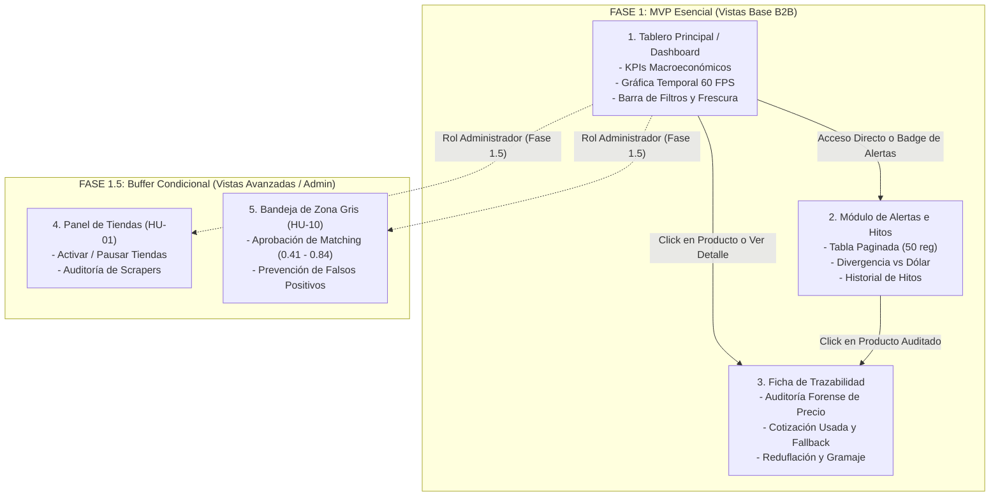

<p align="center">
  
</p>

# Especificación de Diseño UX/UI y Arquitectura Frontend
**PriceScope — Monitor de Inflación Real Multimoneda**  
*Plataforma B2B de Analítica Económica e Inteligencia de Mercado*

---

## Metadatos del Documento

| Atributo | Detalle Oficial |
| :--- | :--- |
| **Código del Documento** | **`UIX-PRICESCOPE-V1.0`** |
| **Proyecto** | PriceScope — Monitor de Inflación Real Multimoneda |
| **Organización / Programa** | Simulación Laboral Abierta — NoCountry |
| **Sector de Negocio** | FinTech / Analítica Económica (B2B Analytics) |
| **Versión** | **1.0** (Guía Oficial de Prototipado en Figma y Maquetación en Next.js) |
| **Fecha de Emisión** | 16 de Octubre de 2026 |
| **Ubicación en Repositorio** | `docs/01-analisis/07-Frontend-UX-UI-Specs.md` |
| **Documentos Vinculantes** | `01-SRS-PriceScope.md`, `02-API-Contracts-OpenAPI.md`, `04-Business-Rules-Math-Logic.md`, `05-Software-Architecture-Pipeline.md`, `06-QA-Test-Matrix.md` |
| **Estado** | En Revisión y Aprobación Técnica por Células Operativas |

---

## Control de Cambios y Aprobación Formal (Sign-Off)

### HISTORIAL DE VERSIONES
| Versión | Fecha | Autor | Descripción del Cambio |
| :--- | :--- | :--- | :--- |
| **1.0** | 2026-10-16 | Juan Camilo García | Especificación exhaustiva de arquitectura de interfaz, diseño atómico en Figma, flujos de usuario, layouts responsive y especificación de pantallas core (Fase 1: Dashboard, Alertas, Trazabilidad) y condicionales (Fase 1.5: Panel de Tiendas y Zona Gris). |

### ACTA DE APROBACIÓN TÉCNICA (SIGN-OFF)
| Rol Operativo | Célula de Trabajo | Integrante Asignado | Estado de Revisión | Firma / Fecha |
| :--- | :--- | :--- | :--- | :--- |
| **Frontend Lead & UX/UI** | `E-F/UX/UI` | Juan Camilo García | Aprobado | 16/10/2026 |
| **Tech Lead / PO Review** | `E-QA` | Gonzalo Cecchín | Pendiente | [ &nbsp;&nbsp;&nbsp;&nbsp; / &nbsp;&nbsp;&nbsp;&nbsp; / 2026 ] |
| **Backend & DB Lead** | `E-API` | Luis Feliz | Pendiente | [ &nbsp;&nbsp;&nbsp;&nbsp; / &nbsp;&nbsp;&nbsp;&nbsp; / 2026 ] |

---

## 1. Fundamentos de Diseño y Sistema de Diseño (Design System)

La experiencia de PriceScope está orientada a **analistas macroeconómicos, directores de finanzas (CFOs) y gerentes de compras (Procurement B2B)**. La interfaz debe transmitir **rigor técnico, sobriedad financiera, alta densidad de datos sin saturación y rendimiento de 60 FPS**.

### 1.0 Stack de Componentes y UI Kit
* **Framework:** **Next.js 14+ (App Router / React / TypeScript)**.
* **Componentes Base y Accesibilidad:** **shadcn/ui** (construido sobre Radix UI Primitives y Tailwind CSS), garantizando componentes accesibles y totalmente personalizables (`Dialog`, `DropdownMenu`, `DateRangePicker`, `Table`, `Badge`, `Toggle`).
* **Visualización de Datos & Gráficas:** **Tremor** (`@tremor/react`), librería nativa de analítica y finanzas sugerida formalmente por NoCountry, utilizada tanto para las tarjetas de KPI (`Card`, `Metric`, `Text`, `BadgeDelta`) como para el **motor de gráficos interactivos** (`LineChart`, `AreaChart`, `ScatterChart`), optimizado para renderizado fluido a 60 FPS con downsampling semanal.
* **Iconografía:** **Lucide Icons** (`lucide-react`).

### 1.1 Paleta de Color Institucional y Semántica Financiera
* **Colores Principales de Marca:**
  * `Primary Dark (Fondo Sidebar / Elementos Clave):` `#0F172A` (Slate 900)
  * `Primary Brand (Acentos / Serie Principal):` `#2563EB` (Blue 600)
  * `Surface Base (Fondo de Aplicación):` `#F8FAFC` (Slate 50)
  * `Surface Card (Contenedores / Modales):` `#FFFFFF` (White)
  * `Border / Dividers:` `#E2E8F0` (Slate 200)
* **Semáforo Forense de Calidad de Datos (RN-04 / HU-48):**
  * `Dato Válido (Verde):` `#16A34A` (Green 600) — Captura íntegra, stock disponible.
  * `Agotado / Quiebre (Amarillo):` `#D97706` (Amber 600) — Sin stock comercial.
  * `Error de Captura (Rojo):` `#DC2626` (Red 600) — Caída de portal o HTTP 5xx.
  * `Sin Dato (Gris / Corte):` `#94A3B8` (Slate 400) — Sin cotización (>72h).
* **Alertas e Hitos Económicos:**
  * `Advertencia Cambiaria (Fallback TTL 48h):` `#F59E0B` (Amber 500) con icono `⚠️`.
  * `Hito Reduflación (Cambio Gramaje):` `#7C3AED` (Purple 600).
  * `Hito Promoción Comercial:` `#0D9488` (Teal 600).

### 1.2 Tipografía y Escala Numérica
* **Fuente Primaria:** `Plus Jakarta Sans` o `Inter` (Sans-Serif moderna con cifras tabulares).
* **Cifras Numéricas (`font-variant-numeric: tabular-nums`):** Imprescindible en tablas de precios y KPIs para que los decimales queden perfectamente alineados verticalmente.
* **Escala de Texto:**
  * KPI Metric: `text-3xl font-bold tracking-tight` (30px)
  * Header de Pantalla: `text-2xl font-semibold` (24px)
  * Subtítulos / Cards: `text-lg font-medium` (18px)
  * Body / Tablas: `text-sm font-normal` (14px)
  * Metadata / Labels: `text-xs font-medium uppercase tracking-wider` (12px)

---

## 2. Mapa de Navegación del Sistema



---

## 3. Especificación Detallada de Pantallas Base (Fase 1 — MVP)

### 3.1 Pantalla 1: Tablero Principal / Dashboard Analítico (`/dashboard`)
Es la pantalla central de analítica donde los directivos y analistas consultan los índices de variación de precios y su correlación con la divisa.

```text
+----------------------------------------------------------------------------------------------------+
|  [Logo PriceScope]   Dashboard   |   Alertas (3)   |   Trazabilidad        [Últ. Act: Hoy 14:00 ART ●] |
+----------------------------------------------------------------------------------------------------+
|  FILTROS: [ Selector de Fechas: Desde YYYY-MM-DD  Hasta YYYY-MM-DD ] [ Atajos: 30D | 90D | 1A ]   |
|           [ Tienda: Todas v ]  [ Categoría: Almacén v ]  [ Moneda: ARS / USD Blue v ] [ Limpiar ]  |
+----------------------------------------------------------------------------------------------------+
|  [ KPI 1: Variación ARS ]   [ KPI 2: Variación USD ]   [ KPI 3: vs Devaluación ]   [ KPI 4: Mediana ]  |
|         +25.0%                    +5.0%                      +5.0 pts                    +5.0%     |
|   Precio Reg. vs Base       Cotiz: $1.200 (Venta)       Exceso vs Divisa         Cat: Almacén (N=45) |
+----------------------------------------------------------------------------------------------------+
|  EVOLUCIÓN TEMPORAL DE PRECIOS             [ Downsampling: >90d = Semanal ] [ Toggle Cortes|Continuo]
|  +----------------------------------------------------------------------------------------------+  |
|  | $14.000 |                                                   * (Hito: Reduflación 450g)        |  |
|  | $12.000 |                         /------------------------\                                 |  |
|  | $10.000 |   /--------------------/                          \------ (Gap: Agotado) ---\      |  |
|  |  $8.000 | _/                                                                           \____ |  |
|  +----------------------------------------------------------------------------------------------+  |
|    Banda Calidad: [ ■■■■■■■■■■■■■■■■■■■■■■■■■■■■■■■■■■■■■■■■■■■■■■■■■■■■■■■■■■■■■■■■■■■■■■■■■■■ ]      |
|    Leyenda: ■ Válido (Verde)   ■ Agotado (Amarillo)   ■ Error Captura (Rojo)   ■ Sin Dato (Gris)   |
+----------------------------------------------------------------------------------------------------+
```

#### Componentes Clave:
1. **Barra Superior de Estado (Header):**
   * Imagotipo corporativo alineado a la izquierda.
   * Indicador de **Frescura de Datos (`HU-49`):** Badge dinámico con círculo verde pulsante (`●`) que expone: *"Datos actualizados al: 16/10/2026 14:00 ART"*.
2. **Barra de Filtros Dinámica y Rango Temporal Totalmente Personalizable:**
   * **Selector Temporal Custom Base (`fecha_desde` y `fecha_hasta`):** El usuario puede seleccionar libremente cualquier ventana de fechas en un *DateRangePicker* nativo (`YYYY-MM-DD`).
   * **Atajos Rápidos en UI (Client-Side Quick Presets):** Botones auxiliares de un clic (`30D`, `90D`, `1A`) que únicamente recalculan los valores de `fecha_desde` y `fecha_hasta` en el frontend para comodidad del usuario, enviando siempre el rango explícito a la API.
   * **Regla Automática de Downsampling (RN-07 / HU-47):**
     * **Rango $\le 90$ días:** La API entrega la serie día a día (resolución diaria fina).
     * **Rango $> 90$ días:** La API y la base de datos agrupan automáticamente los datos en **1 punto por semana (mediana semanal)** mediante `agg_precios_semanales`. La interfaz muestra el pill informativo: *"Vista semanal activa (optimización a 60 FPS)"*.
   * **Filtros Adicionales:** Selectores desplegables de Tienda, Categoría y Moneda (ARS, USD Blue, USD Oficial) con botón *"Limpiar Filtros"* y chips activos.
3. **Fila de Tarjetas de Indicadores Clave (KPIs):**
   * **Variación acumulada en moneda local ($):** Cambio porcentual nominal entre fecha inicio y fin.
   * **Variación acumulada en USD:** Cambio porcentual de precios convertidos a dólares con cotización de cierre.
   * **Comparación vs. Devaluación:** Diferencial en puntos porcentuales netos ($\Delta_{\text{pts}} = v_{\text{pesos}} - v_{\text{divisa}}$).
   * **Variación por Categoría (Mediana):** Mediana estadística de la categoría seleccionada (aislando outliers severos). Expone el porcentaje de cobertura muestral (`cobertura_pct`). Si la muestra es insuficiente, muestra el estado *"Sin datos suficientes"*.
4. **Gráfico de Evolución Temporal (`grafico_evolucion` a 60 FPS):**
   * **Mapeo 1:1 con Contrato API (`GET /api/v1/dashboard`):** La gráfica consume directamente la colección `grafico_evolucion.series`.
   * **Alternancia Monetaria Fluida:**
     * Al seleccionar `moneda=ARS`, la serie principal grafica el campo `precio_regular` (numérico en pesos) y puntos secundarios sobre `precio_promocional` si no es nulo.
     * Al seleccionar `moneda=USD`, la serie grafica el campo `precio_usd` y expone en tooltip el valor de `cotizacion_aplicada`.
   * **Representación de Faltantes según `estado_dato`:**
     * `DATO_VALIDO`: Punto y línea continua normal.
     * `AGOTADO`, `ERROR_CAPTURA` o `SIN_DATO`: La API envía `precio_regular: null` y `precio_usd: null`. El gráfico genera un **corte físico visible (*gap*)** en ese punto temporal (la línea no desciende a cero).
   * **Controles de Lectura en UI (Toggle):**
     * *Modo Estricto (Por Defecto):* Respeta los cortes (*gaps*) físicos de la serie.
     * *Modo Continuo (Visualización Tendencial):* El frontend une los puntos válidos con una línea punteada interpolando temporalmente según la regla LOCF informada en `kpis.variacion_pesos.regla_faltantes`.
   * **Franja Semafórica de Calidad Diaria (`banda_calidad_diaria`):** Consume directamente el arreglo `[{ fecha, estado }]` entregado por la API:
     * `VERDE` $\rightarrow$ Verde (`#16A34A`).
     * `AMARILLO` $\rightarrow$ Amarillo (`#D97706`).
     * `ROJO` $\rightarrow$ Rojo (`#DC2626`).
   * **Downsampling Algorítmico Transparente (`metadata`):**
     * Si `metadata.downsampling_aplicado == true`, la UI expone un pill informativo: *"Agrupación semanal activa (52 pts) para optimización visual"*.
   * **Marcadores de Hitos (`hitos`):** Consume la lista de hitos de la API (`tipo`, `titulo`, `descripcion`) y renderiza un pin vertical interactivo sobre el eje X.
   * **Tooltips Ricos e Interactivos:**
     * Muestran fecha, precio en pesos, cotización usada y motivo del estado (`motivo`).
     * **Alerta de Fallback:** Si `cotizacion_aproximada == true`, el tooltip muestra obligatoriamente el icono de advertencia visual (**⚠️**) indicando *"Cotización aproximada por cierre anterior (<72h)"*.

---

### 3.2 Pantalla 2: Módulo de Alertas e Hitos Económicos (`/alerts`)
Diseñada para detectar desviaciones anómalas de precios que superan la devaluación y auditar hitos comerciales.

```text
+----------------------------------------------------------------------------------------------------+
|  [Logo PriceScope]   Dashboard   |   Alertas (3 Activas)   |   Trazabilidad                            |
+----------------------------------------------------------------------------------------------------+
|  ALERTAS DE INFLACIÓN DIVERGENTE (PRECIO SUPERA AL DÓLAR)                   [ Exportar CSV / JSON ]|
|  Filtros: [ Severidad: Todas v ]  [ Categoría: Todas v ]                                           |
+----------------------------------------------------------------------------------------------------+
| Producto               | Tienda     | Var. Precio | Var. USD  | Diferencial | Cotiz. Usada | Acción |
|------------------------|------------|-------------|-----------|-------------|--------------|--------|
| Café Molido 500g Clás. | Carrefour  |   +25.0%    |  +20.0%   |  +5.0 pts   | $1.200 (Blue)| [Ver]  |
| Aceite Girasol 1.5L    | Jumbo      |   +32.0%    |  +20.0%   | +12.0 pts   | $1.200 (Blue)| [Ver]  |
| Smart TV 55" 4K UHD    | Frávega    |   +45.0%    |  +20.0%   | +25.0 pts   | $1.200 (Blue)| [Ver]  |
+----------------------------------------------------------------------------------------------------+
| Mostrando 1-50 de 150 alertas              [ Anterior ]  Página 1 de 3  [ Siguiente ] (Límite: 50) |
+----------------------------------------------------------------------------------------------------+
| HISTORIAL VISUAL DE HITOS Y REDUFLACIÓN                                                            |
|  - 2026-10-15: [Reduflación Detectada] Café Marca A redujo empaque de 500g a 450g (-10%)           |
|  - 2026-10-12: [Evento Comercial] Inicio de jornada promocional ElectroFest                        |
+----------------------------------------------------------------------------------------------------+
```

#### Componentes Clave:
1. **Tabla Paginada Estricta a 50 Registros (HU-46):**
   * Control de paginación obligatorio para impedir el bloqueo del navegador por carga excesiva.
   * Controles de página: Página actual, total de páginas y selector de página.
2. **Columnas de Desglose Matemático:**
   * Nombre del Producto y Tienda de origen.
   * Variación porcentual del precio regular en pesos ($v_{\text{pesos}}$).
   * Variación porcentual de la divisa de referencia ($v_{\text{divisa}}$).
   * **Diferencial neto en puntos ($\Delta_{\text{pts}}$):** Resaltado con chip rojo de atención.
   * Cotización de cierre aplicada con marca de advertencia ⚠️ si proviene de fallback.
   * Botón de acción directo *"Auditar"* que navega a la ficha de trazabilidad del producto.
3. **Panel Inferior de Hitos del Mercado:**
   * Línea de tiempo visual (*Timeline*) con hitos automáticos detectados por el sistema (reduflaciones registradas) e hitos manuales (eventos de alta/baja de tiendas).

---

### 3.3 Pantalla 3: Ficha de Producto y Trazabilidad Forense (`/products/{id}/traceability`)
Orientada a directores legales y analistas financieros para certificar el origen de cada dato.

```text
+----------------------------------------------------------------------------------------------------+
|  [Logo PriceScope]   <- Volver al Dashboard                                                        |
+----------------------------------------------------------------------------------------------------+
|  FICHA TÉCNICA DEL PRODUCTO CANÓNICO                                                               |
|  Nombre: Café Tostado Clásico Molido              Marca: La Virginia         Categoría: Almacén    |
|  Contenido Neto Base: 500g (0.5000 kg)            Unidad Métrica: kg         Empaque: x1           |
|  Historial de Reduflación: [ 2026-10-15: Reducción de 500g a 450g detectada (Motivo: REDUFLACION)] |
+----------------------------------------------------------------------------------------------------+
|  REGISTRO HISTÓRICO DE OBSERVACIONES (APPEND-ONLY)                                                 |
|  Fecha y Hora Local (ART) | Tienda    | Precio Reg. | Precio $/kg   | Estado Stock | Cotiz. USD     |
|---------------------------|-----------|-------------|---------------|--------------|----------------|
| 2026-10-16 11:30 ART      | Carrefour | $12.000,00  | $24.000,00/kg | DISPONIBLE   | $1.200 (10.00$)|
| 2026-10-15 11:30 ART      | Jumbo     | $12.000,00  | $26.666,67/kg | DISPONIBLE   | $1.190 (10.08$)|
| 2026-10-14 11:30 ART      | Carrefour |    --       |     --        | AGOTADO      | SIN_DATO (gap) |
+----------------------------------------------------------------------------------------------------+
|  AUDITORÍA DE REGLAS: Versión Algorítmica: v1.0 | Sincronización: 23:59:59 ART | Fallback: TTL 72h |
+----------------------------------------------------------------------------------------------------+
```

#### Componentes Clave:
1. **Ficha Canónica del Producto:** Muestra marca, modelo, empaque, contenido neto normalizado e histórico de cambios de gramaje (`historial_contenido`).
2. **Tabla de Observaciones de Solo Lectura (Append-Only):**
   * Estampas de tiempo convertidas a hora local de Argentina (ART = UTC-3).
   * Precio nominal, precio regular y precio por unidad de medida normalizada ($/kg o $/L).
   * Estado del dato: `DATO_VALIDO`, `AGOTADO`, `ERROR_CAPTURA` o `SIN_DATO` (nunca el número cero).
   * Cotización de cierre aplicada detallando fuente y hora de fijación cambiaria.
3. **Caja de Metadatos de Negocio:** Detalle de las reglas matemáticas con las que se construyó la serie.

---

## 4. Especificación de Pantallas del PLUS / Buffer Condicional (Fase 1.5)

Estas pantallas se incorporarán al diseño de Figma y a la maquetación en Next.js únicamente cuando el MVP base esté 100% certificado y desplegado:

### 4.1 Pantalla 4: Panel de Tiendas y Administración de Scrapers (`/admin/stores` - HU-01)
* **Objetivo:** Permitir a un usuario administrador auditar la salud de los scrapers y activar/pausar fuentes.
* **Componentes de UI:**
  * Tabla con las 4 tiendas piloto (Carrefour, Jumbo, Frávega, Musimundo).
  * Switch de activación (`Activa` / `Pausada`).
  * Indicador de última ejecución (Hora inicio, duración, publicaciones leídas, guardadas y fallidas).
  * Botón de ejecución manual bajo demanda (*Trigger Run*).

### 4.2 Pantalla 5: Bandeja de Auditoría y Aprobación de Zona Gris (`/admin/matching` - HU-10)
* **Objetivo:** Interfaz humana para validar o descartar publicaciones cuyo score de similitud caiga en el rango de incertidumbre $0.41 \le S \le 0.84$.
* **Componentes de UI:**
  * Tarjetas comparativas lado a lado: *Publicación Extraída en Tienda* vs. *Producto Canónico Propuesto*.
  * Barra de similitud gráfica con el score ponderado (ej. `Score: 0.76`).
  * Botones de acción binarios:
    * `[ Aprobar Vínculo ]` $\rightarrow$ Realiza `POST /api/v1/matching/approve`.
    * `[ Descartar / Crear Nuevo Canónico ]` $\rightarrow$ Evita contaminación de la serie.

---

## 5. Criterios de Rendimiento Frontend (60 FPS & UX)

Para cumplir con la homologación de calidad de la célula `E-QA` (`TC-PERF-03` / `HU-47`):
1. **Preservación de Tasa de Refresco a 60 FPS:** En consultas interactivas (zoom, pan, cambio de moneda), el tiempo de renderizado por cuadro no debe superar los **16.6ms**.
2. **Uso de Memoización en Componentes Pesados:** Uso estricto de `useMemo` y `React.memo` en el cálculo de coordenadas de la gráfica Tremor (`LineChart` / `AreaChart`) para evitar re-renderizados innecesarios del DOM.
3. **Cero Salto de Diseño (Cumulative Layout Shift - CLS < 0.1):** Las tarjetas de KPI y los contenedores de gráficos deben tener esqueletos de carga (*skeletons*) con dimensiones fijas para evitar brincos en la pantalla al recibir los datos de la API.
4. **Respeto a la Definición de Honestidad Visual (RN-04):** Queda prohibido pintar líneas que desciendan a cero ante datos nulos; la curva debe cortarse físicamente para representar la ausencia real de precio.

---

## 6. Gestión de Entregables de Diseño en Figma y Gobernanza en el Repositorio

Para articular el trabajo de diseño visual con el repositorio de código y evitar dispersión de enlaces o archivos huérfanos:

### 6.1 Enlaces Oficiales del Proyecto en Figma
Los tableros interactivos de Figma (Wireframes, Prototipo de Alta Fidelidad y Design System) se centralizan en la nube y se vinculan oficialmente en esta documentación:

* **Figma File Oficial (Design System & UI Kit):** `[Pegar URL pública de Figma aquí]`
* **Prototipo Interactivo (Figma Presentation Flow):** `[Pegar URL del modo Prototype/Present aquí]`
* **Modo de Acceso:** Rol de *Viewer* con permisos de inspección (*Dev Mode*) habilitados para las células `E-API` y `E-QA`.

### 6.2 Dónde y Cómo se Suben los Diseños al Repositorio Git
Dado que los archivos nativos de Figma no se pueden commitear directamente como texto:
1. **Exportación de Wireframes y Mockups Clave a `docs/assets/`:**
   * Una vez aprobados los diseños de alta fidelidad de las 3 pantallas base en Figma, se exportan capturas en formato `.png` de resolución `@2x` y se almacenan en:
     ```text
     docs/assets/
     ├── wireframes/
     │   ├── 01-dashboard-view.png
     │   ├── 02-alerts-table-view.png
     │   ├── 03-traceability-product-view.png
     │   ├── 04-admin-stores-phase1-5.png
     │   └── 05-admin-matching-phase1-5.png
     ```
2. **Vinculación en el Documento:**
   * Las capturas exportadas se embeben directamente en esta especificación para que cualquier desarrollador pueda consultar el comportamiento visual sin necesidad de abrir Figma.
3. **Exportación de Diagramas de Flujo a `docs/assets/diagrams/`:**
   * Los mapas de navegación, arquitectura de información y user journeys elaborados en Figma o FigJam se exportan en `.png` / `.svg` dentro de `docs/assets/diagrams/` para su uso en las diapositivas de la presentación final (Demo Day).
4. **Tokenización de Diseño para Next.js (`apps/client`):**
   * Las variables de color, tipografía, radios de borde y sombras definidas en Figma se trasladan directamente al archivo de configuración `apps/client/tailwind.config.ts`, asegurando una correspondencia 1:1 entre el diseño visual y el código en producción.
