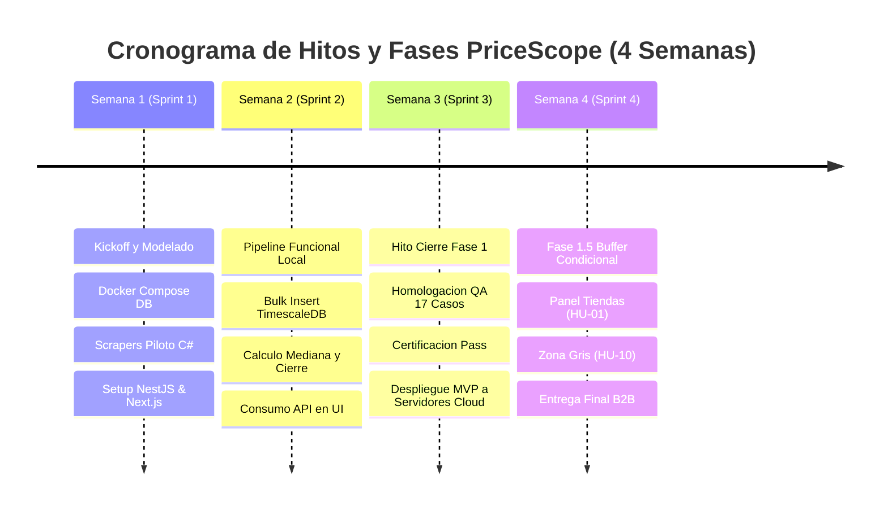
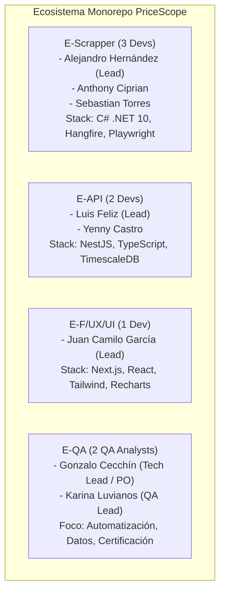

  

# Plan Operativo de Desarrollo y Roadmap de Implementación
**PriceScope — Monitor de Inflación Real Multimoneda**  
*Plataforma B2B de Analítica Económica e Inteligencia de Mercado*

---

## Metadatos del Documento

| Atributo | Detalle Oficial |
| :--- | :--- |
| **Código del Documento** | **`PLN-PRICESCOPE-V1.0`** |
| **Proyecto** | PriceScope — Monitor de Inflación Real Multimoneda |
| **Organización / Programa** | Simulación Laboral Abierta — NoCountry |
| **Sector de Negocio** | FinTech / Analítica Económica (B2B Analytics) |
| **Versión** | **1.0** (Oficial para Ejecución y Sincronización de Células) |
| **Fecha de Emisión** | 16 de Octubre de 2026 |
| **Ubicación en Repositorio** | `docs/02-planeacion/01-Plan-Operativo-Roadmap.md` |
| **Documentos Vinculantes** | `01-SRS-PriceScope.md`, `02-API-Contracts-OpenAPI.md`, `03-Data-Model-TimescaleDB.md`, `04-Business-Rules-Math-Logic.md`, `05-Software-Architecture-Pipeline.md`, `06-QA-Test-Matrix.md` |
| **Estado** | En Revisión y Aprobación Técnica por Células Operativas |

---

## Control de Cambios y Aprobación Formal (Sign-Off)

### HISTORIAL DE VERSIONES
| Versión | Fecha | Autor | Descripción del Cambio |
| :--- | :--- | :--- | :--- |
| **1.0** | 2026-10-16 | Equipo PriceScope | Definición del roadmap operativo de 4 semanas, distribución por células, desglose de Sprints 1 a 4 con enfoque Local-First para Fase 1, transición a Fase 1.5 en cloud y criterios de Definition of Done (DoD). |

### ACTA DE APROBACIÓN TÉCNICA (SIGN-OFF)
| Rol Operativo | Célula de Trabajo | Integrante Asignado | Estado de Revisión | Firma / Fecha |
| :--- | :--- | :--- | :--- | :--- |
| **Frontend Lead & UX/UI** | `E-F/UX/UI` | Juan Camilo García | Aprobado | 16/10/2026 |
| **Tech Lead / PO Review** | `E-QA` | Gonzalo Cecchín | Pendiente | [ &nbsp;&nbsp;&nbsp;&nbsp; / &nbsp;&nbsp;&nbsp;&nbsp; / 2026 ] |
| **Backend & DB Lead** | `E-API` | Luis Feliz | Pendiente | [ &nbsp;&nbsp;&nbsp;&nbsp; / &nbsp;&nbsp;&nbsp;&nbsp; / 2026 ] |
| **Scraper Lead** | `E-Scrapper` | Alejandro Hernández OReilly | Pendiente | [ &nbsp;&nbsp;&nbsp;&nbsp; / &nbsp;&nbsp;&nbsp;&nbsp; / 2026 ] |

---

## 1. Visión Estratégica y Enfoque de Ejecución (Local-First Phasing)

Para maximizar la velocidad de entrega y garantizar la estabilidad del producto dentro del marco de la simulación laboral de **NoCountry (4 semanas)**, el proyecto implementa una estrategia de desarrollo dividida en dos grandes horizontes de despliegue:

### Principios Operativos del Equipo:
1. **Prioridad Absoluta al Flujo Local-First (Semanas 1 a 3):**
   * Toda la infraestructura (PostgreSQL 15 + TimescaleDB) corre localmente vía `docker-compose.yml`.
   * C# / ASP.NET Core (.NET 10) con Hangfire ejecuta los scrapers y realiza `bulk insert` directo a la base de datos sin depender de latencias o cuotas de red externas.
   * La API en NestJS computa la mediana y sincronización cambiaria en local.
   * El cliente Next.js consume la API en `localhost:3000`.
   * **Objetivo:** Cero tiempo perdido en caídas de tiers gratuitos, sin apagados por inactividad (*cold starts*) ni límites de memoria de Playwright en la nube antes de tener el software terminado.
2. **Despliegue Único del MVP (Fin de Semana 3):**
   * El despliegue a la nube (Vercel, Render/Fly.io, Timescale Cloud) se ejecuta únicamente cuando el sistema pasa el **Sign-Off Gate de QA** con el 100% de las pruebas bloqueantes (P0) aprobadas.
3. **Fase 1.5 Modular (Semana 4):**
   * Si el MVP está desplegado y certificado a tiempo, se activan las historias condicionales: Panel de Administración de Tiendas (`HU-01`), Aprobación Humana de Zona Gris (`HU-10`) y Refactor opcional de Ingesta HTTP (`POST /api/v1/ingest/observations`).

---

## 2. Asignación de Responsabilidades por Célula Operativa

---

## 3. Desglose Operativo por Sprints (Roadmap de 4 Semanas)

### 3.1 Sprint 1 (Semana 1) — Cimientos de Datos, Modelado y Scrapers Base
* **Meta del Sprint:** Levantar el entorno local con Docker Compose, validar el DDL de TimescaleDB, iniciar la extracción de las primeras 2 tiendas en C# y configurar las estructuras base de NestJS y Next.js.

| Célula | Entregables y Tareas Técnicas | Historias Vinculadas | Criterio de Éxito del Sprint |
| :--- | :--- | :--- | :--- |
| **`E-Scrapper`** | Configuración de proyecto ASP.NET Core (.NET 10), integración de Hangfire y Playwright .NET. Extracción piloto de Carrefour y Jumbo desde `seed.json`. Implementación del DTO con validación anti-cero. | `HU-02`, `HU-03`, `HU-04` | 50 productos de Carrefour y Jumbo extraídos en consola con precios válidos y stocks clasificados. |
| **`E-API`** | Puesta a punto de PostgreSQL 15 + TimescaleDB en `docker-compose.yml`. Ejecución de DDL (`03-Data-Model-TimescaleDB.md`). Setup de NestJS con TypeScript y endpoints mock iniciales (`GET /api/v1/dashboard`). Ingesta horaria de divisas (DolarAPI). | `HU-21`, `HU-22`, `HU-23` | Base de datos local levantada con hypertables particionadas y cron de cotización financiera persistiendo USD. |
| **`E-F/UX/UI`** | Setup del workspace Next.js (`apps/client`). Configuración de Tailwind CSS y tipografía corporativa (Plus Jakarta Sans / Inter). Maquetación estática de la interfaz ejecutiva: Header, Tarjetas KPI y Sidebar. | `HU-41`, `HU-42` | Shell de la aplicación Next.js corriendo localmente con paleta institucional y estructura responsive. |
| **`E-QA`** | Generación de datasets sintéticos para pruebas unitarias de mediana (`TC-MATH-01`, `TC-MATH-02`). Armado de la suite de pruebas unitarias en el pipeline de CI (`.github/workflows/`). | `TC-MATH-01..03` | Tests unitarios matemáticos ejecutándose en GitHub Actions en verde sobre mocks. |

---

### 3.2 Sprint 2 (Semana 2) — Integración de Pipeline, Mediana y Gráficos
* **Meta del Sprint:** Completar las 4 tiendas de scraping, persistir por bulk insert en TimescaleDB, calcular la mediana estadística en NestJS y pintar la serie temporal en Next.js.

| Célula | Entregables y Tareas Técnicas | Historias Vinculadas | Criterio de Éxito del Sprint |
| :--- | :--- | :--- | :--- |
| **`E-Scrapper`** | Extracción de Frávega y Musimundo. Orquestación de ejecuciones concurrentes en Hangfire con reintentos exponenciales. Conexión de bulk insert directo hacia `observaciones_precios`. | `HU-02`, `HU-03`, `HU-05` | 4 tiendas scrapeadas de forma programada e insertadas en la base de datos sin duplicados. |
| **`E-API`** | Implementación del cálculo de Mediana por categoría (`percentile_cont(0.5)`) y cruce de cotización de cierre a las 23:59:59 ART con fallback a 48h/72h (`SIN_DATO`). Lógica de paginación a 50 registros (`HU-46`). | `HU-30`, `HU-23`, `HU-46` | Endpoints `GET /dashboard`, `GET /alerts` y `GET /traceability` retornando datos reales calculados desde la base de datos. |
| **`E-F/UX/UI`** | Integración de Recharts/Chart.js para visualización de series temporales. Implementación del selector de moneda (ARS / USD Blue / Oficial). Integración de la franja semafórica de calidad (verde, amarillo, rojo). | `HU-43`, `HU-44`, `HU-48` | Gráfico renderizando datos reales de la API local con soporte de cambio de divisa y franja de calidad. |
| **`E-QA`** | Ejecución de pruebas de resiliencia temporal: simulación de cortes cambiarios a 24h, 48h y 72h (`TC-RESIL-01..04`). Verificación de rechazo con código 422 en peticiones `limit > 50`. | `TC-RESIL-01..04`, `TC-PERF-01..02` | Validado el corte de serie (*gap*) ante más de 72h sin cotización y rechazo RFC 7807 de paginación. |

---

### 3.3 Sprint 3 (Semana 3) — Optimización, Auditoría QA y Despliegue de Fase 1 (MVP)
* **Meta del Sprint:** Downsampling para 60 FPS, auditoría completa de los 17 casos de prueba por `E-QA`, firma de Sign-off y despliegue del MVP a servidores de producción.

| Célula | Entregables y Tareas Técnicas | Historias Vinculadas | Criterio de Éxito del Sprint |
| :--- | :--- | :--- | :--- |
| **`E-Scrapper`** | Afinamiento de selectores de tiendas, optimización de consumo de memoria de Playwright .NET y verificación de logs en Hangfire Dashboard. Preparación de script/contenedor para despliegue de worker. | `HU-04`, `HU-05` | Cero fallos no controlados en ejecuciones continuas de 4 tiendas. |
| **`E-API`** | Activación del Continuous Aggregate `agg_precios_semanales` en TimescaleDB. Filtro de series largas (>90 días) a intervalos semanales (`HU-47`). Auditoría de seguridad UUID en rutas. | `HU-47`, `RN-07` | Respuestas de agregación anual entregadas en < 150ms con ~52 puntos JSON. |
| **`E-F/UX/UI`** | Optimización de renderizado UI para sostener 60 FPS sin tirones durante interacciones con el gráfico. Manejo exhaustivo de estados: Loading, Empty State, Error y Badges de advertencia ⚠️. | `HU-47`, `HU-49` | Auditoría de Performance de Chrome DevTools > 90 puntos y fluidez certificada a 60 FPS. |
| **`E-QA`** | **Certificación Formal de Fase 1 (Sign-Off Gate):** Ejecución rigurosa de los 17 casos de prueba (`TC-MATH`, `TC-RESIL`, `TC-PERF`, `TC-SEC`). Emisión del informe final en `docs/03-qa/`. | Matriz Completa | **100% de casos P0 aprobados**. Firma del acta de pase a producción. |
| **Todo el Equipo** | **Hito de Cierre Fase 1:** Despliegue a producción en plataformas cloud gratuitas (Vercel + Render/Fly.io + Timescale Cloud). | Despliegue MVP | MVP accesible en Internet con dominio público y pipeline automatizado. |

---

### 3.4 Sprint 4 (Semana 4) — Fase 1.5 (Buffer Condicional) y Cierre de Proyecto
* **Meta del Sprint:** Incorporar funcionalidades avanzadas si los tiempos lo permiten, preparar la demo comercial B2B y presentar la defensa del proyecto ante NoCountry.

| Célula | Entregables Condicionales (Fase 1.5) | Historias Vinculadas | Criterio de Aprobación |
| :--- | :--- | :--- | :--- |
| **`E-API` / `E-Scrapper`** | Migración condicional de ingesta de scrapers a endpoint HTTP seguro `POST /api/v1/ingest/observations` con token API. | `HU-06`, `HU-07` | Ingesta desacoplada vía HTTP con validación RFC 7807 sin romper el flujo de scraping. |
| **`E-API` / `E-F/UX/UI`** | Implementación del Panel de Administración de Tiendas (`HU-01`) y bandeja de aprobación de Zona Gris de Matching (`HU-10`). | `HU-01`, `HU-10` | Interfaz administrativa funcional que permite pausar tiendas y aprobar pares dudosos. |
| **`E-QA`** | Pruebas de regresión sobre el entorno de producción cloud. Verificación de estabilidad con usuarios concurrentes. | `02-reportes-stress-test.md` | Sistema estable en la nube con cero anomalías críticas. |
| **Todo el Equipo** | Ensayos de presentación comercial para inversores / jurado NoCountry. Pulido final del `README.md` del repositorio. | Cierre Proyecto | Demo en vivo fluida, sin errores en consola y con datos macroeconómicos reales. |

---

## 4. Definición de Hecho (Definition of Done - DoD)

Ningún Pull Request ni funcionalidad se considerará completada (*Done*) a menos que satisfaga estrictamente la siguiente lista de verificación:

* [ ] **Código y Compilación Limpia:** El código compila sin errores ni advertencias en el pipeline de GitHub Actions correspondiente (`ci-client.yml`, `ci-api.yml`, `ci-scraper.yml`).
* [ ] **Regla Anti-Cero (RN-04):** Se verificó que ninguna tupla en base de datos ni campo en la API retorne `0` o `0.0` para indicar falta de precio o quiebre de stock.
* [ ] **Tipado Estricto:** Cero uso de `any` en TypeScript (NestJS / Next.js) y modelos fuertemente tipados en C# (.NET 10).
* [ ] **Manejo de Errores RFC 7807:** Toda respuesta de error en la API (4xx / 5xx) expone `type`, `title`, `status` y `detail`.
* [ ] **Verificación Local Obligatoria:** La funcionalidad fue ejecutada y validada en el entorno local con `docker-compose.yml` antes de solicitar el merge a la rama principal.
* [ ] **Revisión por Pares (Peer Review):** Todo PR cuenta con la revisión y aprobación de al menos un integrante de la célula asignada y la validación del Tech Lead (`E-QA`).

---

## 5. Dinámica de Trabajo y Ceremonias Ágiles

Para mantener al equipo sincronizado sin sobrecargar de reuniones innecesarias:
1. **Daily Asíncrona (Discord / Slack):** Cada miembro responde 3 preguntas antes de las 11:00 AM:
   * *¿Qué completé ayer?*
   * *¿Qué avanzaré hoy?*
   * *¿Tengo algún bloqueo que dependa de otra célula?*
2. **Sincronización de Bloqueos (Semanal - 30 min):** Los lunes para alinear prioridades del Sprint y los viernes para demostración del avance en local.
3. **Pase de Etapa Formal:** El paso de Fase 1 a Fase 1.5 es una decisión colegiada liderada por el Tech Lead sujeta a la aprobación de la matriz de calidad.
