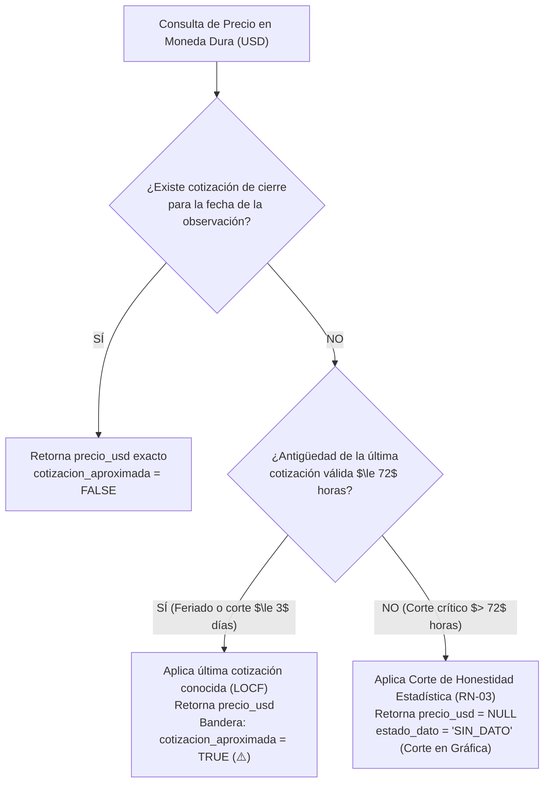

<p align="center">
  
</p>

# Matriz de Riesgos y Protocolos de Contingencia
**PriceScope — Monitor de Inflación Real Multimoneda**  
*Plataforma B2B de Analítica Económica e Inteligencia de Mercado*

---

## Metadatos del Documento

| Atributo | Detalle Oficial |
| :--- | :--- |
| **Código del Documento** | **`RSK-PRICESCOPE-V1.0`** |
| **Proyecto** | PriceScope — Monitor de Inflación Real Multimoneda |
| **Organización / Programa** | Simulación Laboral Abierta — NoCountry |
| **Sector de Negocio** | FinTech / Analítica Económica (B2B Analytics) |
| **Versión** | **1.0** (Oficial de Gestión de Riesgos Técnicos y Operativos) |
| **Fecha de Emisión** | 16 de Octubre de 2026 |
| **Ubicación en Repositorio** | `docs/02-planeacion/02-matriz-riesgos.md` |
| **Documentos Vinculantes** | `01-SRS-PriceScope.md`, `04-Business-Rules-Math-Logic.md`, `05-Software-Architecture-Pipeline.md`, `06-QA-Test-Matrix.md` |
| **Estado** | En Revisión y Aprobación Técnica por Células Operativas |

---

## Control de Cambios y Aprobación Formal (Sign-Off)

### HISTORIAL DE VERSIONES
| Versión | Fecha | Autor | Descripción del Cambio |
| :--- | :--- | :--- | :--- |
| **1.0** | 2026-10-16 | Equipo PriceScope | Formalización de riesgos técnicos, operativos y de infraestructura (bloqueos de scrapers, cuotas cloud gratuitas, caída de APIs cambiarias, desviaciones algorítmicas) y definición de protocolos de contingencia y fallbacks automáticos. |

### ACTA DE APROBACIÓN TÉCNICA (SIGN-OFF)
| Rol Operativo | Célula de Trabajo | Integrante Asignado | Estado de Revisión | Firma / Fecha |
| :--- | :--- | :--- | :--- | :--- |
| **Frontend Lead & UX/UI** | `E-F/UX/UI` | Juan Camilo García | Aprobado | 16/10/2026 |
| **Tech Lead / PO Review** | `E-QA` | Gonzalo Cecchín | Pendiente | [ &nbsp;&nbsp;&nbsp;&nbsp; / &nbsp;&nbsp;&nbsp;&nbsp; / 2026 ] |
| **Backend & DB Lead** | `E-API` | Luis Feliz | Pendiente | [ &nbsp;&nbsp;&nbsp;&nbsp; / &nbsp;&nbsp;&nbsp;&nbsp; / 2026 ] |
| **Scraper Lead** | `E-Scrapper` | Alejandro Hernández OReilly | Pendiente | [ &nbsp;&nbsp;&nbsp;&nbsp; / &nbsp;&nbsp;&nbsp;&nbsp; / 2026 ] |

---

## 1. Metodología de Clasificación y Evaluación de Riesgos

Para salvaguardar la viabilidad del proyecto, cada riesgo identificado se califica según su **Probabilidad de Ocurrencia** (Baja: 1, Media: 2, Alta: 3) y su **Impacto en el Negocio / Entrega** (Bajo: 1, Moderado: 2, Crítico: 3).

El **Nivel de Severidad** se determina mediante el producto:
$$\text{Severidad} = \text{Probabilidad} \times \text{Impacto}$$

* **Severidad 6 – 9 (Crítica / Bloqueante):** Requiere protocolo de mitigación preventiva activa y arquitectura de fallback automático implementada en código desde el día uno.
* **Severidad 3 – 4 (Media):** Requiere monitoreo preventivo y estrategia de desacoplamiento.
* **Severidad 1 – 2 (Baja):** Se absorbe dentro del plan de desarrollo rutinario.

```mermaid
quadrantChart
    title Matriz de Calor de Riesgos PriceScope
    x-axis Baja Probabilidad --> Alta Probabilidad
    y-axis Bajo Impacto --> Alto Impacto
    quadrant-1 Riesgos Críticos (Acción Inmediata)
    quadrant-2 Riesgos de Alto Impacto (Plan de Contingencia)
    quadrant-3 Riesgos Menores (Monitoreo)
    quadrant-4 Riesgos Operativos Frecuentes (Mitigación Estándar)
    "R-01: Bloqueo Anti-Bot E-Commerce": [0.8, 0.9]
    "R-02: Agotamiento de Cuotas Cloud Gratis": [0.85, 0.75]
    "R-03: Caída Prolongada de API Divisas": [0.6, 0.85]
    "R-04: Degradación UI con Series Largas": [0.5, 0.7]
    "R-05: Inyección de Valor Cero Falso": [0.4, 0.9]
    "R-06: Desalineación entre Células": [0.4, 0.6]
```

---

## 2. Matriz Consolidada de Riesgos Técnicos y Operativos

| ID | Categoría | Descripción del Riesgo | Prob. | Imp. | Sev. | Célula Responsable | Estrategia de Mitigación Preventiva |
| :---: | :--- | :--- | :---: | :---: | :---: | :---: | :--- |
| **R-01** | Extracción / Red | **Bloqueo Anti-Bot / WAF en Portales E-Commerce:** Detección de tráfico automatizado mediante HTTP 403 (Cloudflare) o HTTP 429 (Rate Limit). | 3 | 3 | **9 (Crítica)** | `E-Scrapper` | (1) Reintentos micro (máx. 3) con Exponential Backoff y Full Jitter ($2\text{s}$ a $30\text{s}$). (2) Respeto estricto a cabecera `Retry-After`. (3) Rotación de `User-Agent`, mutación de viewport y proxies. (4) Activación de Circuit Breaker tras 5 fallos consecutivos para evitar el baneo de IP y paso a contingencia offline. |
| **R-02** | Infraestructura | **Agotamiento de Cuotas Cloud y Cold Starts en Tiers Gratuitos:** Agotar los 750h/mes o límites de memoria (512MB RAM) en Render/Fly.io por ejecutar navegadores headless o tener contenedores caídos. | 3 | 2 | **6 (Alta)** | Todo el Equipo | **Estrategia Local-First & Flags Chromium:** Ejecución y pruebas locales con Docker Compose durante Sprints 1 a 3. Optimización de Playwright .NET con flags `--no-sandbox`, `--disable-dev-shm-usage` y bloqueo de descarga de imágenes/fuentes para prevenir *OOM Kills*. |
| **R-03** | Datos / Divisas | **Caída o Cambio de Contrato de APIs de Cotización Financiera:** Que DolarAPI o Bluelytics dejen de responder o cambien la estructura de su JSON intempestivamente. | 2 | 3 | **6 (Alta)** | `E-API` | Implementación del **patrón Multi-Provider Fallback**: si DolarAPI falla, el cron consulta Bluelytics. Si ambas caen, entra en juego el **Fallback Cambiario de 72h** (`cotizacion_aproximada: true`). A las 72h+1s se aplica corte a `SIN_DATO` (RN-03). |
| **R-04** | Rendimiento UI | **Degradación del Navegador y Caída de FPS en Consultas Anuales:** Transferir y pintar más de 1.400 puntos por gráfica satura la memoria del navegador y congela el scroll en Next.js. | 2 | 2 | **4 (Media)** | `E-API` / `E-F/UX/UI` | Implementación de **Downsampling Semanal Obligatorio (HU-47 / RN-07)** para períodos $> 90$ días mediante la vista continua `agg_precios_semanales` en TimescaleDB, garantizando renderizado fluido a 60 FPS con un máximo de 53 puntos. |
| **R-05** | Integridad Numérica | **Contaminación Estadística por Inyección de Cero (RN-04):** Que un scraper o servicio de backend interprete una falta de stock como `$0.00`, distorsionando la mediana y el historial económico. | 1 | 3 | **3 (Media)** | `E-API` / `E-DB` | Blindaje en tres niveles: (1) Constraint en base de datos `chk_consistencia_dato`, (2) DTO de validación en NestJS arrojando HTTP 422 RFC 7807, y (3) Caso de prueba bloqueante `TC-MATH-03`. |
| **R-06** | Gobernanza | **Desalineación de Contratos entre Backend, Scraper y Frontend:** Que un equipo modifique nombres de campos o rutas sin previo aviso, rompiendo la integración. | 2 | 2 | **4 (Media)** | Tech Lead / `E-QA` | Uso vinculante y obligatorio de `02-API-Contracts-OpenAPI.md` y `03-Data-Model-TimescaleDB.md`. Status checks automáticos en GitHub Actions que bloquean cualquier PR que no pase el linter y compilador de tipos TypeScript / .NET. |
| **R-07** | Legal / Compliance | **Contingencia Regulatoria o Violación de Términos:** Reclamos por uso abusivo de ancho de banda o extracción de datos personales. | 1 | 3 | **3 (Media)** | Tech Lead / `E-Scrapper` | Cumplimiento taxativo de la postura de scraping ético: extracción exclusiva de precios comerciales públicos sin PII (Ley 25.326), ventanas de ejecución valle (03:00 a 05:00 ART), delays de 2-5s, respeto a directivas de servidor y prohibición de bypass malicioso. |

---

## 3. Protocolos de Contingencia y Fallbacks Técnicos Detallados

### 3.1 Protocolo Anti-Bloqueo de Scrapers y Circuit Breaker (Contingencia R-01)
Si durante la ejecución de las corridas diarias de scraping en Fase 1, una de las tiendas piloto activa protecciones anti-bot o rate limits agresivos:
1. **Reintento Micro y Rotación:** Playwright aplica hasta 3 reintentos inmediatos con *Exponential Backoff + Jitter* ($2\text{s}$ a $30\text{s}$), respetando cabeceras `Retry-After` y rotando User-Agent y proxies.
2. **Apertura de Circuit Breaker:** Si se acumulan 5 fallos consecutivos de HTTP 403/429 o una tasa de fallas $> 20\%$ en la tienda, el worker aborta la recolección de esa tienda particular por la jornada para no quemar la IP ni saturar la tienda (`HU-05`). Las otras 3 tiendas continúan su proceso normal sin verse afectadas (`HU-02`).
3. **Reintento Macro en Hangfire:** A nivel de orquestación, Hangfire reprograma la ejecución de la tienda bloqueada para 45 minutos después. Si el bloqueo persiste, marca la ejecución como fallida en `GET /api/v1/pipeline/status`.
4. **Fallback Offline (Plan de Emergencia para Demos):** Al activarse el Circuit Breaker de forma definitiva en la jornada, `E-Scrapper` activa el proveedor `OfflineFileSeederService`, inyectando las series temporales pre-capturadas y etiquetadas en `seed_dataset_offline.json` para asegurar que el tablero analítico y las demos comerciales cuenten con datos continuos y consistentes.

### 3.2 Protocolo de Desconexión Cambiaria (Contingencia R-03)
Ante caídas masivas en los servicios de provisión de divisas (DolarAPI / Bluelytics):



### 3.3 Protocolo de Preservación de Servidores Cloud Gratuitos (Contingencia R-02)
Para evitar que los servicios en Render o Fly.io se deshabiliten o consuman el saldo mensual antes de la entrega final:
1. **Desarrollo 100% Aislado en Local:** Durante los Sprints 1 y 2, queda terminantemente prohibido levantar instancias activas en la nube para pruebas manuales o desarrollo individual.
2. **Base de Datos Compartida Local:** Todos los desarrolladores utilizan la misma configuración de Docker Compose `pricescope-db`.
3. **Plan de Despliegue en Ventana Única (Sprint 3):** Los contenedores en la nube se aprovisionan únicamente cuando el código de `apps/api`, `apps/client` y `apps/scraper` esté congelado (*feature freeze*) y certificado por `E-QA`.
4. **Hibernación Post-Validación:** Si se detecta un consumo acelerado de horas de servidor, el Tech Lead configurará el apagado automático del worker de scraping nocturno, ejecutándolo bajo demanda para la sesión de demostración comercial.

---

## 4. Matriz de Escalado y Comunicación de Incidentes

Cuando un riesgo se materializa en un bloqueo efectivo de desarrollo, se aplica la siguiente ruta de resolución:

| Nivel de Escalamiento | Tiempo Máximo de Respuesta | Responsable de Decisión | Acción Inmediata |
| :--- | :---: | :--- | :--- |
| **Nivel 1: Técnico / Código** | 2 horas | Lead de la Célula Afectada | Diagnóstico en local, revisión de logs y propuesta de solución o bypass. |
| **Nivel 2: Integración Cruzada** | 4 horas | Tech Lead (`Gonzalo Cecchín`) | Llamada express de 15 minutos entre los leads involucrados (`E-API`, `E-Scrapper` o `E-F/UX/UI`) para ajustar contrato o fallback. |
| **Nivel 3: Compromiso de Alcance** | Mismo día | Tech Lead + Equipo Completo | Activación de poda de alcance (ej. posponer la tienda afectada a Fase 1.5 y mantener el MVP con 3 tiendas totalmente funcionales). |
