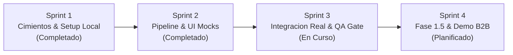

  

# Gestion del Proyecto, Cronograma y Contingencias (`docs/02-planeacion/`)
**PriceScope - Monitor de Inflacion Real Multimoneda**  
*Plataforma B2B de Analitica Economica e Inteligencia de Mercado*

---

## Mision del Directorio

Este directorio centraliza los artefactos oficiales de gestion agil, cronograma operativo por sprints, control de hitos, matrices de riesgos y protocolos de contingencia aplicables a las cuatro celulas del proyecto (`E-Scrapper`, `E-API`, `E-F/UX/UI` y `E-QA`).

---

## Estructura Documental

| Archivo | Titulo / Alcance | Estado |
| :--- | :--- | :--- |
| [`01-Plan-Operativo-Roadmap.md`](01-Plan-Operativo-Roadmap.md) | **Plan Operativo de Desarrollo y Roadmap de Implementacion:** Estrategia Local-First, desglose de Sprints 1 a 4, asignacion por celulas y Definition of Done (DoD). | **v1.1 (Activo - Sprint 3)** |
| [`02-matriz-riesgos.md`](02-matriz-riesgos.md) | **Matriz de Riesgos y Protocolos de Contingencia:** Evaluacion cuantitativa de riesgos tecnicos/operativos, Circuit Breakers, mitigacion de caida de divisas (LOCF 72h) y proteccion de cuotas cloud. | **v1.1 (Activo)** |
| [`03-Matriz-RACI-Gobernanza.md`](03-Matriz-RACI-Gobernanza.md) | **Matriz RACI y Modelo de Gobernanza de Celulas:** Delimitacion formal de Responsable, Aprobador, Consultado e Informado por artefacto y reglas de resolucion. | **v1.0 (Activo)** |
| [`04-Estrategia-Despliegue-Ambientes.md`](04-Estrategia-Despliegue-Ambientes.md) | **Estrategia de Ambientes, Configuracion y Despliegue Cloud:** Matriz de variables de entorno, topologia Local/Staging/Produccion, Neon Cloud PG16 y checklist pre-vuelo. | **v1.0 (Activo)** |
| [`05-Guion-Demo-Presentacion-B2B.md`](05-Guion-Demo-Presentacion-B2B.md) | **Guion de Demostracion y Pitch Comercial B2B:** Estructura cronometrada (10 min), casos de prueba en vivo para jurados/inversores y matriz de contingencias. | **v1.0 (Activo)** |

---

## Flujo de Trabajo y Sincronizacion Agil

1. **Local-First (Sprints 1 a 3):** Desarrollo desacoplado y validacion integral sobre Docker Compose (`PostgreSQL 16 + TimescaleDB`).
2. **Quality Sign-Off Gate (Fin de Sprint 3):** Certificacion formal de los 17 casos de prueba por parte de `E-QA` antes de cualquier despliegue a la nube.
3. **Fase 1.5 Buffer Condicional (Sprint 4):** Activacion de panel de tiendas, aprobacion de zona gris y presentacion comercial final ante NoCountry.
